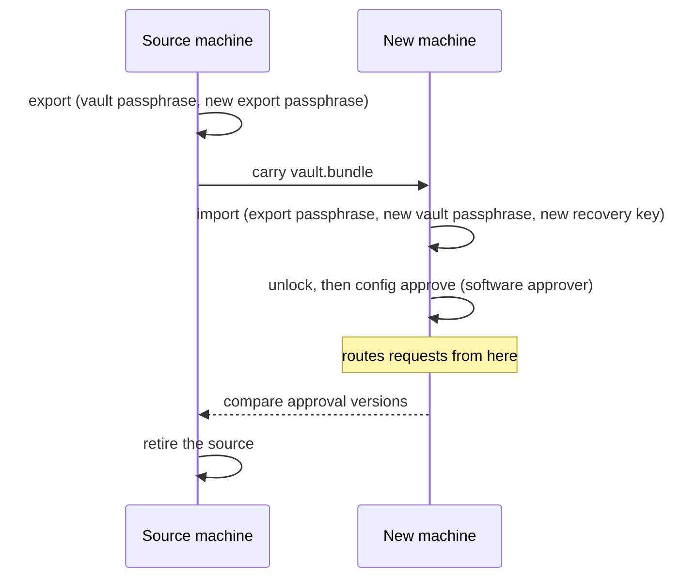

# Move a vault to a new machine

At the end of this recipe a new machine holds your vault, with the same credentials, the same vault ID and the same
approval counters, and routes requests under a config you approved on it. The old machine keeps serving until you
retire it.

`iron-vault export` writes an encrypted bundle once you prove you own the source vault, and `import` makes the vault
from it on the new machine. No plaintext secret is written anywhere on the way: the bundle holds the encrypted record
files as they are, and the vault identity sealed with an export passphrase you choose. Old config approvals stay
invalid on the new machine, because its first approval commits at a version above every one the source reserved.

The commands below are for a protected installation: run every `iron-vault` command through `sudo` (see [`sudo` in a
protected installation](../reference/cli.md#sudo-in-a-protected-installation)).



## Prerequisites

- **The source**, running and Ready, and its **vault passphrase**. Export asks for it every time, even while the vault
  is unlocked. If the source has a `tpm` approver, its TPM approval PIN can authorize the export in place of the vault
  passphrase: the prompt can switch to it.
- **The new machine**, with Iron Vault installed and its service running, and no vault: `iron-vault status` shows
  `vault: not initialized`. Import never overwrites a vault.
- **A software approver** on the source, and its approval passphrase. The new machine's first `config approve` asks
  for it. A TPM approver's key cannot leave its TPM, so `export` refuses a vault with no software approver
  (`approver-set-invalid`, error 42); enroll one first with [`approver add`](approval-signers.md).
- **A way to carry one file** between the machines, such as a USB stick or `scp`. The bundle is encrypted, but it
  opens with the export passphrase, so carry the passphrase separately.

## Steps

### 1. Export on the source

```sh
iron-vault export vault.bundle
```

It asks for the vault passphrase, then for a new export passphrase, twice. Choose one you have never used: the bundle
can be guessed at offline, so make it long.

```text
exported vault 3f2b8c1e-5d4a-4e6f-9a7b-1c2d3e4f5a6b to vault.bundle: 3 credentials, 6144 bytes
the source vault keeps serving until you retire it
the bundle opens only with the export passphrase
```

The bundle arrives in `.vault.bundle.partial` and takes its name only once it is whole. If export fails, it removes
the partial file; if it was killed, remove the partial file yourself before you run it again.

### 2. Carry the bundle to the new machine

Copy `vault.bundle` across. Delete other copies once the import has worked: an old bundle opens as long as someone
knows its export passphrase.

### 3. Import on the new machine

```sh
iron-vault import vault.bundle
```

It asks for the export passphrase, then shows a summary built from the bundle's verified contents:

```text
import a migration bundle
  vault: 3f2b8c1e-5d4a-4e6f-9a7b-1c2d3e4f5a6b
  credentials: 3
  approvers: approval passphrase
  committed approval: version 4; highest reserved version: 4
  config: the source's committed config, to be approved on this machine
  then: a new vault passphrase and a new recovery key for this machine
  routing starts after iron-vault config approve, at version 5 or later
```

A TPM approver appears in the `approvers` line as `bound to the source machine`: the bundle carries no key for it, so
it cannot sign on the new machine.

Then it asks for a new vault passphrase, twice, and shows a new recovery key once, as `init` does. Store it the way
[check and store your recovery key](recovery-key.md) describes, then type `yes`. The source's recovery key does not
open the new machine's vault.

Import writes the source's config to `vault.bundle.config.toml` beside the bundle, and prints what to do next:

```text
imported vault 3f2b8c1e-5d4a-4e6f-9a7b-1c2d3e4f5a6b: 3 credentials, approval version 4 committed, highest reserved version 4
recipients: operational, recovery
the source's committed config has the digest blake2b:…
next:
  1. iron-vault unlock                    (the service then answers 503 until a config is approved)
  2. iron-vault config approve vault.bundle.config.toml
  …
```

### 4. Unlock, and approve the config

```sh
iron-vault unlock
iron-vault config approve vault.bundle.config.toml
```

`unlock` opens the vault, then ends with `unlocked-unavailable` (error 16), "the vault unlocked, but the config check
failed", and a non-zero exit status. That is expected here: the new machine has the config, but no approval of it, so
the service is Unavailable with the reason `policy invalid` and answers `503` to every caller. A script that stops on
the first failure, such as one under `set -e`, must let this `unlock` fail.

`config approve` shows the whole config as added, because nothing is active yet, and asks for an approval passphrase:
a software approver's, since a TPM approver cannot sign here. Edit the copy first if the new machine needs a different
listener address or path.

Once it is approved, send a request through a route you use, as [getting started](getting-started.md) does. It works
with the credential the source held.

### 5. Replace the TPM approvers

Skip this step if the summary listed no approver `bound to the source machine`. Otherwise remove each one, so that
`approver list` names only approvers that can sign on this machine:

```sh
iron-vault approver list
iron-vault approver remove <approver ID>
```

If you want a TPM approver on the new machine, enroll a new one there with
[`approver add --kind tpm`](../reference/cli.md#iron-vault-approver-add), as in
[approve configs with a TPM PIN](tpm-approval.md).

### 6. Check the recovery key

```sh
iron-vault recovery check
```

Type the recovery key that import showed. See [check and store your recovery key](recovery-key.md).

### 7. Compare the versions with the source

On the source, run `iron-vault status` and compare its `approval committed` and `approval highest reserved` lines with
the versions import printed. If the source shows higher versions, someone approved a config there after the export.
Export again, run [`iron-vault reset`](../reference/cli.md#iron-vault-reset) on the new machine to discard the vault
you imported, and import the new bundle.

### 8. Retire the source

Only now stop using the old machine. Stop its service, and keep or destroy its state directory as you would any other
copy of the vault: its passphrase and recovery key still open it. If it had TPM unlock, follow
[retire a machine](forget-machine.md) for its TPM.

## What can go wrong

- **`import-denied`.** The export passphrase was wrong. Nothing was written; run `import` again.
- **`already-initialized`.** The new machine has a vault, or files in its state directory that are not a vault. Import
  never overwrites one.
- **`bundle-invalid`.** The file is not a bundle this version reads, or was damaged on the way. The message names the
  rule it failed. Nothing was written; export again from the source.
- **`import-failed`.** A write failed. `status` shows `import unfinished (run iron-vault import again)`, and `unlock`
  refuses. Run `import` again: it discards the unfinished import and starts over, with a new recovery key.
- **`migration-denied`** or **`migration-rate-limited`** from `export`. The vault passphrase was wrong, or wrong too
  many times; see the [errors reference](../reference/errors.md).

## Reference

- [CLI](../reference/cli.md#iron-vault-export): `export` and `import`.
- [Files and locations](../reference/files.md): the bundle, its partial file and the config copy.
- [Migration bundle design](../../../design/migration-bundle.md): what the bundle holds and how import checks it.
- Requirements: [§16](../../../design/iron-vault-specification.md#16-administration-recovery-and-migration).
