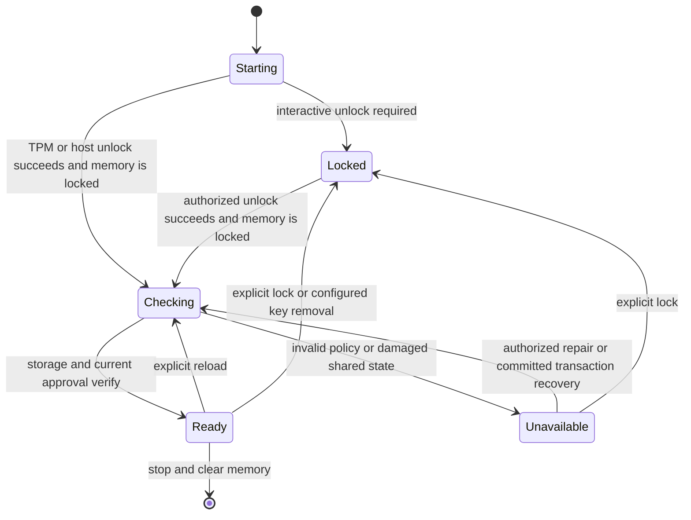

# Service states

The service is always in one of five states: Starting, Locked, Checking, Ready or Unavailable. The state decides what
the request listeners do with a request and which admin commands run. Only Ready serves requests; every other state
answers `503` with a short reason, so a caller can tell a locked vault from a broken one
([§15](../../../design/iron-vault-specification.md#15-service-states-and-errors)).

Terms follow the [glossary](../glossary.md). The [errors reference](errors.md) lists every refusal these states cause.

## The state diagram



The diagram is the one in the specification. The table below says the same in words.

| From | To | When |
|---|---|---|
| Starting | Locked | The vault needs an interactive unlock: every Development start, and a Protected or Container start whose host unlock handoff was absent or refused. |
| Starting | Checking | A host unlock succeeded: in the Protected and Container profiles, the unlock handoff opened the vault at startup. TPM unlock is still to come (EP-32). |
| Locked | Checking | `iron-vault unlock` succeeded. |
| Checking | Ready | The config check passed: storage and the current approval verify. |
| Checking | Unavailable | The config check failed: the policy is invalid, or shared state is damaged. |
| Ready | Checking | A reload (SIGHUP), a `config approve` about to commit, or a committed `replace` or `rm`. |
| Ready | Locked | `iron-vault lock`. Key removal (a YubiKey) comes in a later phase. |
| Unavailable | Checking | A config approval from `policy invalid`, or an authorized repair. |
| Unavailable | Locked | `iron-vault lock`. |
| Ready | stopped | The service stops and clears its memory. |

Any other move is refused, not performed. `status` can also print `stopped`, a marker for a service that has stopped
from Ready; it is not one of the five states.

## What each state means

| State | Vault identity in memory | Requests get | What to do |
|---|---|---|---|
| Starting | no | `503` `locked` | Wait; it lasts a moment. |
| Locked | no | `503` `locked` | `iron-vault unlock`, or `iron-vault init` if there is no vault yet. |
| Checking | yes | `503` `checking` | Wait for the check to finish. |
| Ready | yes | served | Nothing. |
| Unavailable | yes, but no policy or records | `503` `policy invalid` or `503` `recovery needed` | Read `status` and the log's `config.check-failed`. For `policy invalid`, approve a good config. |

While the service is not Ready, the request listeners come from the published `config.toml` without its approval
verified. They answer only `503` with the reason: they never identify a caller, select a route or touch a credential.
That way a caller sees why it is refused, instead of a refused connection.

Unavailable has two reasons:

- **policy invalid**: the config or its approval did not verify, or a verified config would not activate. A hand edit
  of the published config is the usual cause ([Tamper detection and recovery](../cookbook/tamper-detection.md)).
  Approving a good config moves the service through Checking to Ready.
- **recovery needed**: the vault's shared state is damaged, or a committed change could not be finished. The log's
  `remediation` field says what to do.

A damaged credential record is not a state. Only the routes that use it answer `503`, and the rest keep working.
`status` lists it.

## Admin commands by state

`ping`, `status` and `caller-token` run in every state. `list` runs in every state too, but shows credentials only
when the vault is open. The rest run only where this table says; elsewhere they are refused with `wrong-state`, or for
`config approve` with `approval-unavailable`.

| Command | Starting | Locked | Checking | Ready | Unavailable |
|---|---|---|---|---|---|
| `unlock` | | yes | | | |
| `init` | | yes | | | |
| `recovery check` | | yes | | yes | |
| `lock` | | | | yes | yes |
| `config approve` | | | | yes | `policy invalid` only |
| `add`, `replace`, `rm` | | | | yes | |
| reload (SIGHUP) | | | | yes | |

A SIGHUP in any state but Ready is ignored, so a reload is never a way out of Unavailable.

## `status`

`iron-vault status` prints one field per line, in a fixed order. It changes nothing, holds no secret, and works in
every state. It exits `0` when the service is Ready and `4` otherwise, so a script can wait on it.

```text
service: ready
profile: development — no isolation from malware running as alice
vault: unlocked
vault id: 2a682de7-b14d-4900-9ea9-0c968e1a6589
approval committed: 4
approval highest reserved: 4
memory protection: NOT protected, swap protection unavailable (RLIMIT_MEMLOCK soft limit is 8315834368 bytes, not unlimited)
recovery last checked: 2026-11-06 (1 day ago)
credential httpbin_key: healthy
credential venice_chat: healthy
```

| Field | Values | Meaning |
|---|---|---|
| `service` | `starting`, `locked`, `checking`, `ready`, `unavailable`, `stopped` | The service state. |
| `reason` | `policy invalid`, `recovery needed` | Only when the service is `unavailable`: why. |
| `profile` | `protected`, `container`, `development — no isolation from malware running as <user>` | The deployment profile, fixed when the binary was built ([below](#development-mode-and-a-protected-install)). |
| `vault` | `locked`, `unlocked`, `not initialized (run iron-vault init)`, `initialization unfinished (run iron-vault init again)`, `reset unfinished (run iron-vault reset again)` | Whether a vault exists and is open. `unlocked` means Checking or Ready; Unavailable shows `locked`, because a failed check closes the vault. |
| `vault id` | a UUID, or `unknown` | The vault's ID. Unknown while no vault is open. |
| `approval committed` | a number, `none`, or `unknown while the vault is locked` | The approval version of the active config. |
| `approval highest reserved` | a number, or `unknown while the vault is locked` | The highest version ever reserved. Higher than the committed version after an approval that failed once it had reserved one. |
| `memory protection` | `locked against swap`, `NOT protected, swap protection unavailable (<why>)`, `NOT protected, unsupported on this platform` | Whether the service's memory is kept out of swap. Only `locked against swap` means it is. |
| `recovery last checked` | see below | When `recovery check` last proved the recovery key opens this vault. |
| `credential <name>` | `healthy`, or `damaged (<damage>); unavailable routes: <routes>` | One line per credential, in name order. The damage is `missing`, `substituted` or `unreadable`. |
| `credentials` | `none`, `unknown while the vault is locked` | Printed instead of the credential lines when there are none, or they are unknown. |
| `route <name>` | `unavailable (pinned CA unavailable)` | One line per route that cannot serve for a reason of its own. |

The vault ID, the approval versions and the credentials are sealed with the vault identity, so they are unknown in
Starting, Locked and Unavailable. The CLI says so rather than guess.

`recovery last checked` takes one of these forms:

| Form | Meaning |
|---|---|
| `2027-02-01 (37 days ago)` | The UTC date of the last good check, and the days since. `today` and `1 day ago` for zero and one. |
| `never (reminders counting since 2026-11-06)` | No check yet; reminders count from that date. |
| `unknown (the vault is not initialized)` | There is no vault. |
| `unknown (no check record yet)` | `recovery.toml` does not exist. |
| `unknown (the check record is unusable (<error kind>))` | `recovery.toml` could not be read. |

Any of these ends in `, overdue` inside the parentheses when a recovery reminder is due. Run `iron-vault recovery
check`: see [Check and store your recovery key](../cookbook/recovery-key.md).

## Development mode and a protected install

The deployment profile is fixed at build time, never by config or flag, so a packaged binary cannot be switched into
development mode. Each profile is named in `status`, in `ping`, and as `deployment_profile` in every log record.

| | Protected | Development | Container |
|---|---|---|---|
| Built with | no feature (the `.deb`) | `--features dev-mode` | `--features container` |
| Runs as | the `iron-vault` system account | you | the `iron-vault` account in the image |
| Admin principals | root, so you use `sudo` | you | root only |
| Unlock at startup | from the host unlock handoff when one is there ([files](files.md#container)); otherwise Locked, `unlock` with the vault passphrase | none: starts Locked | from the host unlock handoff when one is there ([files](files.md#container)); otherwise Locked, as protected |
| Memory not locked against swap | stays Locked: `unlock` is refused with `memory-unprotected` | unlocks anyway; `status` says `NOT protected` | as protected |
| Callers | peer account, token or listener | token or listener only: a peer caller may never be the service's own account, and in development that is you | see [docker-compose.md](../../../design/docker-compose.md) |
| TCP listeners | from systemd socket units | bound by the service | bound by the service |
| Files | [system paths](files.md#protected-install) | [your XDG directories](files.md#development-mode) | the protected paths, inside the container |
| Isolation from malware running as you | yes | **none** | from the host's ordinary accounts, not from whoever controls Docker |

Development mode relaxes nothing else: callers still authenticate, routes are still checked, TLS is still verified,
responses are still scrubbed, the vault is still encrypted and configs still need approval. It refuses to run as root.

A protected install's memory rule is why it can sit in Locked with nothing wrong in its config: the service has not
failed, so systemd does not restart it. Fix the limit (`LimitMEMLOCK=infinity` on the unit), restart the service and
unlock. After any restart or upgrade a passphrase install starts Locked again and needs `unlock`.
