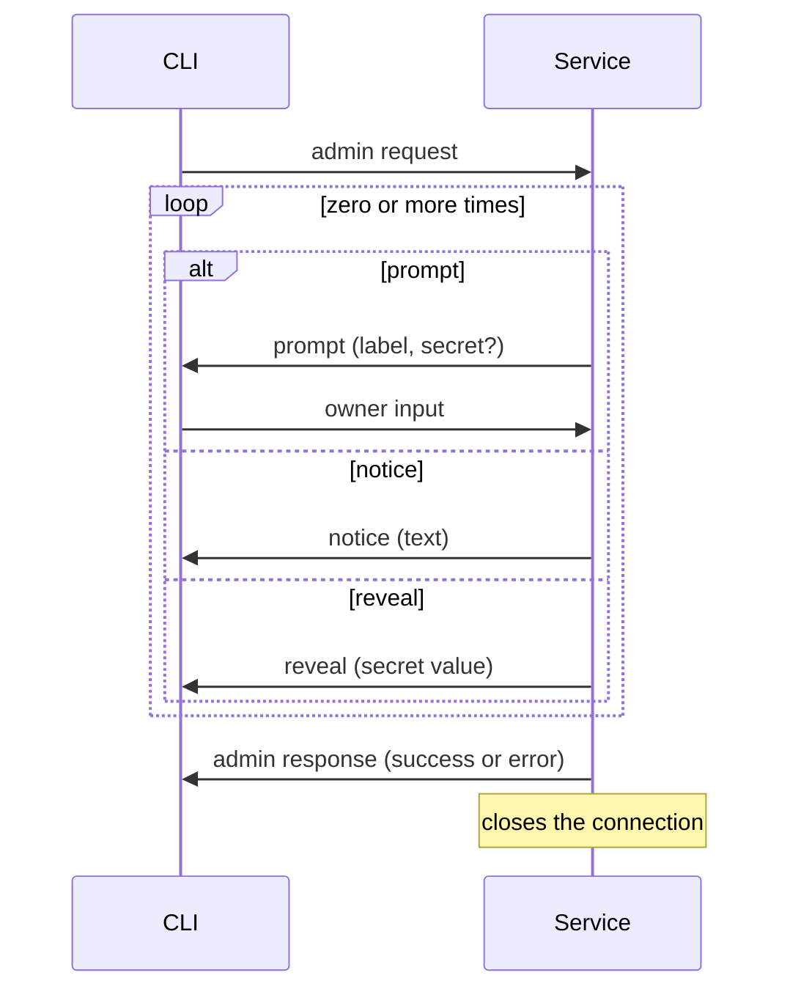

# Admin protocol

The CLI and the service talk only over the admin socket (spec [§3.2](iron-vault-specification.md#32-service-and-cli-boundary)). This document specifies the bytes they exchange:
the **admin protocol**. Terms are defined in the [glossary](glossary.md). The codec is `iron_vault::admin::protocol`;
it is pure and does no I/O. The [admin socket](#admin-socket) section specifies the service's transport:
binding, the peer check and the server loop (`iron_vault::admin::socket` and `iron_vault::admin::server`).

Three properties drive the design:

- **Versioned and deterministic.** Every value has exactly one encoding, so decoding and re-encoding an accepted frame
  reproduces its bytes, and a peer can never be talked into reading one frame two ways.
- **Hostile input is an error, never a crash.** A peer can only make the decoder return a typed error. Nothing it
  sends makes the decoder allocate more than the body bound.
- **Owner input stays out of general-purpose code.** It has its own frame kind, is never parsed as fields, and never
  passes through `serde`, logs or error messages.

## Exchange

One connection carries one exchange:

1. The CLI sends one **admin request**: a command and its arguments.
2. The service sends zero or more **prompts**, **notices** and **reveals**, in any order. The CLI answers each prompt
   with exactly one **owner input** frame before the service sends anything else. A notice or a reveal is shown to the
   owner and never answered.
3. The service sends exactly one **admin response**, success or error, and closes the connection.

The service, not the CLI, decides what to prompt for: the service owns the operation ([§3.2](iron-vault-specification.md#32-service-and-cli-boundary)), so a modified CLI cannot
skip a step by not asking for it. A frame of a kind the receiver does not expect at that point in the exchange ends
it: the service answers with an `unexpected-frame` error response and closes; the CLI reports the fault and closes.

## Frame

Every frame is a 7-byte header followed by its body. Integers are big-endian.

| Offset | Size | Field | Value |
|---|---|---|---|
| 0 | 2 | protocol version | `u16`, `1` |
| 2 | 1 | frame kind | `u8`, see below |
| 3 | 4 | body length | `u32`, at most 65 536 |
| 7 | body length | body | depends on the frame kind |

| Kind | Frame | Sent by | Body |
|---|---|---|---|
| `1` | admin request | CLI | fields |
| `2` | prompt | service | fields |
| `3` | owner input | CLI | the value itself |
| `4` | admin response: success | service | no fields (empty) |
| `5` | admin response: error | service | fields |
| `6` | notice | service | fields |
| `7` | reveal | service | the value itself |

The body bound is 64 KiB (65 536 bytes). It is far above any label, message or typed value an operation needs, and
small enough that a hostile length costs nothing. A body length above the bound is refused as soon as the header is
read, before any body byte is read or any buffer is sized from it.

The decoder checks the header in this order: version, then kind, then length, so a peer speaking a newer version is
always told so, even when its frame kinds are unknown here. A peer may send fewer bytes than a frame needs; the decoder
then asks for more (`NeedMore(n)`: at least `n` more bytes before it can make progress) and the transport reads on.
Bytes after a complete frame belong to the next frame.

## Body encoding

Every body except owner input and a reveal is a sequence of **fields**:

| Size | Field part |
|---|---|
| 2 | tag, `u16` |
| 4 | value length, `u32` |
| value length | value |

- Tags are **strictly ascending**. A repeated tag, or a tag lower than the one before it, is an error, so field order
  cannot vary and no field can appear twice.
- Every field a frame kind defines is required, and no other tag is allowed: a missing field and an unknown tag are
  both errors. A later version adds optional fields, if it needs them, by bumping the protocol version.
- A field must fit inside the body; a field header or value that runs past the end of the body is an error.
- Integer values have a fixed width; any other length is an error.
- Text values are UTF-8, checked on decode.
- A flag is one byte, `0` (false) or `1` (true); any other byte is an error.
- A byte value is taken as is. The codec checks only its length, against the limit its field defines, and never
  interprets, normalizes or re-encodes it, so the bytes decoded are the bytes sent.

### Admin request (kind 1)

| Tag | Field | Value |
|---|---|---|
| 1 | command | `u16` command ID |

A command's arguments, when it has any, follow at tags 2 and up, defined with the command. An unknown command ID is
an error.

| Command ID | Command | Arguments | Result |
|---|---|---|---|
| `1` | `ping` | none | the deployment profile |
| `2` | `config approve` | the proposed config bytes | the committed version, the config digest and the summary headline |
| `3` | `caller-token` | none | a fresh [caller token](#caller-token), once |
| `4` | `unlock` | none | none |
| `5` | `lock` | none | whether every cached secret was confirmed cleared |
| `6` | `status` | none | the [status report](#status) |
| `7` | `init` | the [host unlock flag](#init) | the vault ID, the committed version and the recipient roles enrolled |
| `8` | `add` | the credential name, kind and permitted origins | the [record ID](#add) |
| `9` | `list` | none | the [credential list](#list) |
| `10` | `replace` | the credential name, kind and permitted origins, as `add` | the new [record ID](#replace) |
| `11` | `rm` | the credential name | none |
| `12` | `recovery check` | none | the vault ID, the check time and whether the [check was recorded](#recovery-check) |
| `13` | `recipient list` | none | the enrolled recipients, in inventory order ([recipients.md](recipients.md#admin-protocol)) |

**No command accepts an external signature** ([§3.2](iron-vault-specification.md#32-service-and-cli-boundary)). The service signs only the pending config of its own approval
transaction, and no command takes a signature, an approval envelope or a signing key as an argument, or as owner
input. Normal loading verifies only the `config.toml.sig` the service itself published. A later command that would
take any of these is out of bounds for this protocol, whatever it is for.

`ping` changes nothing; the service answers it with a success response naming its deployment profile. The response's
frame header already carries the service's protocol version, so the result does not repeat it. `ping` lets the CLI
check that the service is up and which profile it runs before the real commands exist.

#### lock

Clears the vault identity and every cached secret from the service's memory (spec [§3.13](iron-vault-specification.md#313-administration-recovery-and-migration), [§3.11](iron-vault-specification.md#311-recipients-startup-and-memory)) and moves the service
from Ready or Unavailable to Locked. It takes no arguments and no prompt. In order, the service stops admitting requests, withdraws the
serving snapshot so requests running on it stop where the transport permits ([§3.9](iron-vault-specification.md#39-configuration-approval-and-reload)), and drops the approval state. It
then waits for the last holder of the old snapshot, a request or a streaming response body, to release it (the *lock
drain*, at most 10 seconds). The vault, which the snapshot owns, is dropped when that last holder releases it, so during
the drain the vault may still be in memory. Unavailable has no snapshot to withdraw: there the service drops the vault
identity it kept for a repair, which clears it at once unless a request still holds a vault from before the failed check.
Before any of this, `lock` cancels a `config approve` waiting at a prompt, which then answers `approval-unavailable`,
and waits for the service-wide lock ([config-approval.md](config-approval.md#the-service-wide-lock)).

The success result:

| Tag | Field | Value |
|---|---|---|
| 2 | cleared | flag: `1` when every snapshot was released within the drain and the vault identity was cleared, `0` when a request still held a snapshot or the identity |

`cleared` `0` is a success, not an error: the service is Locked and admits nothing, but a request that ignored its
cancellation still holds secrets until it ends, and the service logs how many. The CLI prints `locked` for `1`, and for
`0` also a warning on stderr that secrets may remain in memory; both exit with code `0`. Only a Ready or Unavailable
service locks: in any other state the command fails with `wrong-state`.

#### config approve

Runs the approval transaction (spec [§3.9](iron-vault-specification.md#39-configuration-approval-and-reload); [config-approval.md](config-approval.md#the-transaction)) on the bytes the
owner proposes.

| Tag | Field | Value |
|---|---|---|
| 2 | config | byte value: the exact proposed config, at most `MAX_CONFIG_LEN` (61,440) bytes |

The decoder refuses a longer config as `malformed-frame`, so a request body is never above 61,454 bytes, inside the
frame bound. The bytes are a byte value, not text: the service's config parser reports a non-UTF-8 config as an
invalid config, with its own message, and the digest covers the bytes exactly as sent.

The exchange, after the request:

1. The service writes the pending config and validates it. An invalid config ends the exchange with `config-invalid`
   before any prompt.
2. **Summary.** The service sends the approval summary as one or more notices: the header (vault ID, the version this
   approval will commit, the config digest, the committed version), then the sections in their fixed order. A summary
   longer than one notice continues in the next, and nothing is ever truncated (see [Notice](#notice-kind-6)).
3. **Confirmation.** A prompt, not secret: `Approve this config as version <n>? Type yes to approve`. Any answer other
   than exactly `yes` ends the exchange with `declined`. No version is reserved.
4. **Approval passphrase.** A prompt, secret: `Approval passphrase`. The service opens the approver key with it. A
   wrong passphrase ends the exchange with `approval-denied`, still before any reservation. There is no second try in
   the same exchange. Summary, confirmation, then passphrase is the order of [§3.9](iron-vault-specification.md#39-configuration-approval-and-reload)'s sequence diagram, which its text
   words differently ([open question 6](config-approval.md#open-questions)).
5. The service runs steps 2 to 6 of the transaction, including the config check after the commit, and answers once
   the check has ended, with the result or an error below. A success means the new config is active.

A prompt that gets no owner input cancels the command, as for every command, before a version is reserved. The service
answers within the CLI's 60-second timeout after the passphrase: scrypt, three durable replaces, two renames, a
directory fsync and a signature check take a few seconds.

The success result:

| Tag | Field | Value |
|---|---|---|
| 2 | committed version | `u64` |
| 3 | config digest | byte value, exactly 32 bytes: BLAKE2b-256 of the approved config |
| 4 | summary headline | UTF-8 text: one line of counts per summary section |

The full summary was already shown as notices before the confirmation, and goes to the audit log. The result carries
only the headline, which is bounded whatever the config's size, so the response always fits in one frame. The CLI
prints `approved version <n> (blake2b:<64 hex>)` and the headline to stdout.

Errors specific to `config approve`:

| Code | When | Version consumed |
|---|---|---|
| `busy` | another approval, vault write or reload holds the service-wide lock | no |
| `config-invalid` | the proposed config fails parsing, validation or activation; the message names the rule and the configured names involved, escaped, and never quotes other config bytes | no |
| `declined` | the owner did not answer the confirmation with `yes` | no |
| `approval-denied` | the approval passphrase did not open the approver key, or the key it opened is not the pinned approver | no |
| `approval-unavailable` | the service cannot approve now: its state does not allow it (only Ready and Unavailable with an invalid policy do), the approval state is damaged, the version counter is exhausted, a write failed before any version was reserved, or a `lock` cancelled the approval at a prompt; the message says which. Also when the task running the transaction ended without a result (it panicked, or the runtime was shutting down); the message then says a version may be consumed or committed | no, except after that crash: possibly |
| `approval-failed` | the transaction failed after its reservation and before its commit; the active policy is unchanged | yes; the message names it |
| `committed-not-active` | the commit landed, or may have landed, but it could not be settled, published or activated; the service is Unavailable, and a reload does not leave that state: only an authorized repair (`Repaired`, then Checking) or a restart does | yes; the message names the version |

#### unlock

Opens the vault with the interactive passphrase (spec
[§3.11](iron-vault-specification.md#311-recipients-startup-and-memory),
[§3.12](iron-vault-specification.md#312-service-states-and-errors),
[§3.13](iron-vault-specification.md#313-administration-recovery-and-migration)). It is allowed only while the service
is Locked; in any other state the exchange ends with `wrong-state` before any prompt, and the state is unchanged. It
also needs an initialized vault: unless the [initialization state](vault-initialization.md#initialization-state) is
Initialized, the exchange ends with `unlock-failed` before any prompt, and the message names the initialization state
and says to run `iron-vault init`. For Unfinished it adds that an init may be in progress, and for Unrecognized it
names the first offending files instead. Files beside a manifest never refuse `unlock`: it logs their names at WARN.
In a protected install whose memory is not locked, the exchange ends with `memory-unprotected` before any prompt, and
the message names the `RLIMIT_MEMLOCK` soft limit or the locking error
([§3.11](iron-vault-specification.md#311-recipients-startup-and-memory)); the service stays Locked. The checks run
in this order: state, initialization state, memory. A vault that is not Initialized has no secret to protect, and
`iron-vault init` is the step the owner needs first, so its `unlock-failed` comes before `memory-unprotected`.
The state is read again under the service context's mutex in step 2.

After those checks and before the prompt, the service checks the
[vault passphrase attempt limit](migration-authorization.md#passphrase-attempt-limit), which `unlock` shares with
migration authorization. While it cools down, the exchange ends with `unlock-rate-limited` before any prompt, and the
message gives the seconds left, rounded up. The service stays Locked, and the refusal is recorded as
`vault.unlock-refused` with `rate_limited` and `retry_after`.

1. **Vault passphrase.** A prompt, secret: `Vault passphrase`. The value is the vault-unlock passphrase, never the
   approval passphrase: the two are separate types, and unlocking never implies authority to approve. Empty or
   non-UTF-8 input cannot be the passphrase and is answered as a wrong one.
2. The service waits for the service-wide lock, as a reload does: in Locked only a `lock`, an `init` or a config check
   holds it, each for seconds, so the passphrase already typed is not refused as `busy`. It then checks the state
   again under the service context's mutex, so two unlocks never both open the vault, checks the attempt limit again
   (`unlock-rate-limited`), so two exchanges that passed the check before the prompt cannot both test a passphrase,
   and opens `operational.age` with the passphrase, then `identity.age` with the operational identity, which is
   dropped as soon as the vault identity is unwrapped ([§3.10](iron-vault-specification.md#310-vault-structure-and-durable-writes)). A wrong passphrase ends the exchange with
   `unlock-denied`, whose message is only `wrong passphrase`; an envelope that cannot be read or opened ends it with
   `unlock-failed`. Either way the service stays Locked, and no other storage is tried (R-22). A wrong passphrase adds
   to the attempt count and an opened vault clears it; an envelope that cannot be read adds nothing. There is no second try
   in the same exchange.
3. The service moves to Checking and runs the config check. Ready answers with a success without a result.
   Unavailable answers `unlocked-unavailable`, and the message names the redacted reason (`policy invalid` or
   `recovery needed`), never the check's detail, which goes to the log at WARN.

Each state change is recorded at INFO as the audit event `service.lock-transition` under the target `iron-vault.audit`,
with `from_state` and `to_state` and nothing the owner typed ([audit events](audit-logging.md#audit-events)). scrypt and the config check take a few seconds, inside the CLI's 60-second timeout.

#### add

Enrols a new credential (spec [§3.13](iron-vault-specification.md#313-administration-recovery-and-migration), [§3.3](iron-vault-specification.md#33-credential-records-and-configuration)). The name, kind and permitted origins are arguments, because none of
them is secret; the material is owner input, so it never travels as an argument ([§3.2](iron-vault-specification.md#32-service-and-cli-boundary)) and stdin carries
nothing else: `pass show fx | iron-vault add fx --origin api.fx.example` works.

| Tag | Field | Value |
|---|---|---|
| 2 | name | UTF-8 text: the credential name |
| 3 | kind | `u8`: `1` static, `2` basic |
| 4 | origins | byte value: the requested origins below |

The origins value is a `u8` count, 1 to 32, then per origin a `u8` host length, 1 to 253, the host bytes, which must be
UTF-8, and a `u16` port, never `0`. Nothing may follow the last origin. The decoder checks only these bounds: the host
stays text on the wire, and the service parses it with the same origin rule the CLI used, so a modified CLI gains
nothing by skipping it. HTTPS is implied and never sent ([§3.3](iron-vault-specification.md#33-credential-records-and-configuration)).

The service, not the CLI, decides what to prompt for, by kind:

- **static:** one secret prompt, `Secret for <name>`.
- **basic:** `Username for <name>`, then `Password for <name>`. Both are secret prompts, because the username is the
  secret when the password is empty (glossary: *Scrub patterns*).

The success result:

| Tag | Field | Value |
|---|---|---|
| 2 | record ID | byte value, exactly 16 bytes: the new record's random version 4 UUID |

`add` runs only while the service is Ready
([§3.12](iron-vault-specification.md#312-service-states-and-errors)); in any other state it answers `wrong-state`
before any prompt. The name and the origins are checked before any prompt too, so the owner is never asked for material
that cannot be stored. Once the material is in hand, the service takes the service-wide lock and answers `busy` while
an approval, another vault write or a reload holds it. The write goes through a vault opened for it alone, not the one
serving requests, so the new credential takes effect from the next approval: no active route can name it before then.
`status` lists it as healthy at once.

`add` never overwrites. Errors specific to `add`:

| Code | When |
|---|---|
| `name-taken` | the name is in the manifest, healthy or damaged |
| `credential-invalid` | the name, an origin or the material breaks its rule; the message names the rule, never a typed byte |
| `vault-write-failed` | writing the record or the manifest failed; the message says whether the write may have committed |

#### replace

Replaces a credential record with a new one under the same name, after owner presence (spec
[§3.3](iron-vault-specification.md#33-credential-records-and-configuration),
[§3.13](iron-vault-specification.md#313-administration-recovery-and-migration)). The design, including why each step
is where it is, is [credential-commands.md](credential-commands.md). The arguments are `add`'s: tag 2 the name, tag 3
the kind, tag 4 the origins, with the same encoding and bounds. The new kind and origins need not match the old ones.

The exchange, after the request:

1. The service must be Ready, else `wrong-state`. The name and the origins are checked as for `add`
   (`credential-invalid`).
2. The service tries the service-wide lock, and answers `busy` if it is held. It holds the lock until its response.
3. A name the manifest does not list, healthy or damaged, ends the exchange with `unknown-credential`.
4. The [vault change check](credential-commands.md#vault-change-check) ends the exchange with `credential-in-use` when
   a route that uses the name would not activate with the new kind and origins. The message names each route and why.
5. **Summary.** The [vault change summary](credential-commands.md#vault-change-summary), as one or more notices.
6. **Owner presence.** A prompt, secret: `Approval passphrase`. The service opens the approver key with it and drops
   it. A wrong passphrase, or a key that is not the pinned approver, ends the exchange with `approval-denied`. Nothing
   is reserved or signed, and there is no second try.
7. **Material.** The secret prompts for the new kind, as for `add`. Material that breaks its rule ends the exchange
   with `credential-invalid`.
8. The service checks again that it is Ready and that no `lock` and `unlock` ran during the prompts (`wrong-state`),
   then writes the new record and the manifest. The old record file is removed after the commit.
9. The service runs the config check, and answers once it ends.

A damaged record can be replaced: that is how it is repaired. The success result:

| Tag | Field | Value |
|---|---|---|
| 2 | record ID | byte value, exactly 16 bytes: the new record's random version 4 UUID |

The old record ID was shown in the summary. Errors specific to `replace`:

| Code | When |
|---|---|
| `unknown-credential` | the manifest holds no credential of that name |
| `credential-in-use` | a route that uses the name would not activate after the change; the message names each route and, for `replace`, the rule it breaks |
| `approval-denied` | owner presence failed |
| `approval-unavailable` | owner presence could not be checked, or a `lock` cancelled the change at the passphrase prompt; nothing was written |
| `wrong-state` | a `lock` cancelled the change at a secret prompt, or a `lock` and `unlock` ran during the prompts; nothing was written |
| `credential-invalid` | the name, an origin or the material breaks its rule; the message names the rule, never a typed byte |
| `vault-write-failed` | writing the record or the manifest failed; the message says whether the write may have committed, and, when it may have, the state the config check left |
| `committed-not-active` | the change committed, but the config check after it left the service Unavailable; the message names the redacted reason |

#### rm

Removes a credential record, after owner presence (spec
[§3.3](iron-vault-specification.md#33-credential-records-and-configuration),
[§3.13](iron-vault-specification.md#313-administration-recovery-and-migration)); see
[credential-commands.md](credential-commands.md).

| Tag | Field | Value |
|---|---|---|
| 2 | name | UTF-8 text: the credential name |

The exchange follows `replace`'s steps 1 to 6, 8 and 9, without kind, origins or material. Step 4 refuses the
removal with `credential-in-use` while any route of the active config uses the name, healthy or damaged, and names
those routes: the owner first approves a config without them. A damaged record can be removed. Success has no result.
Its errors are `replace`'s, except that `credential-invalid` is only for the name.

#### caller-token

Issues a fresh caller token for the owner to enroll (spec
[§3.4](iron-vault-specification.md#34-caller-authentication-and-listeners),
[§3.3](iron-vault-specification.md#33-credential-records-and-configuration)). It takes no arguments and no prompt. The
service draws the token from the operating system's random source and returns it in the result; it keeps no copy, and
writes no config. Issuing enrolls nothing: the owner puts the token's `token_hash` on a token caller's
`[callers.<name>]` table and approves that config with `config approve`
([config-approval.md](config-approval.md)), which never needs a pending config to outlive one exchange. The token
authenticates its caller from the moment that config is active.

- **Rotate:** issue a new token and approve a config naming its hash. The old token works until that approval commits.
- **Revoke:** approve a config without the caller, or without its `token_hash`.

Neither changes a provider credential. The service cannot prove that an approved `token_hash` came from a token it
issued; the owner is trusted ([§3.2](iron-vault-specification.md#32-service-and-cli-boundary)), and the approval
summary shows that a token changed.

It is allowed in every state the admin socket is served in, Locked and Unavailable included: it touches neither the
vault nor the policy, so the owner can prepare the config that fixes an invalid policy. The service logs
`caller.token-issued` at INFO, with neither the token nor its hash
([§3.15](iron-vault-specification.md#315-logging-and-v0-acceptance)).

The success result:

| Tag | Field | Value |
|---|---|---|
| 2 | caller token | byte value, exactly 47 bytes (`CALLER_TOKEN_LEN`): the token's text, `ivt_` and 43 base64url characters |

The result holds a secret, so the service encodes it into a buffer that clears itself on drop, as it does every frame
it sends. The decoder parses the token with `CallerToken::parse` straight from the clearing read buffer; a wrong length
or an invalid token is `malformed-frame`, and the error names only the tag.

Errors specific to `caller-token`:

| Code | When |
|---|---|
| `random-source-failed` | the operating system's random source failed; no token was made, and no weaker source is tried |

#### init

Creates the vault, its two recovery paths and its first committed approval (spec
[§3.13](iron-vault-specification.md#313-administration-recovery-and-migration),
[§3.11](iron-vault-specification.md#311-recipients-startup-and-memory),
[§3.9](iron-vault-specification.md#39-configuration-approval-and-reload)). The design, including what a crash
part-way through leaves and what a re-run does with it, is [vault-initialization.md](vault-initialization.md). It is
allowed only while the service is Locked; in any other state the exchange ends with `wrong-state` before any prompt. It
leaves the service Locked.

The request's one argument:

| Tag | Field | Value |
|---|---|---|
| 2 | host unlock | flag, exactly 1 byte: `1` to also enrol the host unlock identity from the [unlock handoff](docker-compose.md#enrollment) as a third recipient, else `0`. The CLI sends `1` only for `init --host-unlock`, which only a `container` build accepts, and a service whose profile is not Container refuses it |

The exchange, after the request:

1. The service reads the [initialization state](vault-initialization.md#initialization-state). Initialized or
   Unrecognized ends with `already-initialized` before any prompt. On Unfinished, a notice says that an unfinished
   initialization is discarded once the new recovery key is confirmed, and that a run another init is still writing is
   never discarded: this init then ends with `busy` or `already-initialized`
   ([vault-initialization.md](vault-initialization.md#the-exchange), step 1). (The CLI has already checked for a
   controlling terminal, and never sends the request without one; see [the CLI's `init`](#init-1).) With the host
   unlock flag, the service then reads the unlock handoff, and an absent or refused handoff ends the exchange with
   `init-failed` before any prompt, naming the reason and nothing of the file's bytes.
2. **Passphrases.** Four prompts, all secret: `Vault passphrase`, `Repeat the vault passphrase`, `Approval passphrase`,
   `Repeat the approval passphrase`. A value that breaks a
   [passphrase rule](vault-initialization.md#passphrase-rules) ends the exchange with `passphrase-rejected`, whose
   message names the rule and nothing typed. There is no second try in the same exchange.
3. The service generates every key, then sends the recovery key: one or more notices (the key is shown once and the
   service keeps no copy; store it in an independent password manager or on paper), then one
   [reveal](#reveal-kind-7) holding the key's `AGE-SECRET-KEY-1…` text.
4. **Confirmation.** A prompt, not secret: `Type yes once you have saved the recovery key`. Any answer other than
   exactly `yes` ends the exchange with `declined`.
5. Only now does the service write anything. It tries the service-wide lock, failing at once with `busy` if it is
   taken, and checks the service state and the initialization state again under it: the prompts held no lock, so
   another init may have finished, or the service may have left Locked. That re-check can end the exchange with
   `already-initialized` or `wrong-state` after the reveal. Then it runs the
   [write order](vault-initialization.md#write-order), committing approval version 1 on the initial config, and
   answers once `init.unfinished` is durably removed.

Nothing is written before step 5, so a refusal, or a cancelled prompt or closed CLI up to the owner's `yes`, leaves the
directories as they were. After the CLI has sent `yes` no prompt remains, so a cancel or a lost connection does not
stop step 5. What the owner does with the recovery key depends on how the exchange ended; see
[Failing after the reveal](vault-initialization.md#failing-after-the-reveal): discard it after a refusal, a failed
re-check or lock, a failed write before step 9, or a cancel before `yes`; keep it and run `init` again when the outcome
is unknown, which is after step 9 fails or a cancel after `yes`. Step 5 takes a few seconds (three scrypt operations and
about a dozen durable writes), inside the CLI's 60-second timeout.

The success result:

| Tag | Field | Value |
|---|---|---|
| 2 | vault ID | byte value, exactly 16 bytes: the new vault's ID |
| 3 | committed version | `u64`: always `1` |
| 4 | recipients | byte value, one byte per recipient the identity envelope was wrapped for: its [role code](recipients.md#recipient-roles), in the order `operational`, `recovery`, then `host-unlock` when enrolled. Kinds only, never a key |

Errors specific to `init`:

| Code | When |
|---|---|
| `already-initialized` | the directories hold an initialized vault, or files no initialization explains; the message says which, and names the first such files. Raised by the re-check under the lock (step 5), after the reveal, it also says the recovery key shown opens nothing and is to be discarded |
| `busy` | step 5 found the service-wide lock taken (another init, an approval, a vault write, a reload or a config check) and did not wait. It comes after the reveal, so the message says the recovery key shown opens nothing and is to be discarded, and to run `iron-vault init` again |
| `wrong-state` | the service is not Locked: at the request, before any prompt, or at the re-check under the lock after the reveal, when the message also says the recovery key shown opens nothing and is to be discarded |
| `passphrase-rejected` | a passphrase broke a rule; the message names the rule |
| `declined` | the owner did not answer the recovery key confirmation with `yes`; the message says the recovery key shown opens nothing and is to be discarded |
| `init-failed` | the host unlock flag was set and the service has no host unlock identity to enrol: its profile is not Container, the handoff is absent, or it was refused (untrusted path, too long, not an `age` secret key, unreadable). Raised before any prompt, so the message says nothing was written. Otherwise a write failed; the message names the failed step (its number, or `discard`), says to run `iron-vault init` again, which discards the unfinished vault, and says to discard the recovery key shown, which opens nothing. A failure at step 9 leaves the outcome unknown, so the message says to keep the key and run `init` again: a start-over means the key is dead, and `already-initialized` with a vault that is Initialized means a vault stands, which the owner confirms with `iron-vault recovery check` before relying on the key, because a concurrent init may have finished first. A failure of the discard of an unfinished initialization names `discard` as its step |

#### recovery check

Proves that the owner's offline recovery key opens the current vault (spec
[§3.13](iron-vault-specification.md#313-administration-recovery-and-migration)). The design, including what the check
proves, its record and the reminders that prompt it, is [recovery.md](recovery.md). It takes no arguments. It is
allowed while the service is Locked or Ready; in any other state the exchange ends with `wrong-state` before any
prompt. It never changes the service state. Before the prompt it also needs an Initialized
[initialization state](vault-initialization.md#initialization-state), or the exchange ends with
`recovery-check-unavailable` naming the state, and in a protected install whose memory is not locked it ends with
`memory-unprotected`, as `unlock` does. The checks run in this order: state, initialization state, memory.

1. **Recovery key.** A prompt, secret: `Recovery key`. Empty, non-UTF-8 or unparsable input ends the exchange with
   `recovery-key-invalid`, whose message says the text is not an `AGE-SECRET-KEY-1…` recovery key and holds nothing
   typed. There is no second try in the same exchange.
2. The service tries the service-wide lock, failing at once with `busy` if it is taken, and checks the service state
   (Locked or Ready) and the initialization state again under it. It reads `identity.age` and unwraps it with the key,
   then opens `manifest.age` with the unwrapped identity. A key that is not a recipient of the envelope, or whose
   unwrapped identity does not verify the manifest's MAC, ends the exchange with `recovery-check-failed`, whose
   message is only `the recovery key does not open this vault`. A file that cannot be read, or is malformed in a way
   that says nothing about the key, ends it with `recovery-check-unavailable`, naming the file and the error kind.
   The unwrapped identity is dropped either way, and nothing but the recovery check record is written.
3. On success the service writes the [recovery check record](recovery.md#the-recovery-check-record) and answers.

The success result:

| Tag | Field | Value |
|---|---|---|
| 2 | vault ID | byte value, exactly 16 bytes: the ID in the manifest the key opened |
| 3 | check time | `u64`: Unix seconds, UTC, of the check, as written to the record |
| 4 | recorded | flag: `0` when writing the record failed; the check still passed, and reminders count from the last recorded check |

Errors specific to `recovery check`:

| Code | When |
|---|---|
| `wrong-state` | the service is not Locked or Ready: at the request, before any prompt, or at the re-check under the lock |
| `recovery-check-unavailable` | the vault is not Initialized, before any prompt or at the re-check, or the check could not be run; the message names the initialization state or the file and error kind |
| `memory-unprotected` | a protected install's memory is not locked, before any prompt |
| `recovery-key-invalid` | the text is not a recovery key |
| `busy` | the service-wide lock is taken (an approval, a vault write, an init, a reload or a config check); try again |
| `recovery-check-failed` | the key does not open this vault |

### Prompt (kind 2)

| Tag | Field | Value |
|---|---|---|
| 1 | label | UTF-8 text the CLI shows the owner |
| 2 | secret | flag: when `1`, the CLI turns terminal echo off while the owner types |

### Notice (kind 6)

| Tag | Field | Value |
|---|---|---|
| 1 | text | UTF-8 text the CLI shows the owner, continuing the previous notice's text; `\n` ends a line |

A notice carries text the service needs the owner to read before a prompt, such as an approval summary. It is never
answered. Unlike a prompt label, it may hold many lines, and a command may send as many notices as it needs, so text
of any length reaches the owner without changing the frame bound. A single prompt label could not carry it: a label is
one line, because the CLI removes control characters from it, newlines included.

The CLI writes the texts of consecutive notices one after another and adds nothing between them, so a notice
boundary means nothing to the owner. The service may therefore split text anywhere between two UTF-8 characters, even
inside a line, and does so whenever the next piece would make the body longer than the frame bound. A long line, such
as a route's path patterns after escaping, is split this way across notices. It is never truncated, because the owner
must see everything the service will sign.

### Owner input (kind 3)

The body is the value the owner typed, whole and unframed; it may be empty. It is never parsed as fields. The decoder
copies it once, straight from the received bytes into a buffer that clears itself on drop (`Zeroizing<Vec<u8>>`),
and wraps that in `OwnerInput`, a secret-bearing type (`design/secret-handling.md`). The receiving operation turns it
into its own secret type, such as a passphrase.

The encoder writes the frame into a buffer the caller supplies, so a caller sending owner input passes a clearing
buffer. The transport that reads frames off the socket clears its read buffer for the same reason.

### Reveal (kind 7)

The service shows the owner a secret value it generated, once, such as the recovery key at `init`. Like owner input,
the body is the value itself, whole and unframed, and never parsed as fields; it is never empty. The CLI never answers
it.

The service encodes the frame into a buffer that clears itself on drop, straight from the secret's own type, and drops
both once the frame is written. The CLI decodes the body once, straight from the received bytes into a clearing buffer
(`Zeroizing<Vec<u8>>`), wrapped in `RevealedSecret`, a secret-bearing type (`design/secret-handling.md`). It shows the
value on the owner console, followed by a newline and then the same value as a QR code, and drops it. Every reveal is
shown as text and QR code (specification §3.13), so the owner can scan a recovery key into a phone password manager
instead of retyping it. The CLI draws the QR code itself from the text it holds: the service never sends a rendered
code, because a notice is not a secret type. The code is level M, in the automatic encoding mode, with a quiet zone,
two module rows to a text line, and it goes to the same descriptor as the text. A value too long for any QR code is
shown as text with a one-line note in place of the code. A value with any byte outside printable ASCII is
refused and nothing of it is shown: removing the other bytes would show a value that differs from the secret, which the
owner would save in good faith. It never writes it to stdout, a pipe or a diagnostic: when the owner console cannot
show it, the CLI cancels the command before showing anything (see [Owner input](#owner-input)).

### Admin response: success (kind 4)

A command without a result answers with an empty body. A command with a result answers with fields:

| Tag | Field | Value |
|---|---|---|
| 1 | command | `u16` ID of the command this answers |
| 2 and up | result | defined with the command |

`config approve`'s result is defined [with the command](#config-approve), `caller-token`'s [with its
command](#caller-token), `init`'s [with its command](#init), `replace`'s [with its command](#replace), and
`recovery check`'s [with its command](#recovery-check).

Naming the command keeps the codec context-free: a success body decodes on its own, without knowing which request it
answers, and the CLI can check that it answers the request it sent. A body that names a command without a result, or
an unknown command, is an error.

`ping`'s result:

| Tag | Field | Value |
|---|---|---|
| 2 | deployment profile | `u8`: `1` protected, `2` development, `3` container |

#### status

`status` changes nothing and is answered in every state ([§3.12](iron-vault-specification.md#312-service-states-and-errors)), including Locked and Unavailable, so the owner can
diagnose why requests fail. The result is the **status report**: fields, never one preformatted string, so the CLI
renders them and tests assert on values. Every collection is in name order, and the report holds no secret value, record
digest or permitted origin.

| Tag | Field | Value |
|---|---|---|
| 2 | service state | `u8`: `1` starting, `2` locked, `3` checking, `4` ready, `5` unavailable, `6` stopped |
| 3 | unavailable reason | `u8`: `0` none, `1` policy invalid, `2` recovery needed; non-zero exactly when the state is `5` |
| 4 | deployment profile | `u8`: `1` protected, `2` development, `3` container |
| 5 | vault ID | byte value: empty while the vault is locked, otherwise the 16 raw bytes of the vault ID |
| 6 | committed approval version | `u64`: `0` when none is committed, and while the vault is locked |
| 7 | highest reserved approval version | `u64`: `0` while the vault is locked |
| 8 | memory protection | `u8`: `1` locked against swap, `2` unavailable, `3` unsupported |
| 9 | memory protection detail | UTF-8 text: why memory is not locked; empty when it is locked or unsupported |
| 10 | credentials | byte value: the credential list below; empty while the vault is locked |
| 11 | route faults | byte value: the route fault list below; empty while the vault is locked or no route has a fault |
| 12 | initialization | `u8`: `0` initialized (locked or open), `1` not initialized, `2` initialization unfinished; non-zero only while no vault is open |
| 13 | recovery check record | `u8`: `0` unknown, `1` never checked, `2` checked |
| 14 | recovery check time | `u64`: Unix seconds, UTC: `last_checked` when tag 13 is `2`, `since` when it is `1`, `0` when it is `0` |
| 15 | days since recovery check | `u64`: whole days from tag 14's time to the service's clock, `0` for a time in the future and when tag 13 is `0` |
| 16 | recovery reminder due | flag: `1` when a [recovery reminder](recovery.md#reminders) is due |
| 17 | recovery check detail | UTF-8 text: why tag 13 is `0`, a fixed phrase; empty otherwise |

The vault ID, both approval versions, the credentials and the route faults are sealed behind the vault identity
(`approval.age`, the manifest), so they are unknown while no vault is open. No vault is open in Starting, Locked and
Unavailable: in Unavailable a failed config check dropped the vault and its records and kept only the vault identity
for the next check, so the service holds no ID, version, credential or route fault state to report there. The CLI
shows these as unknown rather than guessing. An empty vault ID is how the report says no vault is open; an open vault
with no credentials has a non-empty vault ID and an empty list.

While no vault is open the service reads the state and config directories for the initialization state
([vault-initialization.md](vault-initialization.md)), without the vault identity. Nothing on disk reports `1`, an
`init.unfinished` marker reports `2`, and an initialized vault reports `0`. Unrecognized files, or a directory that
cannot be listed, also report `0`: `status` has no error to give, and `unlock` and `init` name the files when the owner runs them.

Memory protection is reported from the process hardening report and never claims swap protection unless `mlockall`
succeeded ([§3.11](iron-vault-specification.md#311-recipients-startup-and-memory)).

The recovery check fields are known in every state, because the
[recovery check record](recovery.md#the-recovery-check-record) is plaintext: the service reads `recovery.toml` on each
`status`, bounded and without the service-wide lock, and computes the days and the due flag with its own clock and the
reminder interval in force ([recovery.md](recovery.md#status)). Tag 13 is `0` when the vault is not Initialized
(detail `the vault is not initialized`), when the record is missing (`no check record yet`) and when it is unusable
(`the check record is unusable (<error kind>)`); only an unusable record sets the due flag while tag 13 is `0`. A
missing or unreadable record never fails `status`.

The credential list is one entry per credential in the vault manifest, in credential-name order:

| Size | Part |
|---|---|
| 1 | name length `n`, 1 to 64 |
| `n` | credential name |
| 1 | standing: `0` healthy, `1` damaged: record missing, `2` damaged: record substituted, `3` damaged: record unreadable |
| 2 | `u16` count `r` of routes this credential makes unavailable |
| `r` times | route name length (1 byte) then the route name, in route-name order |

A healthy credential makes no route unavailable. A needs-login standing joins this table with OAuth (v1).

The credential list shares the [64 KiB frame bound](#frame) with the rest of the report. A report that would not fit
is never truncated; `status` has no error to give for it yet, so the service closes the connection, which the CLI
reports as a failed exchange. `list` answers `list-too-large` instead.

The route fault list is one entry per route that is unavailable for a cause of its own, in route-name order. A route
listed here is never listed under a healthy credential; one whose credential is also damaged appears in both lists.

| Size | Part |
|---|---|
| 1 | route name length `n`, 1 to 64 |
| `n` | route name |
| 1 | fault: `1` pinned CA unavailable |

The entry names no CA path, PEM bytes or load error; the owner's log names the route and its `ca_file` field.

#### list

`list` shows the owner what the vault holds, so the owner can write routes that will activate and see what `rm` or
`replace` would touch ([§3.13](iron-vault-specification.md#313-administration-recovery-and-migration)). It takes no arguments and changes nothing. Like `status` it is answered in every state
([§3.12](iron-vault-specification.md#312-service-states-and-errors)), because it reads only what the service context holds of an open vault. It never carries a secret value or a
record digest. `status` leaves permitted origins out; `list` is the one command that reports them.

| Tag | Field | Value |
|---|---|---|
| 2 | vault open | flag: `1` when a vault is open |
| 3 | entries | byte value: the entries below; empty while no vault is open, and for an open vault with no credentials |

While no vault is open (Starting, Locked, Unavailable, and a vault not yet initialized) the flag is `0` and there are no
entries. One entry per credential in the vault manifest, in credential-name order:

| Size | Part |
|---|---|
| 1 | name length `n`, 1 to 64 |
| `n` | credential name |
| 1 | standing, with the codes of the [credential list](#status) |
| 1 | kind: `0` unknown because the record is damaged, `1` static, `2` basic |
| 1 | origin count `o`: `0` for a damaged record |
| `o` times | host length (1 byte), the host, then the `u16` port, in ascending host and port order |

A damaged record's origins cannot be trusted, so a damaged entry has kind `0` and no origins; a healthy entry has a
kind and at least one origin. A decoder refuses any other combination, including an origin count above `0` with kind
`0`.

The encoded entries must fit the 64 KiB frame bound. If they would not, the service answers `list-too-large`, naming
the count, and never sends a truncated list.

### Admin response: error (kind 5)

| Tag | Field | Value |
|---|---|---|
| 1 | error code | `u16`, from the table below |
| 2 | message | UTF-8 text the service wrote |

The error code is stable, so scripts can act on it; the message is for the owner and may change. The service writes
the message itself, and neither the code nor the message ever contains owner input. An unknown error code is an error.

| Code | Name | Meaning |
|---|---|---|
| `1` | `unsupported-version` | the request frame's protocol version is not the service's |
| `2` | `malformed-frame` | the frame broke a rule in this document |
| `3` | `unknown-command` | the command ID is not one the service knows |
| `4` | `unexpected-frame` | a well-formed frame arrived out of turn in the exchange |
| `5` | `not-admin-principal` | the connecting account is not an admin principal; nothing it sent was read |
| `6` | `busy` | the service is already serving as many admin connections as it allows, or another operation holds the lock a command needs; try again |
| `7` | `config-invalid` | `config approve`: the proposed config is invalid |
| `8` | `declined` | the owner declined at a confirmation prompt |
| `9` | `approval-denied` | `config approve`, `replace`, `rm`: owner presence failed: the approval passphrase did not open the approver key, or the key it opened is not the pinned approver |
| `10` | `approval-unavailable` | `config approve`: the service cannot run an approval now; `replace`, `rm`: owner presence could not be checked, or a `lock` cancelled the change at its passphrase prompt; nothing was written |
| `11` | `approval-failed` | `config approve`: failed after reserving a version, before committing it |
| `12` | `committed-not-active` | `config approve`: committed, but not yet published or active; `replace`, `rm`: the change committed, but the config check after it left the service Unavailable |
| `13` | `wrong-state` | the command is not allowed in the service's current state; the message names the state |
| `14` | `unlock-denied` | `unlock`: the vault passphrase was wrong |
| `15` | `unlock-failed` | `unlock`: the vault did not open, for a reason other than the passphrase; the service stays Locked |
| `16` | `unlocked-unavailable` | `unlock`: the vault unlocked, but the config check left the service Unavailable; the message names the redacted reason |
| `17` | `already-initialized` | `init`: the directories already hold a vault, or files init did not write; nothing was changed. Raised after the reveal, the message says to discard the recovery key shown |
| `18` | `passphrase-rejected` | `init`: a chosen passphrase broke a rule; the message names the rule, never the input |
| `19` | `init-failed` | `init`: a write failed; the message names the step, says to re-run `init`, which discards the unfinished vault, and says to discard the recovery key shown (at step 9, where the outcome is unknown, to keep it until the re-run decides) |
| `20` | `name-taken` | `add`: the name is already in the manifest, healthy or damaged; `add` never overwrites |
| `21` | `credential-invalid` | `add`, `replace`, `rm`: the name, an origin or the material breaks its rule; the message names the rule, never a typed byte |
| `22` | `vault-write-failed` | `add`, `replace`, `rm`: the vault write failed; the message says whether it may have committed |
| `23` | `unknown-credential` | `replace`, `rm`: the manifest holds no credential of that name |
| `24` | `credential-in-use` | `replace`, `rm`: a route of the active config uses the name and would not activate after the change; the message names each route and, for `replace`, why |
| `25` | `random-source-failed` | `caller-token`: the operating system's random source failed; no token was made |
| `26` | `list-too-large` | `list`: the credential list does not fit one frame; the message names the count |
| `27` | `memory-unprotected` | `unlock`, `recovery check`: a protected install's memory is not locked, so the vault identity is not unwrapped; the message names the memory-lock limit or the locking error, and the service state is unchanged |
| `28` | `migration-denied` | `export`, `recipient add`: migration authorization was refused: the vault passphrase was wrong, the envelopes it opened are not this vault's, or the authorization expired, was already used or is for another operation; nothing was exported or rewrapped |
| `29` | `migration-unavailable` | `export`, `recipient add`: migration authorization could not be checked: an envelope could not be read or opened for a reason other than the passphrase, the random source failed, or a `lock` cancelled the command at its vault passphrase prompt; nothing was exported or rewrapped |
| `30` | `recovery-key-invalid` | `recovery check`: the text is not an `AGE-SECRET-KEY-1…` recovery key; the message holds nothing typed |
| `31` | `recovery-check-failed` | `recovery check`: the key does not open this vault; the message is fixed |
| `32` | `recovery-check-unavailable` | `recovery check`: the vault is not Initialized, or a file the check reads could not be read or is malformed, so the key was not judged; the message names the initialization state, or the file and error kind |
| `33` | `migration-rate-limited` | `export`, `recipient add`: too many wrong vault passphrases in a row; the [attempt limit](migration-authorization.md#passphrase-attempt-limit) refused the attempt before any prompt, and the message gives the whole seconds to wait; nothing was exported or rewrapped |
| `34` | `unlock-rate-limited` | `unlock`: too many wrong vault passphrases, here or in migration authorization, so no prompt was sent; the message gives the seconds to wait, and the service stays Locked |
| `39` | `recipient-inventory-damaged` | `recipient list`: the inventory check found the recipient inventory missing or damaged; the message names the damage and nothing was changed ([recipients.md](recipients.md#error-codes)) |

The migration codes 28, 29 and 33 are raised by the migration authorization step that `export` and `recipient add`
share ([migration-authorization.md](migration-authorization.md#error-codes)).

## Versions

This document specifies protocol version 1, the only version the codec reads or writes. A frame of any other version
is refused before its kind or length is read. Version 1 has not been released, so the notice frame, the reveal frame,
byte values, `config approve` (command 2), `caller-token` (command 3), `unlock` (command 4), `lock` (command 5),
`status` (command 6), `init` (command 7), `add` (command 8), `list` (command 9), `replace` (command 10), `rm`
(command 11), `recovery check` (command 12), `recipient list` (command 13), `status` tags 13 to 17, and error
codes 7 to 34 and 39 join it rather than starting version 2.
That is a default for the owner to confirm
([open question 11](config-approval.md#open-questions)).

Only the service sends responses, so the version rule is asymmetric:

- **The service** answers a frame with an unsupported version with one `unsupported-version` error response, encoded
  at its own version, and closes. A newer CLI can still read the header of that response and tell the owner which
  version the service speaks.
- **The CLI** that receives a frame with an unsupported version reports the mismatch, naming both versions, and
  closes.

## Errors

Decoding errors are typed (`FrameError`). They name protocol numbers, such as a version, frame kind, tag or command
ID, and never contain body bytes, so no error can carry owner input into a log or a response message.

## Admin socket

The service serves the admin protocol on `admin.sock` in its runtime directory (spec [§3.2](iron-vault-specification.md#32-service-and-cli-boundary), [§3.4](iron-vault-specification.md#34-caller-authentication-and-listeners)).

**Binding.** A leftover file at the path is removed only when `lstat` shows a socket owned by the service account;
a regular file, a symlink, or a socket another account owns stops startup with an error naming the path. The service
creates the socket and binds it, sets the path's mode to `0600` while the socket is not yet listening, and only then
listens. The kernel refuses a connection to a socket that is not listening, so the socket is never connectable at the
mode it was created with. The process umask is never changed: it is process-wide and would race with other threads.
The result is checked with `lstat`: a socket owned by the service account with mode `0600`, or startup fails.

**One exchange per connection**, in this order:

1. Over the connection cap (4 open exchanges), the service answers `busy` and closes.
2. The service reads the peer identity the kernel recorded at connect and checks it against the admin principals
   before reading a single byte. A refused peer gets one `not-admin-principal` error response and the connection
   closes; the refusal is logged at WARN with the peer's uid and pid.
3. It reads one admin request within the request deadline of 30 seconds. A connection that sends no complete frame
   in time, or closes first, is closed without a response.
4. It dispatches the request to the handler registered for its command, with the admin principal and the exchange,
   through which the handler sends prompts. A frame that does not decode gets the error response its fault maps to
   (`unsupported-version`, `unknown-command`, or `malformed-frame`); a well-formed frame of another kind gets
   `unexpected-frame`.
5. It writes the admin response and closes.

**Prompts.** A handler asks the owner for a value with `Exchange::prompt`. The service writes the prompt within the
request deadline, then waits for the owner input under the prompt deadline of 5 minutes, longer than the request
deadline because a person is typing. A prompt that gets no owner input cancels the command: `prompt` returns an
`ExchangeError`, and the handler returns it, typically with `?`, before it changes anything. How the exchange ends
depends on why:

| What happened at the prompt | The exchange ends |
|---|---|
| The CLI closed, the connection failed, or the prompt deadline passed | closed without a response, as when no admin request arrives |
| The answer does not decode | with the error response its fault maps to, as for a request |
| The answer is a well-formed frame other than owner input | with `unexpected-frame` |

Each cancellation is logged at WARN with the command's name and the reason, which never holds a frame body.

The log names the accepted principal's uid and the command at INFO, and never a frame body. The buffer the service
reads frames into is allocated once at the largest frame size, clears itself on drop, and is cleared after each frame,
because it holds owner input before decoding.

**Shutdown.** On SIGTERM or SIGINT the service stops accepting, gives open exchanges up to 5 seconds to finish,
abandons any still open, and removes the socket file. Once the socket is listening, the service removes the file on
every exit, an early error included, but only while `lstat` still shows the device and inode it bound, so a file
someone else has since put at the path is left alone. A socket that fails the check or `listen` while binding stays at
the path, never connectable, until the next start replaces it as stale.

## CLI client

The CLI (`iron-vault`, module `cli`) runs one exchange per command over a blocking Unix stream. It connects to
`admin.sock` in its deployment profile's runtime directory, or to the path `--admin-socket` names, such as a socket
forwarded over SSH; the service judges whoever arrives either way.

A refused or `busy` connection is answered and closed without the service reading the request, so the CLI's write
may fail with a reset or broken pipe while the answer is already waiting. The CLI always reads for the admin response
and reports a failed write only when no response arrives. It reads no more bytes than the decoder asks for, so a reset
after the last frame does not hide it.

| Exit code | Meaning |
|---|---|
| `0` | the command succeeded |
| `1` | the service answered with an error response |
| `2` | usage error |
| `3` | no admin response: no socket or nothing listening, permission denied, the exchange failed or timed out, a prompt got no value, or a reveal could not be shown on a terminal |
| `4` | `status`: the service answered, and it is not Ready; `list`: the service answered, and no vault is open |
| `128 + n` | signal `n` after the CLI opened its owner console: `129` for SIGHUP, `130` for SIGINT, `131` for SIGQUIT, `143` for SIGTERM |

A `not-admin-principal` response or a permission-denied connect tells the owner that a protected install needs `sudo`.
Diagnostics name the socket path, the error code and the service's message, never the request's arguments.

**Timeout.** Each read and write on the admin socket gives up after 60 seconds, so a wedged service or a stalled
forwarded socket ends the command with exit code 3 instead of hanging it. The timeout bounds socket calls only. While
the owner types, the CLI is reading the terminal or stdin, not the socket, so time at a prompt never counts against it;
the service's prompt deadline bounds that wait on the other side. 60 seconds is longer than the request deadline,
within which the service writes every prompt and response once it starts writing. It does not bound the handler's own
work after an owner input arrives: that time, until the next frame, counts against the client's 60 seconds. Commands
whose steps after a prompt can be slow, such as scrypt, a TPM, a touch or OAuth, will need a longer client timeout or
a progress frame.

**Hardening.** Before connecting, a client command disables core dumps: `RLIMIT_CORE` 0, and `PR_SET_DUMPABLE` 0,
which also keeps other processes of the same account from attaching with `ptrace` and reading what the owner typed. A
failure is reported on stderr as a warning and the command goes on, because it would hold only what the owner is about
to type. The CLI does not lock memory: it holds a value only until the value is sent, and `mlockall` with future
mappings would make its allocations fail under a finite `RLIMIT_MEMLOCK`. The client is Linux-only for now, like the
service.

### config approve

`iron-vault config approve <file>` reads the file and sends its bytes. The file is required, and `-` is not accepted:
when stdin is not a terminal, it carries the owner's answers to the prompts, so it cannot also carry the config. The
config is not a secret, but the CLI never echoes its bytes in a diagnostic. A file longer than `MAX_CONFIG_LEN` is
refused before anything is sent, with exit code 2. The CLI never computes a summary or a digest of its own: it shows
the service's notices and result. File-only input is a default that conflicts with K-128's spec, which reads stdin
when no file is given ([open question 12](config-approval.md#open-questions)).

### status

`iron-vault status` prints one field per line, in this order, to stdout: `service`, `reason` (only when Unavailable),
`profile`, `vault` (`locked`, `unlocked`, `not initialized (run iron-vault init)` or `initialization unfinished (run
iron-vault init again)`), `vault id`, `approval committed`, `approval highest reserved`, `memory protection`,
`recovery last checked` (in the [forms recovery.md gives](recovery.md#status)), then one `credential <name>` line per
credential (or `credentials` alone when there are none or they are unknown), then one `route <name>: unavailable
(pinned CA unavailable)` line per route fault. A value sealed behind a locked vault prints as `unknown while the vault
is locked`. Under the development profile the profile line is exactly `profile: development — no isolation from
malware running as <user>`, with the user the CLI runs as: in development the service account, the admin principal and
the invoking user are the same account. Under the container profile the line is `profile: container`. The output is a function of the report, so two runs on the same state are
byte-identical. It exits `0` when the service is Ready and `4` for any other state.

### list

`iron-vault list` prints one line per credential to stdout, in credential-name order: `<name>  <kind>  <host:port,...>
<standing>`, the fields separated by two spaces. The standing is `healthy` or `damaged (<damage>)`. A damaged record
prints `unknown` for its kind and hosts. With no open vault it prints `credentials: unknown while the vault is locked`
and exits `4`; an open vault with no credentials prints nothing and exits `0`. The output is a function of the
service's list, so two runs on the same state are byte-identical.

### unlock

`iron-vault unlock` takes no argument: the passphrase is the answer to the service's secret prompt, read from the
terminal with echo off or as the next line of stdin. On success it prints `the vault is unlocked: the service is
Ready` to stdout. Otherwise it prints the service's error to stderr, which for an Unavailable service names the
redacted reason, and exits with code 1.

### init

`iron-vault init` takes one option, `--host-unlock`, which only a `container` build accepts (any other build's parser
reports an unexpected argument) and which sets the request's host unlock flag. The passphrases are answers to the
service's secret prompts, read as for any prompt, and the recovery key arrives in a reveal. Before it sends the request it checks that it can open `/dev/tty`,
and without a controlling terminal it reports that on stderr and exits with code 3, so the service never generates a
key for a CLI that will refuse to show it. If the command ends after the reveal without a service answer (Ctrl-C, a
closed terminal, a signal, a dropped or timed-out connection), the CLI says on stderr, before it exits, what to do
with the key, because the service cannot say so over a closed connection; after SIGHUP it also logs it
([Owner input](#owner-input)). It tracks whether it has sent `yes`:

- **Before `yes`:** the service writes nothing, so the recovery key shown opens nothing and is to be discarded.
- **After `yes`:** no prompt remains, so step 5 runs on and the outcome is unknown. The CLI says to keep the key and
  run `iron-vault init` again. A start-over, with a new recovery key, means the old one is dead, and `busy` means the
  first run is still writing. `already-initialized` with a vault that is Initialized means a vault stands, but not
  necessarily the one this key opens: a concurrent init may have finished first. The owner confirms the key with
  [`iron-vault recovery check`](#recovery-check-1), which needs no unlock, before relying on it.

On success it prints `initialized vault <vault ID>: approval version 1 committed`, `recipients: <role names>` (such as
`operational, recovery, host-unlock`; kinds, never keys) and `run iron-vault unlock to start serving` to stdout; the
recovery key never goes there. Otherwise it prints the service's error to stderr and exits with code 1.

### caller-token

`iron-vault caller-token` takes no argument. On success it writes exactly the token and a newline to stdout, so
`iron-vault caller-token > token` captures the token alone. It writes the line through a duplicate of fd 1, never
through `io::Stdout`, whose buffer is never cleared. To stderr it writes `token_hash = "blake2b:<64 hex>"`, computed
before the token is consumed so the hash always matches the token printed, then a note: the token is shown once and
the service keeps no copy; put the line on the caller's `[callers.<name>]` table and run `iron-vault config approve
<file>`; the token works only once that config is approved and active, and the caller's old token, if any, keeps
working until then. A service error goes to stderr with exit code 1. No diagnostic names a token byte.

### add

`iron-vault add <name> --origin <ORIGIN>... [--kind static|basic]` sends the name, the kind (static by default) and
one to 32 origins. Each origin is `host`, `host:port`, `[v6]` or `[v6]:port`; the port defaults to 443. The CLI parses
each one with the policy's origin rule before connecting and sends the canonical host: a scheme (`https://…`), a path,
an invalid host or port, or more than 32 origins is a usage error, exit code 2, whose message names the rule and never
the value. The secret is the answer to the service's prompts, read from the terminal with echo off or from stdin. On
success it prints `added <name> (<kind>) as record <uuid>` to stdout; a service error goes to stderr with exit code 1.

### replace

`iron-vault replace <name> --origin <ORIGIN>... [--kind static|basic]` sends the name, the kind (static by default)
and the origins, parsed and refused exactly as for `add`. The approval passphrase and the secret are answers to the
service's prompts, passphrase first. When stdin is not a terminal, its first line is therefore the approval
passphrase and the next lines the secret. On success it prints `replaced <name> (<kind>) as record <uuid>` to stdout;
a service error goes to stderr with exit code 1.

### rm

`iron-vault rm <name>` sends the name. The approval passphrase is the answer to the service's prompt. On success it
prints `removed <name>` to stdout; a service error goes to stderr with exit code 1, and for `credential-in-use` the
message names the routes to remove from the config first.

### recovery check

`iron-vault recovery check` takes no argument: the recovery key is the answer to the service's secret prompt, read
from the terminal with echo off or as the next line of stdin, so `pass show iron-vault-recovery | sudo iron-vault
recovery check` works. On success it prints `the recovery key opens vault <vault ID>: checked <YYYY-MM-DDTHH:MM:SSZ>`
to stdout and exits `0`; when the result says the check was not recorded, it also warns on stderr that the check
passed but was not recorded, so recovery reminders still count from the last recorded check; the exit code is still `0`,
because the key was proved. A service error goes to stderr with exit code 1. Like every client command, it disables core
dumps first, because the key passes through its memory.

### Owner input

The CLI collects each prompted value from its **owner console**, opened at the first prompt, notice or reveal, so a
command the service never prompts for touches neither the terminal nor stdin. No argument ever carries a value
([§3.2](iron-vault-specification.md#32-service-and-cli-boundary),
[§3.13](iron-vault-specification.md#313-administration-recovery-and-migration)).

- **Stdin is a terminal:** the CLI opens `/dev/tty`, writes the label to it followed by `: `, and reads one line from
  it. For a secret prompt it turns echo off for the read with `tcsetattr`: `ECHO` off and `ECHONL` on, so the owner's
  Enter still moves to a new line, applied with `TCSAFLUSH` so anything typed before the prompt is discarded. A guard
  restores the saved settings on every path out of the read, errors included. If echo cannot be turned off, nothing
  is read and the command is cancelled.
- **Signals:** when the console opens, in either mode and before its first read or reveal, the CLI registers handlers
  for SIGINT, SIGQUIT, SIGTERM and SIGHUP. On any of them a watcher thread restores the terminal's saved settings if
  echo is off, writes to stderr any advice the command set (`init`'s, below), and exits with status 128 plus the
  signal number. Turning echo off and the watcher's restore are serialised, and the watcher holds off further prompts
  until the process exits, so a signal never leaves echo off. SIGHUP usually means the terminal has closed, and
  stderr may have closed with it, so on SIGHUP the watcher also sends the advice to the system log (`/dev/log`,
  facility user, severity warning), before stderr, since a stalled stderr pipe would block the write. That is best
  effort: without a logger the line is lost. The advice is the command's fixed text and never holds a secret.
- **The terminal's line limit:** in canonical mode Linux keeps at most 4095 bytes of a line and silently discards the
  rest up to the newline, so a longer pasted value would arrive cut short. The CLI refuses a terminal line of 4095
  bytes or more, counted with its line ending, as possibly cut short, without sending or showing it, and says to pipe
  longer values through stdin. A value typed at the terminal is therefore at most 4093 bytes.
- **Stdin is not a terminal:** each value is the next line of stdin, so `pass show fx | sudo iron-vault add fx` works
  from an interactive shell as well as from a script, and several prompts read consecutive lines. The label goes to
  stderr, and only when stderr is a terminal; it never goes to stdout.
- **A reveal** is written to the controlling terminal, `/dev/tty`, whether or not stdin is a terminal, and nowhere
  else: never to stdout, and never to stderr, which a script may capture. When there is no controlling terminal, the
  CLI shows nothing, reports on stderr that the value can only be shown on a terminal, and cancels the command with
  exit code 3, so the service writes nothing ([open question 5](vault-initialization.md#open-questions)). `init` checks
  for the terminal before it sends its request, so this is its backstop, not its first check.

The label is the service's text with control characters removed, so a label cannot move the cursor or reprogram the
terminal. A notice's text has every control character except `\n` removed, for the same reason. It is written to
`/dev/tty` when stdin is a terminal, and otherwise to stderr, whether or not stderr is a terminal, so a scripted
approval still records the summary it approved. It never goes to stdout. Every line follows the same rules:

- Exactly one trailing `\n` is stripped, and one `\r` before it. A last line without `\n` is still a value; an empty
  line is an empty value.
- Input that ends before any byte is no value. A value longer than the 64 KiB body bound is refused without being sent
  or shown; the CLI stops reading at the first byte past the bound. A terminal line has the tighter limit above.
- A refused or missing value cancels the command: the CLI reports why on stderr, naming no typed byte, and closes the
  connection, so the service cancels too. The CLI exits with code 3.

**Where the CLI's copies live.** Bytes are read one at a time, straight into a buffer that clears itself on drop
(`Zeroizing<Vec<u8>>`), sized once for the longest line so it never reallocates and leaves a copy behind; reading one
byte at a time also means nothing after the line is consumed. Stdin is read through a duplicate of its descriptor,
never through `io::Stdin`, whose buffer is never cleared. The buffer becomes the `OwnerInput`, which is encoded into a
second clearing buffer sized for the frame. Both are dropped, and so cleared, as soon as the frame is written. The
value never passes through `String`, formatting, `Debug` or a log call, and no CLI error names a byte of it.
