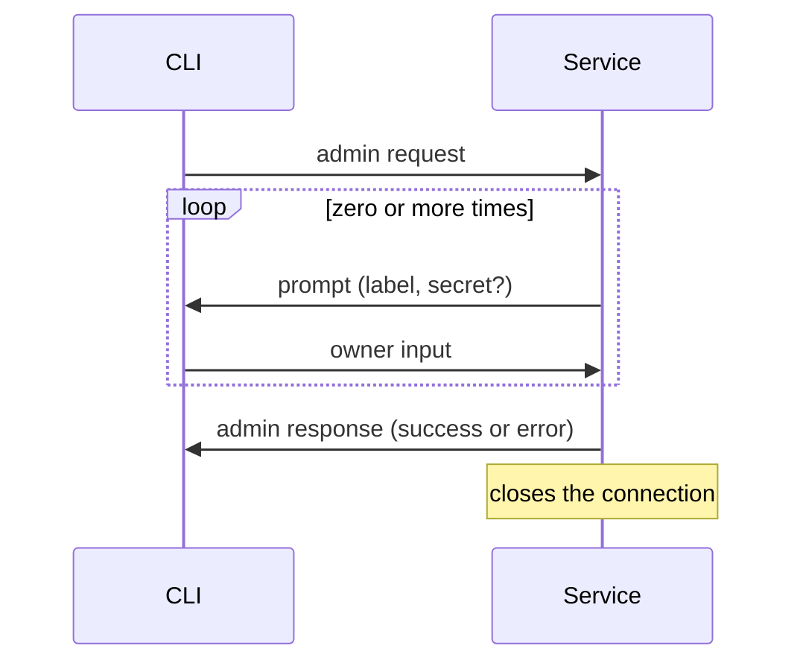

# Admin protocol

The CLI and the service talk only over the admin socket (spec §3.2). This document specifies the bytes they exchange:
the **admin protocol**. Terms are defined in the [glossary](glossary.md). The codec is `iron_vault::admin::protocol`;
it is pure and does no I/O. Sockets, peer-credential checks and the server loop are specified elsewhere.

Three properties drive the design:

- **Versioned and deterministic.** Every value has exactly one encoding, so decoding and re-encoding an accepted frame
  reproduces its bytes, and a peer can never be talked into reading one frame two ways.
- **Hostile input is an error, never a crash.** A peer can only make the decoder return a typed error. Nothing it
  sends makes the decoder allocate more than the body bound.
- **Owner input stays out of general-purpose code.** It has its own frame kind, is never parsed as fields, and never
  passes through `serde`, logs or error messages.

## Exchange

One connection carries one exchange:

1. The CLI sends one **admin request**: a command and its arguments.
2. The service sends zero or more **prompts**. The CLI answers each with exactly one **owner input** frame before the
   service sends anything else.
3. The service sends exactly one **admin response**, success or error, and closes the connection.

The service, not the CLI, decides what to prompt for: the service owns the operation (§3.2), so a modified CLI cannot
skip a step by not asking for it. A frame of a kind the receiver does not expect at that point in the exchange ends
it: the service answers with an `unexpected-frame` error response and closes; the CLI reports the fault and closes.

## Frame

Every frame is a 7-byte header followed by its body. Integers are big-endian.

| Offset | Size | Field | Value |
|---|---|---|---|
| 0 | 2 | protocol version | `u16`, `1` |
| 2 | 1 | frame kind | `u8`, see below |
| 3 | 4 | body length | `u32`, at most 65 536 |
| 7 | body length | body | depends on the frame kind |

| Kind | Frame | Sent by | Body |
|---|---|---|---|
| `1` | admin request | CLI | fields |
| `2` | prompt | service | fields |
| `3` | owner input | CLI | the value itself |
| `4` | admin response: success | service | no fields (empty) |
| `5` | admin response: error | service | fields |

The body bound is 64 KiB (65 536 bytes). It is far above any label, message or typed value an operation needs, and
small enough that a hostile length costs nothing. A body length above the bound is refused as soon as the header is
read, before any body byte is read or any buffer is sized from it.

The decoder checks the header in this order: version, then kind, then length, so a peer speaking a newer version is
always told so, even when its frame kinds are unknown here. A peer may send fewer bytes than a frame needs; the decoder
then asks for more (`NeedMore(n)`: at least `n` more bytes before it can make progress) and the transport reads on.
Bytes after a complete frame belong to the next frame.

## Body encoding

Every body except owner input is a sequence of **fields**:

| Size | Field part |
|---|---|
| 2 | tag, `u16` |
| 4 | value length, `u32` |
| value length | value |

- Tags are **strictly ascending**. A repeated tag, or a tag lower than the one before it, is an error, so field order
  cannot vary and no field can appear twice.
- Every field a frame kind defines is required, and no other tag is allowed: a missing field and an unknown tag are
  both errors. A later version adds optional fields, if it needs them, by bumping the protocol version.
- A field must fit inside the body; a field header or value that runs past the end of the body is an error.
- Integer values have a fixed width; any other length is an error.
- Text values are UTF-8, checked on decode.
- A flag is one byte, `0` (false) or `1` (true); any other byte is an error.

### Admin request (kind 1)

| Tag | Field | Value |
|---|---|---|
| 1 | command | `u16` command ID |

A command's arguments, when it has any, follow at tags 2 and up, defined with the command. An unknown command ID is
an error.

| Command ID | Command | Arguments |
|---|---|---|
| `1` | `ping` | none |

`ping` does nothing; the service answers it with a success response. It gives the transport something to send before
the real commands exist.

### Prompt (kind 2)

| Tag | Field | Value |
|---|---|---|
| 1 | label | UTF-8 text the CLI shows the owner |
| 2 | secret | flag: when `1`, the CLI turns terminal echo off while the owner types |

### Owner input (kind 3)

The body is the value the owner typed, whole and unframed; it may be empty. It is never parsed as fields. The decoder
copies it once, straight from the received bytes into a buffer that clears itself on drop (`Zeroizing<Vec<u8>>`),
and wraps that in `OwnerInput`, a secret-bearing type (`design/secret-handling.md`). The receiving operation turns it
into its own secret type, such as a passphrase.

The encoder writes the frame into a buffer the caller supplies, so a caller sending owner input passes a clearing
buffer. The transport that reads frames off the socket clears its read buffer for the same reason.

### Admin response: success (kind 4)

The body is empty: success carries no fields. A command whose result needs fields defines them with the command.

### Admin response: error (kind 5)

| Tag | Field | Value |
|---|---|---|
| 1 | error code | `u16`, from the table below |
| 2 | message | UTF-8 text the service wrote |

The error code is stable, so scripts can act on it; the message is for the owner and may change. The service writes
the message itself, and neither the code nor the message ever contains owner input. An unknown error code is an error.

| Code | Name | Meaning |
|---|---|---|
| `1` | `unsupported-version` | the request frame's protocol version is not the service's |
| `2` | `malformed-frame` | the frame broke a rule in this document |
| `3` | `unknown-command` | the command ID is not one the service knows |
| `4` | `unexpected-frame` | a well-formed frame arrived out of turn in the exchange |

## Versions

This document specifies protocol version 1, the only version the codec reads or writes. A frame of any other version
is refused before its kind or length is read.

Only the service sends responses, so the version rule is asymmetric:

- **The service** answers a frame with an unsupported version with one `unsupported-version` error response, encoded
  at its own version, and closes. A newer CLI can still read the header of that response and tell the owner which
  version the service speaks.
- **The CLI** that receives a frame with an unsupported version reports the mismatch, naming both versions, and
  closes.

## Errors

Decoding errors are typed (`FrameError`). They name protocol numbers, such as a version, frame kind, tag or command
ID, and never contain body bytes, so no error can carry owner input into a log or a response message.
