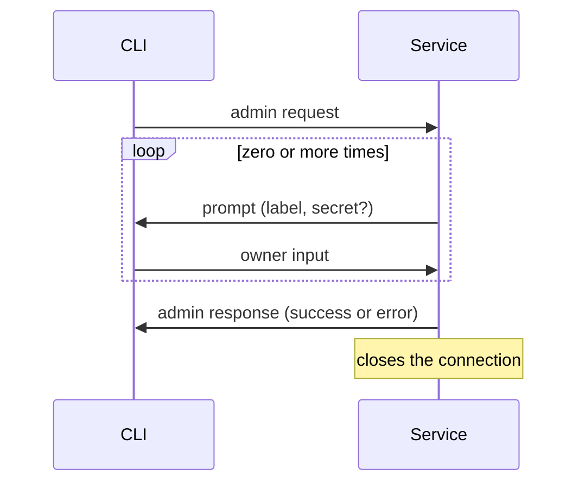

# Admin protocol

The CLI and the service talk only over the admin socket (spec §3.2). This document specifies the bytes they exchange:
the **admin protocol**. Terms are defined in the [glossary](glossary.md). The codec is `iron_vault::admin::protocol`;
it is pure and does no I/O. The [admin socket](#admin-socket) section specifies the service's transport:
binding, the peer check and the server loop (`iron_vault::admin::socket` and `iron_vault::admin::server`).

Three properties drive the design:

- **Versioned and deterministic.** Every value has exactly one encoding, so decoding and re-encoding an accepted frame
  reproduces its bytes, and a peer can never be talked into reading one frame two ways.
- **Hostile input is an error, never a crash.** A peer can only make the decoder return a typed error. Nothing it
  sends makes the decoder allocate more than the body bound.
- **Owner input stays out of general-purpose code.** It has its own frame kind, is never parsed as fields, and never
  passes through `serde`, logs or error messages.

## Exchange

One connection carries one exchange:

1. The CLI sends one **admin request**: a command and its arguments.
2. The service sends zero or more **prompts**. The CLI answers each with exactly one **owner input** frame before the
   service sends anything else.
3. The service sends exactly one **admin response**, success or error, and closes the connection.

The service, not the CLI, decides what to prompt for: the service owns the operation (§3.2), so a modified CLI cannot
skip a step by not asking for it. A frame of a kind the receiver does not expect at that point in the exchange ends
it: the service answers with an `unexpected-frame` error response and closes; the CLI reports the fault and closes.

## Frame

Every frame is a 7-byte header followed by its body. Integers are big-endian.

| Offset | Size | Field | Value |
|---|---|---|---|
| 0 | 2 | protocol version | `u16`, `1` |
| 2 | 1 | frame kind | `u8`, see below |
| 3 | 4 | body length | `u32`, at most 65 536 |
| 7 | body length | body | depends on the frame kind |

| Kind | Frame | Sent by | Body |
|---|---|---|---|
| `1` | admin request | CLI | fields |
| `2` | prompt | service | fields |
| `3` | owner input | CLI | the value itself |
| `4` | admin response: success | service | no fields (empty) |
| `5` | admin response: error | service | fields |

The body bound is 64 KiB (65 536 bytes). It is far above any label, message or typed value an operation needs, and
small enough that a hostile length costs nothing. A body length above the bound is refused as soon as the header is
read, before any body byte is read or any buffer is sized from it.

The decoder checks the header in this order: version, then kind, then length, so a peer speaking a newer version is
always told so, even when its frame kinds are unknown here. A peer may send fewer bytes than a frame needs; the decoder
then asks for more (`NeedMore(n)`: at least `n` more bytes before it can make progress) and the transport reads on.
Bytes after a complete frame belong to the next frame.

## Body encoding

Every body except owner input is a sequence of **fields**:

| Size | Field part |
|---|---|
| 2 | tag, `u16` |
| 4 | value length, `u32` |
| value length | value |

- Tags are **strictly ascending**. A repeated tag, or a tag lower than the one before it, is an error, so field order
  cannot vary and no field can appear twice.
- Every field a frame kind defines is required, and no other tag is allowed: a missing field and an unknown tag are
  both errors. A later version adds optional fields, if it needs them, by bumping the protocol version.
- A field must fit inside the body; a field header or value that runs past the end of the body is an error.
- Integer values have a fixed width; any other length is an error.
- Text values are UTF-8, checked on decode.
- A flag is one byte, `0` (false) or `1` (true); any other byte is an error.

### Admin request (kind 1)

| Tag | Field | Value |
|---|---|---|
| 1 | command | `u16` command ID |

A command's arguments, when it has any, follow at tags 2 and up, defined with the command. An unknown command ID is
an error.

| Command ID | Command | Arguments | Result |
|---|---|---|---|
| `1` | `ping` | none | the deployment profile |

`ping` changes nothing; the service answers it with a success response naming its deployment profile. The response's
frame header already carries the service's protocol version, so the result does not repeat it. `ping` lets the CLI
check that the service is up and which profile it runs before the real commands exist.

### Prompt (kind 2)

| Tag | Field | Value |
|---|---|---|
| 1 | label | UTF-8 text the CLI shows the owner |
| 2 | secret | flag: when `1`, the CLI turns terminal echo off while the owner types |

### Owner input (kind 3)

The body is the value the owner typed, whole and unframed; it may be empty. It is never parsed as fields. The decoder
copies it once, straight from the received bytes into a buffer that clears itself on drop (`Zeroizing<Vec<u8>>`),
and wraps that in `OwnerInput`, a secret-bearing type (`design/secret-handling.md`). The receiving operation turns it
into its own secret type, such as a passphrase.

The encoder writes the frame into a buffer the caller supplies, so a caller sending owner input passes a clearing
buffer. The transport that reads frames off the socket clears its read buffer for the same reason.

### Admin response: success (kind 4)

A command without a result answers with an empty body. A command with a result answers with fields:

| Tag | Field | Value |
|---|---|---|
| 1 | command | `u16` ID of the command this answers |
| 2 and up | result | defined with the command |

Naming the command keeps the codec context-free: a success body decodes on its own, without knowing which request it
answers, and the CLI can check that it answers the request it sent. A body that names a command without a result, or
an unknown command, is an error.

`ping`'s result:

| Tag | Field | Value |
|---|---|---|
| 2 | deployment profile | `u8`: `1` protected, `2` development |

### Admin response: error (kind 5)

| Tag | Field | Value |
|---|---|---|
| 1 | error code | `u16`, from the table below |
| 2 | message | UTF-8 text the service wrote |

The error code is stable, so scripts can act on it; the message is for the owner and may change. The service writes
the message itself, and neither the code nor the message ever contains owner input. An unknown error code is an error.

| Code | Name | Meaning |
|---|---|---|
| `1` | `unsupported-version` | the request frame's protocol version is not the service's |
| `2` | `malformed-frame` | the frame broke a rule in this document |
| `3` | `unknown-command` | the command ID is not one the service knows |
| `4` | `unexpected-frame` | a well-formed frame arrived out of turn in the exchange |
| `5` | `not-admin-principal` | the connecting account is not an admin principal; nothing it sent was read |
| `6` | `busy` | the service is already serving as many admin connections as it allows; try again |

## Versions

This document specifies protocol version 1, the only version the codec reads or writes. A frame of any other version
is refused before its kind or length is read.

Only the service sends responses, so the version rule is asymmetric:

- **The service** answers a frame with an unsupported version with one `unsupported-version` error response, encoded
  at its own version, and closes. A newer CLI can still read the header of that response and tell the owner which
  version the service speaks.
- **The CLI** that receives a frame with an unsupported version reports the mismatch, naming both versions, and
  closes.

## Errors

Decoding errors are typed (`FrameError`). They name protocol numbers, such as a version, frame kind, tag or command
ID, and never contain body bytes, so no error can carry owner input into a log or a response message.

## Admin socket

The service serves the admin protocol on `admin.sock` in its runtime directory (spec §3.2, §3.4).

**Binding.** A leftover file at the path is removed only when `lstat` shows a socket owned by the service account;
a regular file, a symlink, or a socket another account owns stops startup with an error naming the path. The service
creates the socket and binds it, sets the path's mode to `0600` while the socket is not yet listening, and only then
listens. The kernel refuses a connection to a socket that is not listening, so the socket is never connectable at the
mode it was created with. The process umask is never changed: it is process-wide and would race with other threads.
The result is checked with `lstat`: a socket owned by the service account with mode `0600`, or startup fails.

**One exchange per connection**, in this order:

1. Over the connection cap (4 open exchanges), the service answers `busy` and closes.
2. The service reads the peer identity the kernel recorded at connect and checks it against the admin principals
   before reading a single byte. A refused peer gets one `not-admin-principal` error response and the connection
   closes; the refusal is logged at WARN with the peer's uid and pid.
3. It reads one admin request within the request deadline of 30 seconds. A connection that sends no complete frame
   in time, or closes first, is closed without a response.
4. It dispatches the request to the handler registered for its command, with the admin principal and the exchange,
   through which the handler sends prompts. A frame that does not decode gets the error response its fault maps to
   (`unsupported-version`, `unknown-command`, or `malformed-frame`); a well-formed frame of another kind gets
   `unexpected-frame`.
5. It writes the admin response and closes.

**Prompts.** A handler asks the owner for a value with `Exchange::prompt`. The service writes the prompt within the
request deadline, then waits for the owner input under the prompt deadline of 5 minutes, longer than the request
deadline because a person is typing. A prompt that gets no owner input cancels the command: `prompt` returns an
`ExchangeError`, and the handler returns it, typically with `?`, before it changes anything. How the exchange ends
depends on why:

| What happened at the prompt | The exchange ends |
|---|---|
| The CLI closed, the connection failed, or the prompt deadline passed | closed without a response, as when no admin request arrives |
| The answer does not decode | with the error response its fault maps to, as for a request |
| The answer is a well-formed frame other than owner input | with `unexpected-frame` |

Each cancellation is logged at WARN with the command's name and the reason, which never holds a frame body.

The log names the accepted principal's uid and the command at INFO, and never a frame body. The buffer the service
reads frames into is allocated once at the largest frame size, clears itself on drop, and is cleared after each frame,
because it holds owner input before decoding.

**Shutdown.** On SIGTERM or SIGINT the service stops accepting, gives open exchanges up to 5 seconds to finish,
abandons any still open, and removes the socket file.

## CLI client

The CLI (`iron-vault`, module `cli`) runs one exchange per command over a blocking Unix stream. It connects to
`admin.sock` in its deployment profile's runtime directory, or to the path `--admin-socket` names, such as a socket
forwarded over SSH; the service judges whoever arrives either way.

A refused or `busy` connection is answered and closed without the service reading the request, so the CLI's write
may fail with a reset or broken pipe while the answer is already waiting. The CLI always reads for the admin response
and reports a failed write only when no response arrives. It reads no more bytes than the decoder asks for, so a reset
after the last frame does not hide it.

| Exit code | Meaning |
|---|---|
| `0` | the command succeeded |
| `1` | the service answered with an error response |
| `2` | usage error |
| `3` | no admin response: no socket or nothing listening, permission denied, the exchange failed or timed out, or a prompt got no value |
| `128 + n` | signal `n` while the CLI had the terminal open for prompting: `130` for SIGINT, `131` for SIGQUIT, `143` for SIGTERM |

A `not-admin-principal` response or a permission-denied connect tells the owner that a protected install needs `sudo`.
Diagnostics name the socket path, the error code and the service's message, never the request's arguments.

**Timeout.** Each read and write on the admin socket gives up after 60 seconds, so a wedged service or a stalled
forwarded socket ends the command with exit code 3 instead of hanging it. The timeout bounds socket calls only. While
the owner types, the CLI is reading the terminal or stdin, not the socket, so time at a prompt never counts against it;
the service's prompt deadline bounds that wait on the other side. 60 seconds is longer than the request deadline,
within which the service writes every prompt and response once it starts writing. It does not bound the handler's own
work after an owner input arrives: that time, until the next frame, counts against the client's 60 seconds. Commands
whose steps after a prompt can be slow, such as scrypt, a TPM, a touch or OAuth, will need a longer client timeout or
a progress frame.

**Hardening.** Before connecting, a client command disables core dumps: `RLIMIT_CORE` 0, and `PR_SET_DUMPABLE` 0,
which also keeps other processes of the same account from attaching with `ptrace` and reading what the owner typed. A
failure is reported on stderr as a warning and the command goes on, because it would hold only what the owner is about
to type. The CLI does not lock memory: it holds a value only until the value is sent, and `mlockall` with future
mappings would make its allocations fail under a finite `RLIMIT_MEMLOCK`. The client is Linux-only for now, like the
service.

### Owner input

The CLI collects each prompted value from its **owner console**, opened at the first prompt, so a command the service
never prompts for touches neither the terminal nor stdin. No argument ever carries a value (§3.2, §3.13).

- **Stdin is a terminal:** the CLI opens `/dev/tty`, writes the label to it followed by `: `, and reads one line from
  it. For a secret prompt it turns echo off for the read with `tcsetattr`: `ECHO` off and `ECHONL` on, so the owner's
  Enter still moves to a new line, applied with `TCSAFLUSH` so anything typed before the prompt is discarded. A guard
  restores the saved settings on every path out of the read, errors included. The CLI also registers handlers for
  SIGINT, SIGQUIT and SIGTERM before the first read: on any of them a watcher thread restores the saved settings if
  echo is off and exits with status 128 plus the signal number. Turning echo off and the watcher's restore are
  serialised, and the watcher holds off further prompts until the process exits, so a signal never leaves echo off.
  If echo cannot be turned off, nothing is read and the command is cancelled.
- **The terminal's line limit:** in canonical mode Linux keeps at most 4095 bytes of a line and silently discards the
  rest up to the newline, so a longer pasted value would arrive cut short. The CLI refuses a terminal line of 4095
  bytes or more, counted with its line ending, as possibly cut short, without sending or showing it, and says to pipe
  longer values through stdin. A value typed at the terminal is therefore at most 4093 bytes.
- **Stdin is not a terminal:** each value is the next line of stdin, so `pass show fx | sudo iron-vault add fx` works
  from an interactive shell as well as from a script, and several prompts read consecutive lines. The label goes to
  stderr, and only when stderr is a terminal; it never goes to stdout.

The label is the service's text with control characters removed, so a label cannot move the cursor or reprogram the
terminal. Every line follows the same rules:

- Exactly one trailing `\n` is stripped, and one `\r` before it. A last line without `\n` is still a value; an empty
  line is an empty value.
- Input that ends before any byte is no value. A value longer than the 64 KiB body bound is refused without being sent
  or shown; the CLI stops reading at the first byte past the bound. A terminal line has the tighter limit above.
- A refused or missing value cancels the command: the CLI reports why on stderr, naming no typed byte, and closes the
  connection, so the service cancels too. The CLI exits with code 3.

**Where the CLI's copies live.** Bytes are read one at a time, straight into a buffer that clears itself on drop
(`Zeroizing<Vec<u8>>`), sized once for the longest line so it never reallocates and leaves a copy behind; reading one
byte at a time also means nothing after the line is consumed. Stdin is read through a duplicate of its descriptor,
never through `io::Stdin`, whose buffer is never cleared. The buffer becomes the `OwnerInput`, which is encoded into a
second clearing buffer sized for the frame. Both are dropped, and so cleared, as soon as the frame is written. The
value never passes through `String`, formatting, `Debug` or a log call, and no CLI error names a byte of it.
