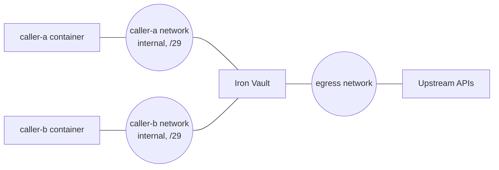
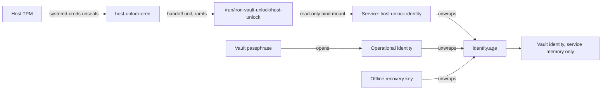

# Docker Compose deployment

This document decides how Iron Vault runs under Docker Compose on a server or a Naomi appliance
([§17](iron-vault-specification.md#17-docker-remote-servers-and-appliances)): the build profile, the service
account, the caller networks, how TCP listeners are bound, the hardening of every container and of the host, admin
access, and how a host TPM unlocks the vault at startup. The [Linux package](linux-package.md) is the model for the
host side, and the paths and modes here are the ones the trusted-path checks (`trusted_path.rs`) accept.

Two items under [Proposed specification changes](#proposed-specification-changes) still await the owner's
approval: the §17 software signer, the one specification change still open, and the glossary edits that follow from
the applied §5 change. Everything else follows the specification as it stands.

The [Compose install guide](../book/src/installation/compose-install.md) is the administrator's walkthrough of this
design.

This document introduces four terms, defined in the [glossary](glossary.md): *Container profile*, *Caller network*,
*Host unlock identity* and *Unlock handoff*.

## Scope

v0 supports one shape: rootful Docker on a Linux host with systemd, run by a host administrator, with Iron Vault and
its callers as containers of one Compose project. Callers on the host itself are out of scope: a host caller uses
the [Linux package](linux-package.md), and the two never share a host ([open question 4](#open-questions)).

Not supported in v0:

- **Rootless Docker.** §17 forbids isolating Iron Vault with a daemon its owner's malware controls. A rootless daemon
  run by a dedicated account would not have that problem, but its containers see host uids only through that
  account's user namespace, which breaks admin access in the same way as remapping (below).
- **`userns-remap`.** Under remapping the container runs in its own user namespace, and the kernel reports a host uid
  with no mapping there as the overflow uid. A host `sudo iron-vault` would arrive as uid 65534, which identifies no
  account and which the service never accepts as an admin principal
  ([§7](iron-vault-specification.md#7-caller-authentication-and-listeners)). Admin access would be impossible.
- **Podman.** Its rootful mode may work, but none of this has been checked against it.
- **A TPM device passed into the container.** §17 allows it only after its own validation.

## Container profile

`DeploymentProfile::Container` is a third build-time profile, chosen by the `container` Cargo feature. Like
`Development`, it is never chosen by config, flag or detection: [audit-logging.md](audit-logging.md#stdout-is-never-the-journal)
already rejects container detection, which depends on each runtime's conventions. The feature cannot be combined with
`dev-mode`: a build with both fails to compile. `--version` lists `container`, and the Linux package's build check
refuses it, so a `.deb` never carries the container build.

The Container profile is `Protected` except in two places:

| | Protected | Container | Why |
|---|---|---|---|
| TCP listeners | from socket activation only | bound by the service | [TCP listeners](#tcp-listeners-without-socket-activation) |
| Startup | always Locked | Checking when the unlock handoff opens the vault, else Locked | [Host unlock](#host-unlock) |

Everything else is `Protected`'s:

- root as the only admin principal ([Admin access](#admin-access));
- the paths `/etc/iron-vault/config.toml`, `/var/lib/iron-vault` and `/run/iron-vault`;
- the service account `iron-vault`, which the service must run as (`require_service_account`);
- the trusted-path rules, with the service account as the expected owner;
- unlock requires locked memory: without it the service stays Locked, attempts no host unlock, and refuses `unlock`
  with `memory-unprotected` ([§14](iron-vault-specification.md#14-recipients-startup-and-memory)).

The `deployment_profile` log field and `status` show `container`.

## Service identity

The service account has one fixed uid and gid, the same in the image and on the host: §17's "dedicated host-mapped
service identity". Without remapping the container shares the host's uids, so the uid must be the same in three places:

- **The image** has an `iron-vault` user and group at that uid and gid. The service resolves the service account from
  the container's `/etc/passwd`, and `require_service_account` refuses to run as any other uid.
- **The Compose file** runs the service with `user: "<uid>:<gid>"`.
- **The host** has an `iron-vault` system account at the same uid, created by a `sysusers.d` file. The host owns two
  things the service checks: `/run/iron-vault`, which the `RuntimeDir` rule requires the service account to own,
  and the listener TLS keys, which the `AdminPrivateKey` rule requires the service account to own. The host CLI needs
  the account too: `ProfileEnv::service_owner` fails with `MissingServiceAccount` without it, so the CLI cannot find
  the admin socket unless `--admin-socket` names one.

A disagreement fails closed. If the host's account has another uid, the service refuses `/run/iron-vault` at startup
and names it, because its owner is not the image's service account. The host account has no login shell and no home,
and nothing on the host runs as it: only the container's service may hold that uid.

## Host layout

What the host holds, outside the Compose project's volumes:

| Path | Owner | Mode | Created by | What it is |
|---|---|---|---|---|
| `/usr/lib/sysusers.d/iron-vault.conf` | root | `0644` | host setup | the `iron-vault` account at the fixed uid and gid |
| `/usr/lib/tmpfiles.d/iron-vault-compose.conf` | root | `0644` | host setup | creates the two directories below at boot |
| `/run/iron-vault` | `iron-vault` | `0711` | `tmpfiles.d` | the runtime directory, bind-mounted into the service container |
| `/run/iron-vault-unlock` | root | `0755` | `tmpfiles.d` | the mount point for the handoff's ramfs |
| `/usr/local/bin/iron-vault` | root | `0755` | host setup | the host CLI: the image's `container` binary, copied out of it |
| `/etc/iron-vault-host/` | root | `0700` | host setup | the Compose project and the sealed credential |
| `/etc/iron-vault-host/compose.yaml` | root | `0600` | administrator | the Compose file |
| `/etc/iron-vault-host/host-unlock.cred` | root | `0600` | provisioning | the host unlock identity, sealed by the TPM |
| `/etc/iron-vault-host/tls/` | root | `0755` | administrator | listener certificates (root, `0644`) and keys (`iron-vault`, `0600`) |
| `/etc/systemd/system/iron-vault-host-unlock.service` | root | `0644` | host setup | the [handoff unit](#at-boot) |

The service-owned directories `/etc/iron-vault` and `/var/lib/iron-vault` are named volumes, not host paths
([Mounts](#mounts)). `/run/iron-vault-unlock` exists even when the handoff unit fails, so the container still starts
and finds no handoff, rather than failing on a missing bind source.

## Networks



- **One caller network per caller.** Each is `internal: true`, so it has no route out, with a small fixed IPv4
  subnet (a `/29`) and IPv6 off. It holds Iron Vault and that one caller, and nothing else, each at its own static
  `ipv4_address`. Docker reserves a static address only while its container is attached, so while Iron Vault is
  stopped its address is free to any container that asks for one. Pinning the caller to its own address means no
  container on the network is ever given Iron Vault's.
- **Gateway mode `isolated`** on every caller network (`com.docker.network.bridge.gateway_mode_ipv4: isolated`).
  Docker normally gives an internal network's bridge an address on the host, so any host process could reach Iron
  Vault's listener on it and be taken for that caller. In `isolated` mode the bridge has no address, and only the
  network's containers reach the listener
  ([Docker: gateway modes](https://docs.docker.com/engine/network/port-publishing/)).
- **One `egress` network,** not internal, for Iron Vault alone. It carries the upstream requests. No caller joins it.
- **No shared caller bridge.** No network holds two callers, and no caller joins another caller's network or
  `egress`. A caller may join other networks of its own that Iron Vault is not on.
- **No shared network namespace.** No container uses `network_mode: "service:iron-vault"` or
  `network_mode: "container:<iron-vault>"`. Such a container shares Iron Vault's interfaces, so every listener address
  is one of its local addresses: it could reach any caller's listener and be taken for that caller, and it could bind
  the addresses while Iron Vault restarts.

Each caller has its own listener, bound to Iron Vault's address on that caller's network, with TLS and
`auth = "isolated-network"`:

```toml
[listeners.caller-a]
address = "172.30.1.2:8443"
tls_certificate = "/etc/iron-vault-tls/caller-a.crt"
tls_key = "/etc/iron-vault-tls/caller-a.key"

[callers.caller-a]
listener = "caller-a"
auth = "isolated-network"
routes = ["venice-chat"]
```

The isolated-network rule in `iron-vault-policy` (`validated.rs`, `check_listener_auth`) already enforces the
listener's side at approval: a TLS address listener, on a dedicated address that is neither loopback nor a wildcard,
with that caller as its only caller. The rule cannot see Docker's networks, so the Compose file must keep each address
on its own network, and the [release check](#release-checks) confirms it on a running stack.

The caller trusts the CA that issued its listener's certificate, which names Iron Vault's address on that network as an
IP subject alternative name. One certificate may name every listener's address, since only Iron Vault holds its key.

## TCP listeners without socket activation

Docker cannot pass a listening socket from the host into a container, so the Container profile binds its TCP
listeners itself: `socket_activation::check_origin` lets `Container` bind an unadopted TCP endpoint, where `Protected`
refuses it. [§7](iron-vault-specification.md#7-caller-authentication-and-listeners) allows this for a container
installation.

Socket activation exists to stop listener squatting (§7): a service that binds its own port leaves a gap at each
restart in which another local process can take the port, collect caller tokens and forge responses. In the Container
profile no one who could use that gap can reach it:

- **The addresses live in Iron Vault's own network namespace.** Each listener address is an interface address of Iron
  Vault's container. This holds only while no container joins that namespace with `network_mode: "service:…"` or
  `"container:…"`, which the [checklists](#hardening-checklist) forbid. The service is then the only process in the
  namespace: nothing else runs in its container, and getting a process in, with `docker exec` or otherwise, takes
  control of the runtime.
- **Callers cannot claim the address on their network.** A caller container has neither `NET_ADMIN`, so it cannot add
  the address or a route, nor `NET_RAW`, so it cannot send raw frames, such as ARP replies claiming the address or
  packets addressed to it on another interface. Every container on a caller network is pinned to its own static
  address, so Docker never hands Iron Vault's address to a caller that starts while Iron Vault is stopped.
- **Every non-loopback listener uses TLS,** as §7 already requires, and every isolated-network listener is
  non-loopback. Whoever does take an address while Iron Vault is down, which only a runtime administrator can arrange,
  still cannot present Iron Vault's certificate, because the key is only in Iron Vault's mounts. The caller refuses the
  connection before sending anything. An isolated-network caller has no token to steal, and TLS keeps its request
  bodies and Iron Vault's responses out of reach. A loopback listener needs no TLS, because it is reachable only from
  inside Iron Vault's network namespace.

A restart of the service is a restart of its container. Docker reattaches it to the same networks at its pinned
addresses, which no other container is configured to use, and the provisional listener set binds them again before
any unlock ([Locked](glossary.md)).

Linux accepts a packet for any of its addresses on any interface. So a caller that could write raw frames could send a
packet to another caller's listener address through its own network, and be identified as the other caller. Dropping
`NET_RAW` and withholding `NET_ADMIN` is what stops it, which is why the
[caller checklist](#caller-containers) requires both
([§7](iron-vault-specification.md#7-caller-authentication-and-listeners)).

## Hardening checklist

One line per setting, with why it is there and the threat it answers. R-numbers are the specification's. The
reference Compose file applies every line.

### Service container

| Setting | Why | Spec |
|---|---|---|
| `user: "<uid>:<gid>"`, the fixed service account | The service runs as the account that owns its files and is refused as any other ([Service identity](#service-identity)). | §17 |
| `read_only: true` | The image's files cannot be changed from inside; the service writes only to its volumes and `/run/iron-vault`. The log directory `/var/log/iron-vault` is therefore not writable: the log goes to stdout, and a `[logging]` file destination would need a volume mounted there. | §17 |
| `cap_drop: [ALL]` | The service needs no capability. Without `CAP_DAC_OVERRIDE`, even root inside the container cannot open the vault's files or the admin socket. | §17 |
| `security_opt: [no-new-privileges:true]` | No set-uid program or file capability can raise the service's privileges. | §17 |
| `ulimits: memlock: -1` | `hardening.rs` locks memory only when `RLIMIT_MEMLOCK` is unlimited, and unlock requires locked memory. | §14 |
| `ulimits: core: 0` | No core dump holds service memory. The service also sets `RLIMIT_CORE` and clears `PR_SET_DUMPABLE`. | §14 |
| No `privileged`, `pid: host`, `ipc: host`, `network_mode: host`, `devices` or Docker socket | Each would let the container, or whatever compromises it, reach the host or other containers. | §17 |
| No `seccomp=unconfined` or `apparmor=unconfined` | Docker's default profiles allow what the service needs (`mlockall`, `prctl`) and refuse the rest. | §17 |
| No `environment` or `env_file` holding a secret | Environment variables are visible to `docker inspect` and inherited by children; §17 forbids secrets there. | §17 |
| `command: ["serve", "--log-to-stdout"]` and `logging: driver: json-file` with `max-size` and `max-file`, never `journald` | As [the log operations guide](../book/src/reference/log-operations.md#docker) says: the runtime keeps and rotates the log, and the journal's readers are not bound by the log's permissions. | — ([§18](iron-vault-specification.md#18-logging)) |
| `restart: unless-stopped` | The service comes back after a crash and at boot, unattended ([§15](iron-vault-specification.md#15-service-states-and-errors)). `on-failure` would not restart it when the daemon starts. A Locked service has not failed and keeps running. | — |
| `image:` pinned by digest | A retagged image cannot change what a later recreation runs. | §17 |
| Networks: `egress` and every caller network, each with a static `ipv4_address` | Each listener's address is fixed and on its caller's network alone. | §7 |
| No other container names it in `network_mode: "service:…"` or `"container:…"` | A container sharing Iron Vault's network namespace has every listener address as its own, so it could pose as any isolated-network caller and bind the addresses while Iron Vault restarts. | §7 |

### Mounts

| Mount | Why | Threat |
|---|---|---|
| Named volume `config` at `/etc/iron-vault` | The config directory. The image makes the directory `iron-vault`, `0700`, and Docker copies its owner and mode into the empty volume on first use, so the `ConfigDir` rule passes with no manual step. | §17 |
| Named volume `state` at `/var/lib/iron-vault` | The state directory, made the same way (`StateDir`, `0700`). | §17 |
| Host `/run/iron-vault` at `/run/iron-vault`, read-write | The service binds `admin.sock` there, so host root reaches it. The host's `0711` directory and the socket's `0600` keep every other host account out. | §17 |
| Host `/run/iron-vault-unlock` at `/run/iron-vault-unlock`, read-only | The unlock handoff. The directory is mounted, not the file: a file mount of a missing path makes Docker create a directory in its place, and a replaced file would not be seen. | §17 |
| Host `/etc/iron-vault-host/tls` at `/etc/iron-vault-tls`, read-only | Listener certificates (`AdminCertificate`) and keys (`AdminPrivateKey`: the service account's, `0600`). | §7 |
| Nothing else | No home directory, no Docker socket, no host path the service does not need. | §17 |

The volumes take their owner and mode from the image only when they are first created empty. Removing a volume
removes the vault's only copy, as purging the Linux package's state directory does.

### Caller containers

| Setting | Why | Spec |
|---|---|---|
| `cap_drop: [ALL]`, and never `NET_ADMIN` | Without `NET_RAW` a caller cannot forge frames or source addresses; without `NET_ADMIN` it cannot take another address or add a route. Docker grants `NET_RAW` by default, so it must be dropped. | §7 |
| `security_opt: [no-new-privileges:true]` | A set-uid binary in the caller's image cannot regain a dropped capability. | §7 |
| Its own caller network only, never `egress` or another caller's | The listener address identifies the caller only while no other container can reach it. | §7 |
| Never `network_mode: "service:iron-vault"`, `"container:…"` naming Iron Vault, or `host` | Sharing Iron Vault's network namespace makes every caller's listener address local to it. | §7 |
| A static `ipv4_address` of its own on its caller network | While Iron Vault is stopped its address is free; a caller with a dynamic address could be given it, and bind it. | §7 |
| No `config` or `state` volume, no `/run/iron-vault`, `/run/iron-vault-unlock` or TLS key mount, no Docker socket | A compromised caller can read nothing of the vault, reach no admin or unlock interface, and cannot control the daemon. | §17 |
| No `privileged`, `pid: host` or `ipc: host` | A caller must not see or enter Iron Vault's processes or memory. | §17 |
| Trusts only the CA that issued its listener's certificate | It talks to Iron Vault only if Iron Vault answers. | §7 |

### Host

| Control | Why | Spec |
|---|---|---|
| `/etc/iron-vault-host` root-owned, `0700`: the Compose file, any `compose.override.yaml` and `.env` beside it, which Compose reads automatically | Whoever can write these changes what the next `docker compose up` runs, even without daemon access. | §17 |
| The image's build context and any entrypoint or mounted script kept as root's | As above, for the image a rebuild produces. | §17 |
| `host-unlock.cred` root, `0600`; the handoff unit and its scripts root-owned | Only a host administrator can change how the vault is unlocked. | §17 |
| The Docker socket reachable only by root: no ordinary account in the `docker` group, no passwordless `sudo docker` | Daemon access is runtime administration, which reaches everything ([§17](iron-vault-specification.md#17-docker-remote-servers-and-appliances)). | §17 |
| The host `iron-vault` account has no shell, and nothing on the host runs as it | Only the container's service may read the handoff and the TLS keys. | §17 |
| Encrypted swap and hibernation storage | Locked memory does not stop hibernation from capturing RAM ([the Linux install guide](../book/src/installation/linux-install.md)). | §14 |
| `sudo` hardened as [the Linux install guide](../book/src/installation/linux-install.md) says | Every admin command passes through `sudo` ([§5](iron-vault-specification.md#5-service-and-cli-separation-of-concerns)). | — |

## Admin access

Without user-namespace remapping the container shares the host's uids, and the kernel reports a connecting process's
host uid on the admin socket:

- a host `sudo iron-vault <command>` arrives as uid 0;
- an `ssh -L` forward to `/run/iron-vault/admin.sock` arrives as the uid of the SSH login account, because `sshd`
  connects to the socket as that account.

The peer's pid is a different matter. The connecting process is outside the container's PID namespace, so the kernel
reports its pid as 0, and the admin audit record leaves `peer_pid` out. The pid is recorded for the audit log only and
decides nothing (`peer.rs`), so nothing else changes.

**Root is the Container and Protected profiles' only admin principal.** `AdminPrincipals::accepts` accepts uid 0 and
refuses everything else, the service account included. Only the service itself runs as that uid, so accepting it would
grant nothing an administrator needs and would admit anything that took over the service's uid.
The owner reaches the socket the way §5 intends, by becoming a host administrator.

The admin socket in the bind-mounted runtime directory is `0600`, owned by the service account. Host root opens it
with `CAP_DAC_OVERRIDE`. A plain `docker exec` into Iron Vault's container runs as the container's `user:`, the service
uid, which owns the socket and can connect; it is refused because `AdminPrincipals::accepts` rejects the service
account. `docker exec -u 0` arrives as root but, under `cap_drop: [ALL]`, without
`CAP_DAC_OVERRIDE`, so it cannot open the socket.

Remote administration takes one of two forms:

- **`ssh -t admin@server sudo iron-vault <command>`.** The command runs on the server through `sudo`, and the
  owner's typed input goes through the SSH terminal. This is the default.
- **An `ssh -L` socket forward with a key-only root login** (`PermitRootLogin prohibit-password`):
  `ssh -N -L ~/.iv-admin.sock:/run/iron-vault/admin.sock root@server`, then
  `iron-vault --admin-socket ~/.iv-admin.sock <command>` locally. Any process of the local account can use the
  forwarded socket while it is open, as root on the server, so close the forward when done.

`docker exec` and any other use of the daemon is runtime administration, outside the threat model (§17).
[§5](iron-vault-specification.md#5-service-and-cli-separation-of-concerns) covers the admin principal.

## Host unlock

[§17](iron-vault-specification.md#containerised-deployments) prefers a host adapter that unseals with `systemd-creds`
and hands the result to the container on a ramfs, and gives the reasons. `systemd-creds` does not implement an `age`
recipient, so the handoff carries an
[intermediate identity](glossary.md) in the sense of [§13](iron-vault-specification.md#13-vault-structure-and-durable-writes),
never the vault identity: the **host unlock identity**, a generated X25519 identity whose recipient key is an
ordinary recipient of `identity.age`, beside the operational identity and the recovery key. `systemd-creds` only
seals and unseals its secret text, which needs no `age` support. The vault identity itself is unwrapped only inside
the service, and `identity.age` still holds nothing but X25519 stanzas.



### Its role among the recipients

The host unlock identity enters the recipient inventory of [`recipients.md`](recipients.md) with the role
`host-unlock`, role code 6, which that design reserves; the Compose epic makes the inventory decoder accept it. It is a machine-bound recipient: its secret exists only sealed to this host's TPM, and it
is lost with the TPM, the motherboard, a TPM clear or a change to the PCR it is bound to.

[`recipients.md`](recipients.md) puts `host-unlock` in the unlock class. Two parts of its independence rule decide
how the host unlock identity counts. The inventory after any change must hold:

> 1. **the recipient of each configured unlock method, and at least one unlock-class recipient.** The passphrase's is
>    `operational`; a TPM's is `tpm`, a hardware key's `hardware`, and a host unlock adapter's `host-unlock`. No unlock
>    method is required beside another;
> 2. **the `operational` recipient while the vault passphrase is the only source-owner method.**
>    [Migration authorization](migration-authorization.md#source-owner-method), which `recipient add` and `export` run,
>    proves authority through a source-owner method. A vault left with none could never add a recipient or migrate
>    again. In v0 the vault passphrase, through `operational`, is the only method, so this part keeps `operational` in
>    every v0 vault. Once the TPM approval signer (EP-33) or a hardware key is a method, a vault that has one may drop
>    `operational`;

Part 3 requires at least one `recovery` recipient, and part 4 between 2 and 64 recipients. For the host unlock
identity:

- **Part 1 keeps the host unlock identity while the host unlock adapter is configured.** That design leaves "configured"
  to this epic. Here, the adapter is configured for the host unlock identity whose recipient key the current unlock
  handoff holds. In the Container profile, `recipient remove` reads the handoff before any prompt, as Starting does,
  and part 1 keeps that one recipient. Any other `host-unlock` recipient, such as an old host's or one whose TPM was
  replaced, is not configured and can be removed. With no readable handoff, no host unlock is configured.
  Whether a recipient can be removed depends on the host's handoff at the time of the command, never on how the
  service was last unlocked.
- **Part 2 keeps the operational identity beside it.** Enrolling a host unlock identity never makes the operational
  identity removable, so in v0 passphrase `unlock` is always there when the handoff fails.
- **To retire host unlock,** the host administrator stops and disables the handoff unit and removes
  `host-unlock.cred`, then runs `recipient remove`. Part 1 no longer applies to the identity, and the service keeps
  working through the passphrase.
- **It never counts toward part 3.** Its secret lives on the host and dies with the machine, so a vault with one still
  needs its own `recovery` recipient. It does count toward part 4's floor of two and limit of 64.

It is not a source-owner method for migration authorization. Like unattended TPM unwrap in
[§16](iron-vault-specification.md#16-administration-recovery-and-migration), it opens the vault but proves no owner
took part, so it never authorizes `export` or `recipient add`.

### Format

The handoff holds the recovery key's secret-text format: the 74 ASCII bytes of `AGE-SECRET-KEY-1…`, uppercase Bech32,
optionally followed by one newline. It is parsed by the same code as the recovery key,
`RecipientIdentity::from_secret_text`, after at most one trailing newline is removed. It does not share
`RecoveryKeySecret::parse`'s trim of all surrounding whitespace, which is for a key typed at a prompt: a program writes
the handoff, so anything more than one newline means the wrong file. Letter case is whatever `age`'s parser accepts;
`age-keygen` writes uppercase, and nothing here relies on lowercase being refused. That is how the handoff is
"validated against the vault's recovery format" (§17): the host unlock identity and the recovery key are the same
kind of key in the same text, and the identity envelope cannot tell them apart. Anything else is refused: comment
lines such as `age-keygen` writes, other whitespace, a public key, or a file longer than 128 bytes.

### Provisioning on the host

The host administrator provisions the identity once, as root. The secret text exists only in a pipe:

```bash
set -euo pipefail
umask 077
cred=/etc/iron-vault-host/host-unlock.cred
[ -e "$cred" ] && { echo "$cred exists; enrol a new identity under another name first" >&2; exit 1; }
age-keygen 2>/dev/null \
  | grep '^AGE-SECRET-KEY-1' \
  | tee >(age-keygen -y >&2) \
  | systemd-creds encrypt --with-key=tpm2 --tpm2-pcrs=7 --name=host-unlock - "$cred"
```

- The block needs `bash`, for the `>(…)` process substitution. It stops if the credential already exists.
- `grep` keeps only the secret-key line, dropping `age-keygen`'s comment lines.
- `age-keygen -y` prints the recipient key, `age1…`, so the administrator can compare it with what `init` or
  `recipient add` enrols.
- `--with-key=tpm2` seals to this host's TPM alone. `host+tpm2` also ties it to `/var/lib/systemd/credential.secret`
  and is the only alternative allowed.
- `--tpm2-pcrs=7` binds the seal to the Secure Boot policy, which §14 accepts for the server and appliance profile.
  Current `systemd-creds` binds no PCR unless asked
  ([systemd-creds(1)](https://www.freedesktop.org/software/systemd/man/latest/systemd-creds.html)).
- `--name=host-unlock` embeds the credential's name. Decryption fails when the name it is loaded under differs, so the
  file cannot be reused as another credential.

The result is `/etc/iron-vault-host/host-unlock.cred`, root, `0600`. Replacing it means a new identity, which must be
enrolled before the old one is removed: the host setup moves the old credential aside only once the new recipient is
in `identity.age`.

### At boot

A host unit loads the credential and installs the handoff before Docker starts:

```ini
[Unit]
Description=Iron Vault host unlock handoff
Before=docker.service
After=systemd-tmpfiles-setup.service
ConditionPathExists=/etc/iron-vault-host/host-unlock.cred

[Service]
Type=oneshot
RemainAfterExit=yes
LoadCredentialEncrypted=host-unlock:/etc/iron-vault-host/host-unlock.cred
ExecStart=/bin/mount -t ramfs -o mode=0711,nosuid,nodev,noexec ramfs /run/iron-vault-unlock
ExecStart=/usr/bin/install -o iron-vault -g iron-vault -m 0400 %d/host-unlock /run/iron-vault-unlock/host-unlock
ExecStopPost=-/bin/rm -f /run/iron-vault-unlock/host-unlock
ExecStopPost=-/bin/umount /run/iron-vault-unlock

[Install]
WantedBy=docker.service
```

- **`Before=docker.service`** and **`WantedBy=docker.service`**: the handoff is in place before any container starts,
  and a failure of this unit does not stop Docker. The service then starts without a handoff and waits Locked.
- **`LoadCredentialEncrypted=`** decrypts the credential when the unit starts, and a decryption or authentication
  failure fails the unit. systemd places it in the unit's credentials directory, `%d`, in non-swappable memory where it
  can.
- **ramfs**, not tmpfs: ramfs pages are never written to swap, and only root can write the mount
  ([ramfs](https://docs.kernel.org/filesystems/ramfs-rootfs-initramfs.html)). The mount's root stays root's, `0711`:
  the service account can open the one file it knows the name of, but cannot list, add or remove anything, or change
  the directory's mode. That matters because a ramfs has no size limit. The handoff is the service account's, `0400`.
- **No sandboxing directives.** The unit has no `PrivateMounts=`, `ProtectSystem=` or other setting that gives it its
  own mount namespace, so its ramfs mount is visible to Docker. The [release check](#release-checks) confirms it with
  `findmnt` ([open question 2](#open-questions)).
- **`ExecStopPost=`** runs after a stop and after a failed start, so a half-finished start leaves no plaintext.

The handoff could instead be the credentials directory itself, bind-mounted into the container. That is
[open question 2](#open-questions); the default is the unit's own ramfs, because systemd ties the credentials
directory's lifetime and visibility to the unit, and gives its files to the unit's user, here root.

### In the container

Only the service container mounts the host's `/run/iron-vault-unlock`, read-only. It reads the handoff once, while
Starting:

1. **Memory.** Without locked memory it does not open the file
   ([§14](iron-vault-specification.md#14-recipients-startup-and-memory)).
2. **Read.** The file must pass the `UnlockHandoff` trusted-path rule: a regular file, not a symlink, owned by the
   service account, with no group or other permission bits, in a directory owned by the service account or root that
   neither group nor others can write. It is opened with `O_NOFOLLOW` and checked again through the open descriptor,
   as `admin_file::read` does, and read into a buffer cleared on drop. A missing file is **absent**, not an error.
3. **Initialized.** The vault must be Initialized, as for passphrase `unlock`
   ([vault-initialization.md](vault-initialization.md#state-before-and-after)).
4. **Unwrap.** The identity unwraps `identity.age` (`unwrap_identity`), and the manifest's MAC verifies, as for
   passphrase unlock. The host unlock identity is dropped, and its bytes cleared, as soon as the vault identity is
   unwrapped.
5. **Checking.** The service moves from Starting to Checking ([§15](iron-vault-specification.md#15-service-states-and-errors))
   and runs the usual config check.

Each attempt writes one audit event, `vault.host-unlock`, which never holds the file's bytes or the recipient key:

| Field | Values |
|---|---|
| `host_unlock_outcome` | `unlocked`, `absent` or `refused` |
| `refusal` | when refused: `memory_unprotected`, `untrusted`, `unreadable`, `not_an_identity`, `not_initialized` or `not_a_recipient` |

`unlocked` and `absent` are INFO, `refused` is WARN. The field is `host_unlock_outcome`, not `outcome`, which the
request event already uses with another meaning, and its labels are snake_case like every fixed label
([audit-logging.md](audit-logging.md#field-rules)). Other profiles never write it. A `memory_unprotected` refusal also
writes the `vault.unlock-refused` record that every unlock path's memory guard writes.

### Lifetime

The handoff stays on its ramfs for as long as the stack runs, so a crashed service restarts unattended (§15). It is
never in an environment variable, an image layer, a named volume or any file that outlives the boot: the unit removes
it when it stops, and the ramfs goes at shutdown. The service reads it only while Starting. After an explicit `lock`
the service stays Locked until a passphrase `unlock` or a restart; a restart uses the handoff again, so in this
profile `lock` holds only until whoever controls the runtime restarts the container.

### Failure

A missing, unsafe or wrong handoff leaves the service Locked, with the reason in `vault.host-unlock`. Passphrase
`unlock` still works, because the operational identity is still a recipient. A host unlock failure is not counted
toward the [passphrase attempt limit](migration-authorization.md#passphrase-attempt-limit): it is not a guess, only
root can change the file, and counting it would let a stale handoff lock the owner out of the fallback. Fixing the
handoff takes effect at the next restart.

### Enrollment

- **A new vault:** `init --host-unlock`, accepted only by a container build. The service reads the handoff before any
  prompt, as Starting does, and refuses `init` if it is absent or refused, naming the reason. Init then wraps
  `identity.age` for the operational identity, the recovery key and the host unlock identity, and proves that each
  opens it. Init's summary and the `vault.initialized` record name the kinds enrolled, never a key.
- **An existing vault:** `iron-vault recipient add --host-unlock <age1…> --label <text>`, a form of `recipient add` in
  [`recipients.md`](recipients.md#recipient-add---host-unlock-age1) (owner decision, 2026-11-10). It takes the host
  unlock identity's recipient key, which the provisioning script prints, runs migration authorization with
  `AddRecipient(<key>)` like the other forms, and enrolls the key with role `host-unlock`. It reads no handoff: the
  owner may enrol the new identity before the handoff holds it, and part 1 of the independence rule then keeps whichever
  `host-unlock` recipient the handoff holds when `recipient remove` runs. Like every recipient command, it maps onto
  the admin operation `AdminOperation::VaultChange`, so it runs only in Ready.

### Against the implementation spec §3 gate

[Implementation spec §3](implementation-specification.md#3-implementation-gates-and-unresolved-details)'s "Host unlock handoff" gate asks for proof that the adapter "can supply the same recoverable vault identity without
persistent plaintext or exposing a signing oracle":

- **The same recoverable vault identity.** The handoff unwraps the existing `identity.age`; it does not replace the
  vault identity. The recovery key and the operational identity still open the same envelope.
- **No persistent plaintext.** The secret text exists in the provisioning pipe, the unit's credentials directory and
  the ramfs handoff, all in memory that is never swapped where systemd and the kernel allow it, and all gone at
  shutdown. On disk there is only the TPM-sealed credential.
- **No signing oracle.** The host unlock identity can unwrap `identity.age` and nothing else. The host offers no
  interface that signs or decrypts on request; the unit runs once at boot.

The evidence is the [host unlock release check](#release-checks), [`compose-unlock-check.sh`](../scripts/release/compose-unlock-check.sh),
run on a host with a TPM. **The gate is met.** On 2026-11-11, at commit `9591715`, it passed every item with none
skipped (5 in part 1, 14 in part 2) on a fresh Ubuntu 24.04.5 VM with an emulated TPM 2.0 (`swtpm`), Secure Boot and a
swap file: [the output and host details](evidence/compose-unlock-check-2026-11-11.md). A run on TPM hardware is still
to come; the gate does not wait for it.

## Approval signing

v0 keeps the [software signer](glossary.md) inside the service. Its key is in an approver key envelope,
`approver-<approver ID>.age`, in the state volume, opened only by the approval passphrase, which the owner types over
the admin socket, for one approval at a time ([storage-formats.md](storage-formats.md#approver-key-envelope)). The host
exposes no signing interface, and nothing in the container can sign without the owner typing that passphrase. The host
unlock identity gives no approval authority: the approval passphrase is separate from every unlock factor.

[§17](iron-vault-specification.md#containerised-deployments) says that "in the host-unlock profile, the host owns
approval signing, or exposes a narrowly scoped, authenticated signing helper". That rule is about a TPM approval key,
which the container cannot reach. Until one exists, the software signer meets it: there is no host key to own and no
helper to narrow. The host-side helper for a TPM approval key waits for EP-33's signer.

## Threats

| Threat | Controls here | What remains |
|---|---|---|
| Another process claims a listener during a restart (§7) | Addresses in a network namespace no other container shares; callers without `NET_ADMIN` or `NET_RAW`, each at its own static address; TLS on every non-loopback listener | A runtime administrator can start anything at the address; callers refuse it without Iron Vault's key |
| Memory capture leaves credentials on disk (§14) | `memlock: -1` and unlock only with locked memory; `core: 0` and no dumpability; the handoff on ramfs; encrypted swap and hibernation on the host | Locked memory does not stop hibernation; the host's disk encryption must |
| A sibling container enters Iron Vault or reads its vault identity (§17) | No caller mounts of volumes, runtime directory, unlock directory or Docker socket; no `privileged` or `pid: host`; the service container's dropped capabilities and read-only image | A caller can use its own routes, as §2 allows |
| A network observer reads or changes caller traffic (§7) | TLS on every non-loopback listener, which includes every isolated-network listener; callers trust only Iron Vault's CA | — |
| A caller impersonates another caller (§7) | One internal caller network per caller, gateway mode `isolated`, a dedicated listener per caller, no `NET_RAW` or `NET_ADMIN` in callers, no container sharing Iron Vault's network namespace | A caller given `NET_RAW` back, put on a second caller's network, or joined to Iron Vault's network namespace defeats it; the release check looks for all three |
| An ordinary host user changes what a later recreation runs (§17) | Compose files, overrides, `.env`, image sources, the unit and the sealed credential all root-owned and closed to other accounts; the image pinned by digest | — |
| A process running as the service uid replaces `admin.sock` and collects the passphrases the owner types (§5) | None: the bind-mounted `/run/iron-vault` is the service account's and writable. Neither a root-owned admin socket nor a CLI check of the server's pid would stop it: a program `execve`d in place keeps the service's pid and its sockets | Accepted Low residual under §5, which treats anything running as the service uid as the service. A program the service starts, or a `docker exec` as the service uid that the service takes over, can capture the passphrases at the local path or through an `ssh -L` forward. No control is built for it: the service already receives every owner input, so the replacement saves an attacker only the work of hooking the running service. Administer with `sudo iron-vault` on the host ([iron-vault-account.md](reviews/iron-vault-account.md), finding 3) |
| A process running as the service uid replaces a Unix request socket (§7) | Other accounts cannot write `/run/iron-vault` | The service uid can, but callers would only send it what a compromised service already sees |
| Runtime administrator | Outside the threat model ([§17](iron-vault-specification.md#17-docker-remote-servers-and-appliances)) | Can replace the image, `docker exec` with any capability, read the handoff, and capture the vault identity from memory after unlock |

## Release checks

Two release checks run on a disposable host and are the evidence for this profile:

- **Caller isolation and hardening:** every caller drops `NET_RAW`, each caller network holds one caller and Iron Vault
  and has no host address, every container on a caller network has the static address the Compose file gives it, no
  container's `NetworkMode` names Iron Vault's container (from `docker inspect`, and from `docker compose config` on the
  reference file), no caller reaches another's listener, the service runs as the fixed uid with locked memory,
  the admin socket refuses a non-root host account and accepts `sudo iron-vault ping`, and the named volumes have the
  modes the image gave them.
- **The host unlock gate:** after provisioning and `init --host-unlock`, a restart and a reboot reach Ready with no
  `unlock`; the recovery key opens the same vault; `identity.age` has three X25519 stanzas; the handoff is on a ramfs
  that `findmnt` shows on the host; no `AGE-SECRET-KEY` appears in the image, the environment, the volumes, `/etc`,
  `/var` or swap, other than the public test keys of published crate sources in the build cache; and a missing or
  wrong handoff leaves the service Locked with passphrase `unlock` still working.
  [`scripts/release/compose-unlock-check.sh`](../scripts/release/compose-unlock-check.sh) runs it in two parts around a
  reboot, behind the same `--i-know-this-is-a-disposable-vm` opt-in as the isolation check, and prints one PASS or
  FAIL line per item, or SKIP for the swap item on a host with no swap. Its last check is that nothing but the admin socket
  and the request listeners listens (TCP, UDP or unix) on the host or in the container, so there is no signing oracle.

## Proposed specification changes

**Two items still await the owner's approval: the §17 change and the glossary edits.** Neither is applied to
[`iron-vault-specification.md`](iron-vault-specification.md) or [`glossary.md`](glossary.md). Each gives the text to
replace and its replacement, word for word.

### §5 and §7

The owner approved the §5 and §7 changes on 2026-11-07, and they are applied to
[`iron-vault-specification.md`](iron-vault-specification.md): root alone is the admin principal in a container
installation, and the service binds its own TCP listeners.

### §17 Docker, remote servers, and appliances

Replace:

> In the host-unlock profile, the host must also own approval signing or expose a narrowly scoped,
> authenticated signing helper.

with:

> In the host-unlock profile, the host must also own approval signing or expose a narrowly scoped,
> authenticated signing helper. In v0, which has no TPM approval key, the software signer inside the service meets
> this requirement: its key is opened only by the approval passphrase over the admin socket, and the host exposes no
> signing interface. Once a TPM approval key exists, the host owns it.

### Glossary

The glossary's *Admin principal* entries are applied: root in a protected or container install, the invoking user in
development. The *Actor disambiguation* table compares the two profiles an owner chooses between on a desktop, so it
gets no container column.

## Open questions

1. **The fixed uid and gid.** *Decided (2026-11-09):* uid and gid 460 as the default says, in the build arguments of
   [`Dockerfile`](../packaging/compose/Dockerfile), the `user:` of [`compose.yaml`](../packaging/compose/compose.yaml)
   and [`iron-vault.conf`](../packaging/compose/host/sysusers.d/iron-vault.conf), but no repository test compares the
   three literals; the install guide's `id iron-vault` step and
   [`compose-check.sh`](../scripts/release/compose-check.sh) check the uid instead. The image, the Compose file's
   `user:` and the host's `sysusers.d` line must carry the same value. *Default:* uid and gid 460, in the system range
   and far from where `adduser` (counting up from 100) and `systemd-sysusers` (counting down from 999) allocate. The
   value is a Docker build argument with that default, the host file is `g iron-vault 460` and
   `u iron-vault 460:460 "Iron Vault credential proxy" - /usr/sbin/nologin` (systemd 255 refuses the `u` line alone
   with "please create GID 460"), and the host setup checks after `systemd-sysusers` that `id -u iron-vault` is 460,
   since `systemd-sysusers` may pick another uid when one is taken. A test compares the three literals in the
   repository.
2. **ramfs, or the credentials directory bind-mounted directly.** *Default:* the unit's own ramfs. systemd documents
   that the credentials directory lives in non-swappable memory where possible, is readable only by the unit's user
   and root, exists from activation to deactivation, and is invisible to other services when the unit uses file
   system namespacing ([credentials](https://systemd.io/CREDENTIALS/)). Mounting it directly would need the unit to run
   as the service account and to stay without a private mount namespace, and would tie the handoff's lifetime to
   systemd's handling of a `RemainAfterExit=yes` unit, which the documentation does not state. Not checked: the
   systemd versions on current Ubuntu LTS releases, whether they mount the credentials directory in a private
   namespace by default, and whether a unit that loads a credential gets its own mount namespace, which would hide the
   ramfs from Docker. The host unlock release check settles these with `findmnt` on the target release.
3. **Whether `status` shows the last host unlock failure.** *Decided: default accepted (2026-11-09).* *Default:* no,
   the audit log only. `status` already shows Locked and the memory protection; the `vault.host-unlock` record says
   why.
4. **Whether the Linux package and the Compose stack may share a host.** *Decided: default accepted (2026-11-09).*
   *Default:* no. Both use `/run/iron-vault`, the `iron-vault` account (at a dynamic uid in the package, a fixed one
   here) and `/usr/lib/sysusers.d/iron-vault.conf`.
5. **Named volumes copying the image directory's owner and mode.** Docker documents that an empty named volume
   receives the image directory's contents, but not that it takes the directory's owner and mode; the Docker
   engine's source does copy them. *Default:* rely on it, and have the caller isolation release check verify both
   volumes' owner and mode.
6. **The minimum Docker Engine version.** Gateway mode `isolated` is documented for current Docker Engine but its
   first version was not checked. *Default:* require a Docker Engine that supports it, recorded by the release check.
   Older engines could use `com.docker.network.bridge.inhibit_ipv4`, which also leaves the bridge without an address;
   that is not part of v0.
7. **PCR 7.** *Default:* seal with `--tpm2-pcrs=7`, as §14 allows for unattended server unlock. A Secure Boot
   policy update then makes the handoff fail; the service waits Locked, passphrase `unlock` works, and the
   administrator provisions and enrols a new identity. Binding no PCR would survive such updates but would let any OS
   booted on the machine unseal the credential.
