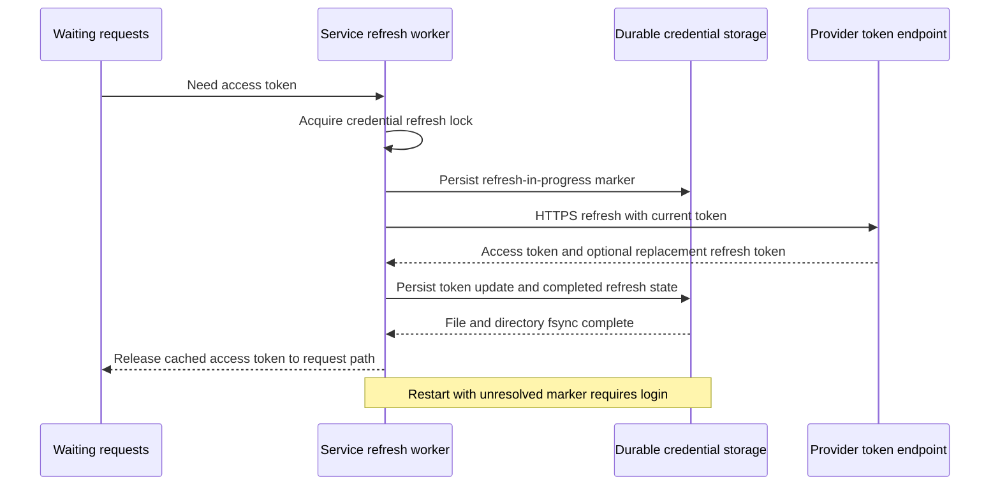
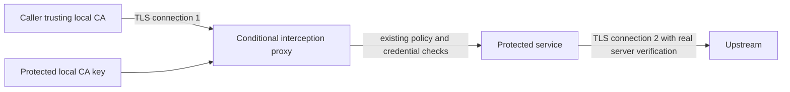

## 1. v1: OAuth login and refresh

v1 adds `oauth_refresh` and targets Naomi's Google integration. It inherits every v0 destination, ownership,
approval, response, and logging rule. Neither the caller nor the CLI receives a refresh token or access token.
The route still supplies a placeholder; the service resolves a fresh access token into its slot. v1 also lets a route
restrict request content ([§1.4](#14-request-content-restrictions)), for every credential kind.

### 1.1 Service-owned consent

`iron-vault login <name>` asks the service to start an authorization-code flow with PKCE and a loopback redirect,
or a device-code flow on a headless machine. The service generates and retains the verifier, authorization state,
and pending login identity. It owns the redirect listener, validates the returned state and transaction, and redeems
the code at the credential record's authorized token endpoint. The browser performs consent; the CLI only displays
the service-provided authorization URL or device instructions and login status.

For a remote service, prefer device-code login or explicitly forward the service's loopback callback through SSH.
Do not move the verifier or code redemption into the remote CLI. Use a short-lived, transaction-specific callback
listener and reject callbacks for completed, expired, or unrelated login transactions. A redirect listener does
not become a general request proxy or admin listener.

The owner supplies or approves the token endpoint, scopes, permitted resource origins, and OAuth-client reference
when enrolling the record. Store a confidential client's ID and secret in their own credential record; never place
the client secret in ordinary config. An OAuth record may reference that record but cannot redirect its secret to
another token endpoint. All token requests use the same controlled HTTPS client and final destination check.

`login` over an existing credential requires owner presence before replacement. Store a provider-verified account
identifier, such as issuer and `sub`, and a display email when the provider supplies them. Show the account in
`list` and in the service-generated replacement summary. Do not infer verified identity from an unvalidated JWT
payload or a caller-supplied email. Narrowed or changed scopes require explicit re-consent where the provider needs it.

### 1.2 Token cache and request retry

The service caches access tokens only inside protected service memory and renews them shortly before expiration.
It serializes refresh per credential; concurrent requests wait for one result instead of rotating the same refresh
token multiple times. A configurable expiry margin must account for clock and network uncertainty.

On an upstream `401`, the service may invalidate the cached access token, refresh once, and retry once only if it
can replay the original body and the operation's retry policy permits another attempt. It must not buffer arbitrary
streaming uploads solely to make them replayable without an explicit size limit. If it cannot replay safely, it
returns a clear error rather than sending a partial or changed body. It must not create an automatic retry loop
for an API operation that may already have caused a side effect.

### 1.3 Refresh-token rotation and crash recovery

The provider may invalidate the previous refresh token as soon as it issues a new one. No local transaction can
make that remote update atomic with a filesystem write. The service must narrow the failure window and treat an
uncertain outcome as a new-login requirement.



The service must execute this transaction:

1. Acquire the per-credential refresh lock and confirm that the record is usable.
2. Persist a refresh-in-progress marker before contacting the provider.
3. Send one refresh request to the authorized HTTPS endpoint. Do not automatically replay a possibly delivered refresh request.
4. Validate the response. Persist the replacement refresh token, or the retained token when no replacement exists, together with completion
   state. Use write, file fsync, rename, and directory fsync.
5. Only after durable completion, publish the new access token to waiting requests and release the lock.

If the process dies or the network outcome remains uncertain while the marker is unresolved, restart places that
credential in `needs login`. Never reuse the previous refresh token to see whether it still works. A successful
durable completion clears the uncertainty in the same record update; leftover temporary files must not erase a
valid completion or imply one that never committed.

`invalid_grant`, revoked consent, and an unrecoverable refresh outcome put the record in `needs login`. Notify the
owner and fail affected routes with `503`; keep unrelated credentials available. Retry only failures for which the
implementation can establish that replay does not reuse a potentially retired token. If it cannot establish that,
require a new login. A fresh, owner-authorized login replaces the failed token record and clears the marker.

### 1.4 Request-content restrictions

v0 narrows a route by method and path only; it never reads query parameters or the request body. A caller granted
a chat route can therefore ask for any model the provider offers on that path, including one far more expensive
than the route's owner intended. v1 adds two optional route restrictions:

- **Query parameters:** an allow-list of values for each named parameter. A route may also refuse any parameter it
  does not name.
- **JSON body fields:** an allow-list of values for each named field, addressed by a simple path such as `model`.

The design for the v1 configuration syntax names the TOML keys. Whatever the syntax, these rules apply:

- The check runs in the request pipeline after method and path narrowing, before the credential is resolved and
  before anything leaves the machine. A request that fails it is refused with `403` and its own reason code.
- Matching is exact and case-sensitive, after percent-decoding a query value once. A restricted parameter that
  appears more than once, a restricted field whose key is duplicated in a JSON object, or a restricted field whose
  value is not a string, number or boolean is refused: the upstream might read a different copy than the check did.
- A route with body restrictions reads the body into memory up to an explicit size limit before forwarding it. A
  body over the limit, a body that is not valid UTF-8 JSON, a `Content-Type` other than JSON, and any
  `Content-Encoding` are refused rather than forwarded unchecked.
- A restricted field that the request leaves out is refused, unless the route explicitly allows the provider's
  default.
- Restrictions are route policy: they take effect only through versioned approval, and the approval summary lists
  each added, removed or changed allow-list.
- Audit records name the route and the parameter or field that failed, never the value the caller sent.

Like method and path narrowing, these restrictions bound what a compromised caller can do with a route; they do not
make every allowed call safe.

### 1.5 v1 release checks

- Run authorization-code/PKCE and headless device-code login through the service, including a remote deployment.
- Prove that the CLI and callers never receive verifier, authorization code, refresh token, or minted access token through an admin
  response.
- Exercise account replacement, changed scopes, wrong-state callbacks, expired transactions, and token-endpoint substitution attempts.
- Exercise concurrent refresh, expiry-margin behavior, one permitted `401` retry, and a body that cannot be replayed.
- Cut power or inject failures before the refresh request, after the provider response, during record replacement, and after directory
  fsync. Recover to either a valid durable token or `needs login`, never an uncertain old-token retry.
- Refuse a disallowed query value or body field, a repeated parameter, a duplicated JSON key, a missing restricted
  field, an oversized body and a compressed body, each before the credential is resolved.
- Validate the actual Google OAuth application status, consent setup, refresh-token lifetime, and requested scopes for Naomi before
  documenting unattended operation. Verify whether tokens for the selected Google OAuth “Testing” configuration expire after seven days;
  do not treat that lifetime as a universal guarantee.

The Gmail route below references a credential enrolled through this flow; its record owns the resource hosts,
token endpoint, scopes, client reference, and verified account.

```toml
[routes.gmail]
prefix = "/gmail"
upstream = "https://gmail.googleapis.com"
credential = "google_naomi"
slot = { header = "Authorization", format = "Bearer {}" }
methods = ["GET", "POST"]
paths = ["/gmail/v1/users/me/**"]
rate_limit = { requests = 120, per_seconds = 60, burst = 20 }
```

This route's broad path grant remains a conscious owner choice. It does not claim that every allowed Gmail call
is safe from misuse by a compromised caller.

## 2. Later: hardware keys and integrations

These features extend the protected service. Their absence must not weaken existing route, record, approval, or
recovery rules. Implement each provider only when a caller needs it and its release checks pass.

### 2.1 Hardware-key recipients, signers, and touch confirmation

The first removable-key backend targets a YubiKey PIV P-256 recipient through a validated
`age-plugin-yubikey` integration. The service owns PC/SC access and the key operations; Linux installations must
configure `pcscd` access deliberately. The package must verify device enrollment, PIN/touch policy, key-slot
separation, and interaction with other desktop smart-card applications. It must not assume that a common desktop
PC/SC policy limits a key to Iron Vault.

A hardware key may replace or accompany the TPM as a vault recipient, through its own hardware-sealed intermediate
identity ([product spec §13](iron-vault-specification.md#13-vault-structure-and-durable-writes)). Any enrolled recipient can unwrap the identity. A TPM-plus-YubiKey installation may still start through its TPM without a touch; adding a touch-enabled
recipient alone does not make touch mandatory. A YubiKey-only operational profile requires PIN and touch on
unlock and keeps the identity in service memory afterwards.

Aim for PIN `once` per service session and touch `always` for opening the hardware-sealed intermediate identity. Do not ship a
protected profile with both PIN and touch disabled. Separate approval signing from unattended vault use; use a
dedicated PIV signing key with the approved signing policy and the same versioned config envelope as the TPM.
The service must verify the policy it actually provisioned and tell the owner when a device cannot meet it.

Default behavior keeps an already unlocked vault open when the key is removed. An optional removal-lock policy
clears the vault identity, derived keys, and cached credential values, refuses requests, and waits for reinsertion
and touch. Losing a hardware key loses one recipient; another independent recipient must still recover the vault.
Use the configured PUK to recover a forgotten PIV PIN when possible. Resetting the applet invalidates its old keys.

Per-route `confirm = "touch"` requires a separate service-owned confirmation for each authorized operation. The
service must bind the pending confirmation to the caller, route, method, normalized destination and body digest
where a body exists, and give it a short expiry. It must not use a touch on an unrelated signing or unwrap request
as confirmation. Parallel requests must not share a confirmation or borrow a queued touch. Cancellation or device
absence must fail the request without sending it.

The service must show and log the operation summary itself, while retaining the compromised-display limitation.
For streaming uploads on confirmed routes, buffer within the configured limit before requesting a body-bound
confirmation, or refuse the route's unsupported streaming operation. Do not silently omit the body binding.

Operators must identify high-impact routes during enrollment and explicitly decide whether to require touch.
Until the product defines provider-specific defaults, it must not describe unconfirmed high-impact access as
protected from local misuse. A machine without a supported key must reject activation of a touch-required route;
it must not substitute a software prompt or approval PIN without an explicit new policy approval.

Evaluate FIDO2 `hmac-secret` for devices such as SoloKeys, Nitrokey, and YubiKey as a separate compatibility effort.
That feature may help derive an unwrap secret; it does not automatically implement an `age` recipient or PIV signing.
Prove wrapping, recovery, PIN/presence behavior, and service isolation before advertising another device family.

Hardware-key release checks must include one unwrap for many credential files, mandatory touch where configured,
service-owned signing, borrowed-touch attempts, concurrent confirmations, removal/reinsertion, wrong PIN and PUK
recovery, a lost device, and unattended startup through an alternate recipient when that profile permits it.

### 2.2 Credential kinds

Every kind accepts a credential record and an authorized request plan, then produces only the value or signed
request that the proxy needs. It must never expose a secret through the caller or management interfaces. The same
caller marker works regardless of whether the service uses a stored key, a minted token, or a computed signature.

| Kind                       | Record contains                                                                                       | Request behavior                                                                                | Phase |
|----------------------------|-------------------------------------------------------------------------------------------------------|-------------------------------------------------------------------------------------------------|-------|
| `static`                   | Provider key                                                                                          | Fill the selected header or query slot; apply an optional fixed format such as `Bearer {}`      | v0    |
| `basic`                    | Username and password                                                                                 | Write `Authorization: Basic base64(user:pass)`                                                  | v0    |
| `oauth_refresh`            | Refresh token, token endpoint, scopes, resource origins, account identity, and OAuth-client reference | Cache an access token and refresh through the service-owned transaction                         | v1    |
| `oauth_client_credentials` | Client ID, client secret, token endpoint, resource origins, and scopes                                | Obtain and cache an access token                                                                | Later |
| `jwt_bearer`               | Signing key, issuer/audience/claims policy, and permitted exchange endpoint                           | Sign an assertion and exchange it for an access token, for example for a Google service account | Later |
| `jwt_self_signed`          | Signing key and bounded claim policy                                                                  | Mint a short-lived JWT for direct upstream use, such as an Apple APNs token                     | Later |
| `github_app`               | App private key, installation ID, and permitted API endpoints                                         | Sign an app JWT, obtain an installation token, and cache it                                     | Later |
| `hmac`                     | Signing secret and a defined provider signing algorithm                                               | Sign the final method, destination, headers, timestamp, and body as required by the provider    | Later |
| `aws_sigv4`                | AWS access-key material, region/service restrictions, and optional session token                      | Sign the final request with AWS Signature Version 4                                             | Later |

Store provider claims, audiences, exchange endpoints, and signing algorithms in the credential record where they
can affect secret use. Restrict token and installation-token endpoints independently of resource hosts. A route
cannot override these values or use its signing key as an arbitrary signing oracle.

`hmac` and `aws_sigv4` require the complete final body. Buffer it within a configured size limit, apply URL/header
and slot transformations, then sign; run the final egress check before sending. Do not allow a later mutation to
change signed bytes. These routes do not support streaming uploads in the planned implementation. Other providers
must specify replayability, token expiry, cache invalidation, retry behavior, and redaction patterns before release.

### 2.3 Password-manager sync and command adapters

Provide explicit sync/import from LastPass, 1Password, and Bitwarden as supported connectors become available.
The service imports secrets into ordinary encrypted credential records. Requests use those local records; they
do not fetch a password-manager secret on every proxy call. Explicit sync keeps connector outages outside the
normal request path.

The owner configures each source through an authorized service operation. Source metadata lives with the credential
record and remains outside ordinary route config. The connector runs within the service boundary or a restricted
service-owned helper and returns imported secrets only to the service. A user-controlled CLI must not become the
repository for cached source credentials or imported provider tokens.

Sync must show a proposed inventory of additions and changes, preserve destination restrictions, reject silent
name collisions, and require owner presence before replacing or removing a record. A connector must not change
allowed hosts, token endpoints, scopes, or account identity merely because the remote field changed. Such a change
uses the explicit replacement or login flow. Imports must leave existing usable records intact on failure.

The later `command` source remains a gated adapter, not permission to execute a command from TOML route
config. If implemented, store its definition in the protected record, require explicit owner authorization, use an
administrator-approved executable and fixed arguments without a shell, and control its environment, timeouts,
output size, and logs. Command stdout carrying a secret goes only to the service. Execute it as an isolated helper
where possible, rather than granting arbitrary code the vault service's full memory and filesystem access.

Live request-time sources and their cache durations need a separate design before activation. The planned phase
ships explicit sync; it must not quietly replace that model with user-supplied code running on every request.

### 2.4 Later platform work

Validate Secure Enclave support and any `age-plugin-se` integration on macOS before promising equivalent hardware
behavior. Keep the platform's dedicated service account and interactive passphrase option throughout this work.
Evaluate signed PCR 11 policies for measured boot without brittle firmware bindings. Any future keyring adapter
must remain under the service identity and state exactly which attacks it does and does not resist.

mTLS client certificates may follow as a route transport feature rather than an injection slot. They require
separate key-storage, server-identity, and certificate-lifecycle requirements before implementation.

## 3. Conditional phase: forward proxy and CLI compatibility

v0 and v1 implement base-URL mode. A plain `CONNECT` tunnel leaves HTTPS opaque, so it cannot attach credentials.
Forward-proxy mode would require Iron Vault to terminate caller TLS with a locally trusted CA and open a separate
TLS connection upstream. That CA could impersonate sites to the caller and creates a larger security boundary.

Before planning this phase, run end-to-end compatibility checks for Brave's MCP server, the accounting/FX MCP
server, `gh`, `npm`, and `cargo`. Verify overrides, authentication behavior, redirects, metadata-provided absolute
URLs, streaming, and downloads. Publish only tested application/configuration combinations. Investigate npm tarball
URLs and GitHub host selection rather than assuming their base-URL settings cover the complete workflow.

If a required caller has no sufficient base-URL override, choose explicitly between a caller patch and a separate
interception design. Move unsupported CLI examples to this conditional phase; do not claim that setting
`HTTPS_PROXY` alone enables credential injection.



The conditional design must specify CA enrollment/removal, private-key isolation, authority selection, caller
authentication, allowed destinations, all existing final checks, and recovery after certificate failures. Existing
base-URL listeners must continue rejecting `CONNECT` and absolute-form targets. Do not share a permissive parser
or interception policy with them accidentally.

Browser login sessions, cookie jars as credentials, TOTP generation, and non-HTTP protocols remain outside the
planned product. SMTP/IMAP with XOAUTH2, databases, and SSH would require their own protocol-aware proxies. The
`ssh-agent` pattern is a useful reference for holding a key and performing an operation without returning it; it
does not imply an SSH feature commitment.
