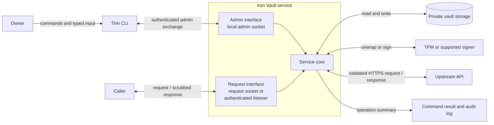
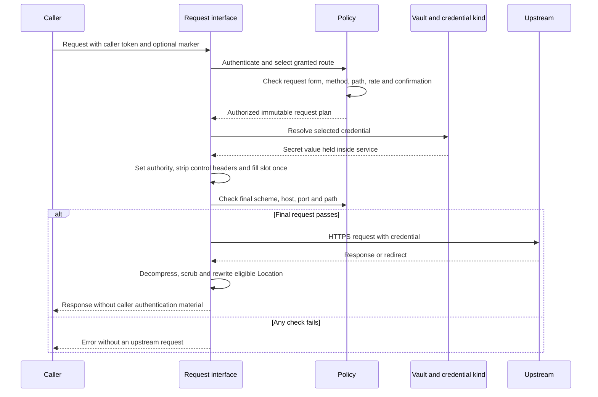
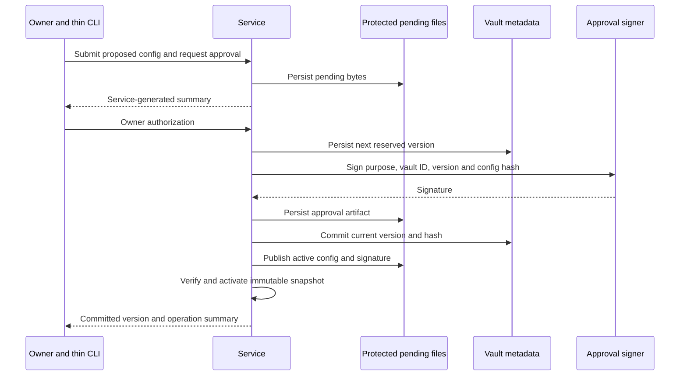
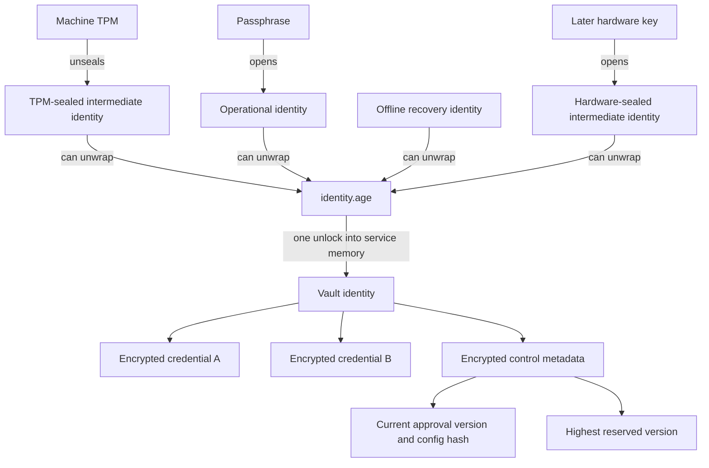
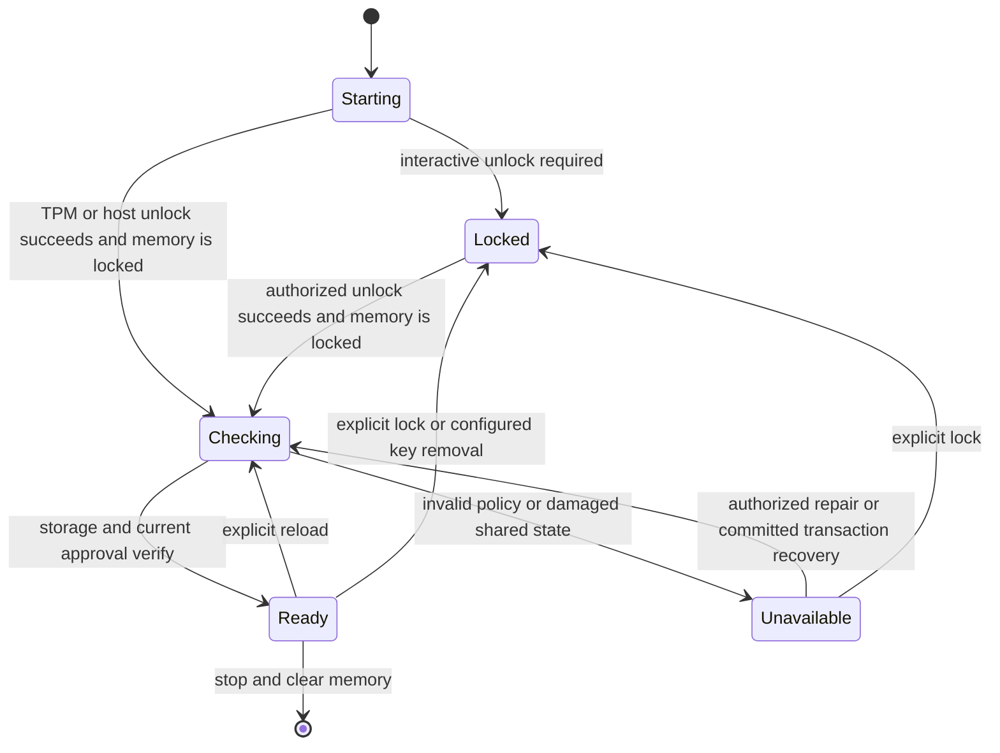

# Iron Vault product specification

Status: product specification, 2026-10-27. 

This document defines the product behavior, security requirements, deployment boundaries, roadmap, and release
checks. It is the authoritative specification. Notes beside the requirements explain the attacks and failures
they address. [Implementation spec §2.1](implementation-specification.md#21-deferred-security-and-compatibility-work) tracks deferred security and compatibility work. “Must” marks a release requirement.
“Later” and “conditional” identify work that does not block v0 unless a deployment uses it.

Table of Contents
1. [Product and scope](#1-product-and-scope)
   _What Iron Vault does, what it keeps out of callers' hands, and who it is for._
2. [Security promise and limits](#2-security-promise-and-limits)
   _What Iron Vault guarantees against callers, and what it cannot prevent._
3. [Terms and definitions](#3-terms-and-definitions)
   _Points to the glossary._
4. [Installation and ownership](#4-installation-and-ownership)
   _The dedicated service account, protected files, and per-platform key integration._
5. [Service and CLI separation of concerns](#5-service-and-cli-separation-of-concerns)
   _Separate request and admin interfaces, who may administer the service, and what the CLI does._
6. [Credential records and configuration](#6-credential-records-and-configuration)
   _What each encrypted credential record holds, and the routes, grants and limits the config defines._
7. [Caller authentication and listeners](#7-caller-authentication-and-listeners)
   _How callers are identified, and the TCP and Unix socket listeners they connect to._
8. [Request flow](#8-request-flow)
   _How the service checks an authorized request, adds the credential and forwards it upstream._
9. [URL, header, and slot rules](#9-url-header-and-slot-rules)
   _Prefix matching, rejecting ambiguous paths, header handling, and where the credential is placed._
10. [Outbound TLS and environment](#10-outbound-tls-and-environment)
    _Verified TLS with fixed trust roots, and no proxy or trust settings taken from the environment._
11. [Responses, redirects, and scrubbing](#11-responses-redirects-and-scrubbing)
    _Scrubbing injected secrets from responses, and never following redirects with credentials._
12. [Configuration approval and reload](#12-configuration-approval-and-reload)
    _Signed, versioned config approval, rollback protection, and reload without a restart._
13. [Vault structure and durable writes](#13-vault-structure-and-durable-writes)
    _One vault identity encrypted to every recipient, and writes that survive a crash or power loss._
14. [Recipients, startup, and memory](#14-recipients-startup-and-memory)
    _The three owner keys, recipient rules, unlocking at startup, and handling secrets in memory._
15. [Service states and errors](#15-service-states-and-errors)
    _The service state machine, and errors that tell lock state, bad policy and damaged storage apart._
16. [Administration, recovery, and migration](#16-administration-recovery-and-migration)
    _The admin commands, recovery with the offline key, and moving a vault to another machine._
17. [Docker, remote servers, and appliances](#17-docker-remote-servers-and-appliances)
    _Deployment rules for desktops and containers, including host unlock and approval signing._
18. [Logging](#18-logging)
    _What request and audit events record, and what must never be logged._
19. [V0 user acceptance](#19-v0-user-acceptance)
    _The checks a v0 release must pass._

- [Feature roadmap](#feature-roadmap): planned features beyond v0.
- [Implementation](#implementation): points to the implementation specification.

## 1. Product and scope

Iron Vault runs a local HTTP proxy that holds upstream credentials and attaches them to authorized requests.
Callers send requests to Iron Vault with a placeholder and, where required, a local caller token. Iron Vault
authenticates the caller, checks its route, supplies the credential, forwards the request over TLS, and returns
the response. Callers never receive upstream credentials through a credential-read API.

The product removes real API keys, passwords, refresh tokens, and signing keys from caller environments,
configuration files, and routine logs. It also centralizes OAuth refresh and request signing. A caller token
only grants local proxy access; operators can revoke it without rotating the provider credential.

### 1.1 Intended users

| User                                              | Required outcome                                                                                   | First phase                         |
|---------------------------------------------------|----------------------------------------------------------------------------------------------------|-------------------------------------|
| Desktop MCP servers and agents                    | Use Brave, AI and SaaS APIs through configurable base URLs without holding real API keys             | v0                                  |
| Naomi back-office applications                    | Allow agents to access online tools without seeing any API keys                | v0                                  |
| Naomi's Google integration                        | Complete consent once, retain the refresh token in the service, and supply access tokens on demand | v1                                  |
| CLI applications such as `gh`, `npm`, and `cargo` | Use the proxy without keeping provider credentials in their own files or environments              | Conditional on compatibility checks |
| Server and appliance operators                    | Run an unattended service with isolated callers and recoverable encrypted storage                  | v0                                  |
| Desktop hardware-key users                        | Unlock the vault and approve changes with PIN and touch                                            | Later                               |

## 2. Security promise and limits

Iron Vault must prevent an ordinary caller from reading stored provider credentials, attaching them to another
origin, or accessing routes that its authenticated identity does not grant. It must reject unapproved configuration
changes and reject a previous configuration paired with its previous approval artifact. Response scrubbing reduces
accidental disclosure when an upstream echoes a secret; it cannot guarantee removal of every transformed secret.

Malware running as the desktop user can read that user's caller tokens and use the same routes. It can also open
any request socket available to that user. Iron Vault limits where those requests go, records their use, and keeps
the provider credential inside the service. It does not promise to prevent authorized-route misuse, malicious
content in API requests, or exfiltration of data that an allowed API returns. Method and path restrictions, rate
limits, and optional owner confirmation reduce this exposure.

The threat model excludes host root, administrators with sudo access, control of Iron Vault's runtime or
memory, and malicious upstream services. Docker-daemon administrators count as host administrators for rootful
Docker. A provider-controlled virtual TPM cannot protect secrets from that provider.

The desktop session can capture secrets that the owner types, replace a user-writable CLI, or falsify a displayed
approval diff. A device touch proves presence, not that the owner saw the intended operation.

## 3. Terms and definitions

See the [Glossary](glossary.md) for the full list of terms and definitions.

## 4. Installation and ownership

On Linux, Iron Vault run as a system service under a dedicated account. Installation
requires administrator access once. Ordinary users must not have access to the service executable, startup
definition, trusted settings, vault, or runtime directory.

| Platform | Required service boundary                                                                                                                | Key integration                                                                                                     |
|----------|------------------------------------------------------------------------------------------------------------------------------------------|---------------------------------------------------------------------------------------------------------------------|
| Linux    | Root-owned package or binary; system service under `iron-vault`; private state at `/var/lib/iron-vault`; sockets under `/run/iron-vault` | TPM through the verified `systemd-creds` host unlock adapter; an in-service adapter with a TPM PIN in a later phase |
| Windows  | Administrator-owned installation; service under a dedicated virtual account; equivalent restrictive ACLs                                 | TPM-backed operations through the Platform Crypto Provider                                                          |
| macOS    | Administrator-owned installation; launchd daemon under a dedicated account; equivalent restrictive permissions                           | Secure Enclave adapter where validated; otherwise interactive passphrase unlock                                     |

### Linux

The Linux state directory has mode `0700`.  The service checks ownership, permissions, containing directories,
and unsafe symlinks before trusting its binary, config, state, or socket paths. Refuse deviations and explain which path failed. 

[`linux-package.md`](linux-package.md) defines the Linux package.

`Development mode` allows installation by a normal user, but it must explicitly report that
it provides no isolation from malware running as that user. It does not qualify as a supported protected deployment.

The service holds an exclusive lock on its state directory. A second writer must fail to start. 
The CLI never writes vault files, calls TPM or hardware-key APIs, or edits active policy directly.

Protected installation files and a separate service identity stop ordinary-user
malware from replacing the vault executable or reading decrypted credentials through that user's process access.
Host administrators remain outside this protection.

## 5. Service and CLI separation of concerns

The service exposes separate *request* and *administrative* interfaces. Request authorization never grants access to
administrative operations.

### Who may administer the service

Only an *admin principal* may use the administrative interface. The admin principals are fixed by the deployment
profile and are never configured:

| Deployment profile | Admin principal |
|--------------------|------------------------------------------|
| Protected | root |
| Container | root on the host |
| Development | the user who runs the service, never root |

In a protected or container installation, no person acts as the service account: only the service itself runs as the `iron-vault` user. 
The service account is never an admin principal, so it doesn't need access to the administrative interface. In particular, 
taking over the service must not deliver administrative access.

The owner's login account is never an admin principal in a protected or container installation, so malware running as
the owner cannot administer the service. The owner acts only by becoming a host administrator, for example through
`sudo`, and that step is only as strong as the host's privilege-escalation settings.

Destructive and policy-changing operations require owner approval, except `reset`, which
[§16](#16-administration-recovery-and-migration) allows on explicit owner or administrator action alone. A borrowed
administrator session alone cannot approve a configuration.

### How the service identifies an admin principal

The local admin socket identifies the connecting OS account from its peer credentials, nothing else. Source ports,
executable names and caller-supplied identity headers never establish administrative identity. A connection that
reaches the socket through an SSH forward is judged by the account it arrives as on the service host: a forward made
with a root login is root, and a forward made with any other login is that login.

The admin socket's permissions must admit only admin principals. The peer-credential check refuses every other account
even if those permissions are wrong.

The CLI must send owner input only to the service. No account but the service account may serve at the admin socket's
path. Anything running as the service account is treated as the service, because the service already receives the vault
and approval passphrases and every other owner input.

### Container installations

The service runs alone in its container, as a dedicated service account that has the same uid and gid in the image and
on the host. It refuses to start as any other account.

- Root on the host is accepted, whether it connects directly (`sudo iron-vault`) or through an SSH forward made with a
  root login.
- User-namespace remapping and rootless container runtimes are unsupported. Under them, host root does not arrive as
  uid 0 and no account could administer the service ([docker-compose.md](docker-compose.md)).

_Note_: The compose design lists "the fixed uid and gid" as an open question (item 1). The image, the Compose file and
the sysusers.d line must all carry the same numbers.

Anyone who controls the container runtime, such as the Docker daemon, can replace or inspect the service. That is
runtime administration by a host administrator, which the threat model excludes (§17).

### CLI

The CLI sends commands to the service.
The CLI may hold values that the owner enters, but it must not receive stored provider secrets, private signing keys, 
refresh tokens, or PKCE verifiers.
Prompted values must not appear in arguments, shell history, command diagnostics, or normal logs.

The service accepts configuration approvals only from signing operations that it initiated.

Approvals cannot be created simply by loading a config, at startup or on reload. It only checks that the published 
`config.toml` and `config.toml.sig` are the pair the service itself committed.

The service never serves a pair that fails any of these checks, even one with a valid signature. That rules out an
older approved pair and a version that was signed but never committed (§12).



The service must produce its own approval summary, including changed callers, route grants, destinations, restrictions,
and the committed version. In v0 the summary goes to the command's result and the audit log. 
The service must not treat the CLI's displayed summary as evidence of
what it signed. Device enrollment and access controls must prevent untrusted processes from using Iron Vault's keys
where the platform supports that restriction. 

**Attack mitigated.** Keeping private keys and stored secrets in the service removes them from a compromised
CLI's memory. Accepting only service-initiated approvals prevents an attacker from submitting a signature obtained
through an unrelated device operation. Neither control protects newly typed secrets or makes a fake CLI display trustworthy.

## 6. Credential records and configuration

The service encrypts and authenticates these fields together in each credential record:

- GUID, unique name, kind, and secret material.
- Exact permitted upstream hosts and permitted ports; HTTPS is mandatory.
- Provider settings, including token endpoint, OAuth scopes, client-credential reference, and account identity when applicable.
- Trusted source metadata and any future source-command definition.
- Operational state, such as a durable refresh-in-progress marker when OAuth is added.

The service sets these fields during `add`, `login`, or an explicitly authorized replacement. Changing allowed
hosts, ports, token endpoint, scopes, or source execution settings requires re-entry of the credential or a new
login and owner authorization. A configuration edit cannot make an existing secret eligible for a new origin.
Automatic token rotation preserves these restrictions.

Configuration contains:

- **Listeners:** the Unix sockets and TCP addresses callers connect to. Separate listeners let each caller, or each
  container network, reach Iron Vault through its own endpoint.
- **Caller identities:** how the service recognises each calling program, by Unix peer account, caller token or
  dedicated listener, so grants attach to a verified caller.
- **Grants:** the routes each caller may use. A caller can reach only the APIs it was granted, so one compromised
  program cannot use every stored credential.
- **Routes:** each maps a path prefix on Iron Vault to one upstream base URL and one credential. An application changes
  only its base URL and sends requests as it normally would.
- **Slots:** where the route places the credential: a named header, a named query parameter, or Basic authorization.
  This matches each provider's expected authentication format without the caller ever handling the secret.
- **Method and path restrictions:** the HTTP methods and upstream paths a route allows. They limit a credential to the
  operations a caller needs, for example read-only `GET` requests on a few endpoints.
- **Rate limits:** a token bucket per route, optionally tightened per caller. They cap how fast a misbehaving or
  compromised caller can spend quota, run up cost or extract data.
- **Confirmation rules:** whether each request on a route needs the owner's touch on a security key. v0 refuses a
  config that sets `confirm = "touch"` when it is read, because no confirmation provider exists yet.
- **CA references:** paths to administrator-installed CA certificates that a route trusts instead of the built-in roots.
  They let Iron Vault reach a self-hosted upstream with a private CA, still over verified TLS.

Configuration contains no provider secrets or credential-record definitions. Every upstream reference must match its
record before activation and immediately before sending a request. OAuth token requests later follow the same
restriction.

`add` must reject an existing name. 

`replace`, `rm`, and login over an existing record require owner presence through
the [approval mechanism](config-approval.md). 
Removal MUST NOT let a caller silently rebind the old name to an attacker's account. 
The service records replacement as a new authorized record identity and checks affected grants. Only the service may
plant or index encrypted record files: `age` encryption does not authenticate the sender of a newly created file.

**Attacks prevented.** Binding destinations to the encrypted record prevents a route edit from sending
an existing credential to an attacker's host or token endpoint. Explicit replacement authorization prevents
malware from silently replacing a user's account with the attacker's account under the same credential name.

The following TOML illustrates the product schema. The implementation must version and validate the schema before
release. Credential enrollment supplies allowed origins separately.

```toml
schema_version = 1

[listeners.local]
unix_socket = "/run/iron-vault/proxy.sock"

[callers.fx-mcp]
listener = "local"
auth = "peer"
user = "fx-mcp"
routes = ["fx"]

[listeners.loopback]
address = "127.0.0.1:7878"

[callers.brave-cli]
listener = "loopback"
token_hash = "blake2b:..."
routes = ["brave"]

[callers.naomi-backoffice]
listener = "naomi-backoffice"
auth = "isolated-network"
routes = ["venice", "brave"]

[listeners.naomi-backoffice]
address = "10.20.0.2:7878"
tls_certificate = "/etc/iron-vault/tls/server.crt"
tls_key = "/etc/iron-vault/tls/server.key"

[routes.fx]
prefix = "/fx"
upstream = "https://api.fx.example"
credential = "fx_key"
slot = { query = "access_key" }
methods = ["GET"]
paths = ["/latest", "/historical/**"]
rate_limit = { requests = 60, per_seconds = 60, burst = 10 }

[routes.venice]
prefix = "/venice"
upstream = "https://api.venice.ai/api/v1"
credential = "venice"
slot = { header = "Authorization", format = "Bearer {}" }
methods = ["POST"]
paths = ["/chat/completions"]
rate_limit = { requests = 120, per_seconds = 60, burst = 20 }

[routes.brave]
prefix = "/brave"
upstream = "https://api.search.brave.com"
credential = "brave"
slot = { header = "X-Subscription-Token" }
methods = ["GET"]
paths = ["/res/v1/web/search"]
rate_limit = { requests = 60, per_seconds = 60, burst = 10 }
```

The non-local listener above requires TLS even on an internal Docker network. A local-only installation omits that
listener and its caller. Operators obtain caller tokens through the admin interface. 
The service stores a cryptographic hash of each generated high-entropy token, never its plaintext value.

Each route MUST declare a method allowlist, path restrictions, and a rate limit. 
Operators MAY explicitly choose `paths = ["/**"]` when the application needs unrestricted paths. 
The service must not infer broader grants from missing restrictions. 
It rejects unknown fields, unresolved references, duplicate names, ambiguous route matches, invalid patterns, 
unsafe upstream URLs, and unavailable confirmation policies.

Path patterns match the normalized request path below the upstream base path, excluding its query: the segments after
the route prefix, as the provider documents them. The service prepends the base path when it forwards the request. A
literal segment matches itself; `*` matches one segment and `**` matches zero or more complete segments. Matching
covers the whole path. The service must use the same path representation for authorization and forwarding.

## 7. Caller authentication and listeners

The service supports these caller identities:

| Mechanism               | Identity rule                                                                                        | Limits                                                                     |
|-------------------------|------------------------------------------------------------------------------------------------------|----------------------------------------------------------------------------|
| Unix peer account       | The OS account the kernel reports for the process connecting to a Unix socket is the caller's `user` | Every process running as that account can use its routes; Unix sockets only |
| Caller token            | A high-entropy token in `Proxy-Authorization` or a configured dedicated header matches a stored hash | Same-user malware can steal caller tokens; tokens never grant admin access |
| Isolated Docker network | A dedicated listener address identifies one caller network                                           | Requires one internal network per caller and no shared caller bridge       |

Who can connect to what is specified wholly in the `config.toml` (see an example above).

### TCP

TCP connections don't carry account information. So a TCP caller must provide a caller token or use an isolated-network 
listener.

### Unix sockets

On a Unix socket, callers run as their OS account (`auth = "peer"`), or present caller tokens. Example configuration:

```toml
[listeners.local]
unix_socket = "/run/iron-vault/proxy.sock"

[callers.fx-mcp]
listener = "local"
auth = "peer" # Dictates who may connect. May NEVER be root, iron-vault or the `nobody`.
user = "fx-mcp"
routes = ["fx"]
```

Peer callers share a socket only with other peer callers, one caller per account.
A peer caller's `user` is resolved to a uid when the configuration is activated. 
The `user` may not be root, the service account (`iron-vault`) or one that resolves to the overflow uid 
(65534 or `nobody` by default); activation rejects a configuration that sets one.
[`multiuser-linux.md`](../book/src/installation/multiuser-linux.md) walks through a workstation that separates work by OS account.

**Attack mitigated.** Peer-account identity bounds malware in one account to that account's granted routes,
without a token file for it to steal.

### Caller bearer tokens

Token enrollment returns a fresh caller token once to the authorized owner. Revocation and rotation take effect
through an approved policy update; they never require a provider-credential rotation. The service compares token
hashes in constant time.

### Connections

Default to a request socket under `/run/iron-vault`, plus a separate admin socket in that service-owned directory.

Other accounts may search that directory but never write to it, so they can reach a request socket but cannot
replace one.

For TCP on Linux, use `systemd` socket activation so the manager holds the port from boot and across restarts. 

A container installation cannot receive sockets from the host, so it binds its TCP listeners itself, inside its own network
namespace. The addresses exist only in that namespace, which no other container shares and where no other process runs;
caller containers MUST NOT carry `NET_ADMIN` nor `NET_RAW` and each has its own static address.

Disabling these flags is mandatory because an isolated-network caller has no token. Iron Vault knows who it is only because the request 
arrived on that caller's own listener on the private network shared only by that caller and Iron Vault. 
This only works if a caller can't make its traffic look like it came from somewhere else or went somewhere else. These flags break
that in two ways:

1. Impersonating another caller. Linux accepts a packet for any of its addresses on any interface. With NET_RAW, caller A could hand-craft  
   a packet addressed to caller B's listener address and send it through A's own network.  Iron Vault would receive it on B's listener and 
   treat it as B, granting B's routes. With NET_ADMIN, A could add a route that achieves the same thing.
2.  Taking over Iron Vault's address. While Iron Vault is stopped or restarting, a caller with NET_ADMIN could add Iron Vault's listener 
    address to its own interface. With NET_RAW, it could send ARP replies claiming that address. Other traffic on that network would then 
    go to the caller instead of Iron Vault.

Every non-loopback listener uses TLS. This is verified at config load. TLS ensures that whoever claims an address while the service 
restarts still cannot present Iron Vault's certificate. A loopback listener is reachable only inside that namespace.
Supported TCP packages on other platforms must provide equivalent listener ownership or an authenticated transport
that prevents a replacement local process from impersonating Iron Vault. Privileged port numbers alone do not solve
port squatting.

WireGuard or Tailscale can protect an additional network path, but their addresses do not bypass this listener rule. An SSH-forwarded Unix 
socket preserves the local socket interface. Remote callers still authenticate, and operators may add source-address
allowlists as an additional restriction.

**Attack prevented.** Authenticated TLS prevents a network observer from reading caller tokens and request
bodies or modifying traffic to a non-local listener. Caller authentication still determines which routes it may use.

For Docker callers, bind a distinct listener to each isolated network, map identity from the local listen address,
and drop `NET_RAW` from caller containers. Do not establish identity from source IP on a shared bridge. Caller
containers must not receive Docker's management socket or access to Iron Vault's private files.

**Attack mitigated.** Isolated caller networks, listener-based identity, and removal of `NET_RAW` prevent
ordinary sibling-container address spoofing from becoming another caller's identity. Source IP on a shared bridge
does not provide that protection.

An alternative to configuring 1 network per service is to give services caller tokens over TLS. With tokens, several callers could share 
one network and one listener, and the token would identify each caller. It's configuration, but it gives up two things:

- Each caller holds a secret that malware inside it could steal. An isolated-network caller has nothing to steal.
- Callers on the same network can reach each other.

Note that with multiple networks, docker can be configured so that all networks share a single TLS certificate, reducing the amount of 
configuration.

## 8. Request flow

Iron Vault must forward authorized requests itself. It must not redirect the caller to the upstream to obtain a
credentialed response. It does not follow upstream redirects with credentials attached.

For example, the caller sends `GET /fx/latest?base=USD` to the local request socket or the optional authenticated
loopback listener at `127.0.0.1:7878`. Iron Vault sends
`GET https://api.fx.example/latest?base=USD&access_key=<stored-key>` over TLS. The placeholder above describes the
upstream request; the service never returns that secret-bearing URL to the caller or writes it to a log.



The service executes these steps in order:

1. Enforce request size, header size, connection, and timeout limits.
2. Accept origin-form request targets only; reject `CONNECT`, absolute-form, authority-form, and unsupported upgrades.
3. Authenticate the caller and select a route that the caller may use.
4. Normalize and validate the path, select the method, and apply the route's restrictions.
5. Charge the route's rate limit and any stricter caller limit, then obtain required owner confirmation before credential resolution or
   sending.
6. Resolve the credential selected by the route; NEVER select one from a caller-supplied marker.
7. Construct the URL structurally, remove control headers and caller auth, and fill the slot exactly once.
8. Apply the final outgoing-request check to the actual request about to leave the service.
9. Send over authenticated TLS with automatic redirects and ambient proxies disabled.
10. Process the response, return it to the caller, and write a redacted request event.

Rate limits apply to each route in aggregate across its callers; an operator may also set stricter limits for a
caller/route pair. The service uses token buckets with the configured refill rate and burst capacity, checks them
before upstream work, and returns `429` when either limit is exhausted. Concurrent requests cannot exceed a bucket
through races. Buckets start empty, so repeated restarts cannot replenish an allowance instantly.

## 9. URL, header, and slot rules

The policy must match route prefixes on complete segments. `/fx` matches `/fx` and `/fx/...`; it must not match
`/fx.evil.example` or `/fx@evil.example`. The service parses the configured upstream once and appends validated
remaining path segments through a URL API. It never concatenates untrusted text into a URL string or joins a
caller-supplied absolute URL.

Reject traversal and ambiguous paths before URL normalization can erase the evidence. This includes dot segments,
percent-encoded dots, slashes or backslashes, literal backslashes, NUL, malformed escapes, repeated interior empty
segments, and encodings that another decoding pass could reinterpret as these characters. A root path and one
trailing slash remain valid. The service must not let a request escape the upstream's configured base path.
Property tests must cover raw, mixed-case encoded, and double-encoded hostile paths.

Immediately before sending, `iron-vault-policy` must check the actual request for all of the following:

- Scheme equals `https`; no user-info component or caller-controlled authority exists.
- Host exactly matches a permitted host in the credential record after one canonical host conversion; suffix matching never grants access.
- Port matches both the configured upstream and the credential's allowed port; omitted HTTPS ports mean 443.
- Path stays inside the upstream base path and matches the authorized method/path decision.
- `Host` or HTTP/2 `:authority` and TLS server-name verification refer to the selected upstream.

A final-check failure indicates a policy or construction defect. The service must refuse the request, emit a
redacted high-severity event, and send no credentials. Every later credential kind and token-endpoint request must
use this boundary too.

The service must remove caller authentication before forwarding. It controls `Host`/`:authority`; it never copies
the caller's value. It removes hop-by-hop headers, headers named by `Connection`, forwarding headers such as
`Forwarded` and `X-Forwarded-*`, method-override headers, and URL-rewrite headers. The implementation maintains an
explicit, tested denylist, including `X-HTTP-Method-Override`, `X-Method-Override`, `X-HTTP-Method`, `X-Original-URL`,
and `X-Rewrite-URL`. It rejects ambiguous framing rather than interpreting conflicting lengths differently from
the HTTP stack.

The configured slot is the only injection location:

- Header slot: remove every occurrence of that header, regardless of case, then write one generated value.
- Query slot: parse query parameters structurally, remove every occurrence of the selected parameter, then insert one encoded value.
- Basic slot: remove caller `Authorization` headers and write one `Basic` value derived from the stored username and password.

For caller-forwarded requests, the service never inserts credentials into a body, URL path, unrelated header, or
unrelated parameter. Service-owned OAuth exchanges may send credentials in a provider-defined body, but only to
the separately enrolled token endpoint ([future spec §1.1](future-specifications.md#11-service-owned-consent)). Header formats must have one substitution point and must not permit
CR or LF injection. Slot names must not collide with caller-authentication headers or transport-control headers.
A marker that names another credential in the selected slot causes rejection. A missing or ordinary SDK
placeholder may be replaced by the
route's selected credential. Markers outside that slot remain inert text, including markers in issue titles,
Gmail drafts, or arbitrary JSON bodies.

**Attacks prevented.** Structural URL construction and the final HTTPS origin check stop hostile
paths, alternate request targets, and cleartext upstream settings from diverting a credential. Service-controlled
authority and stripped override headers prevent domain fronting and method-override bypasses of route policy.
Slot-only injection prevents an attacker from placing a marker in an issue title,
email body, or other published content and causing the upstream to store the real credential there.

## 10. Outbound TLS and environment

The outbound client must disable environment proxy discovery, including `HTTPS_PROXY` and `ALL_PROXY`; the Rust
adapter must use `reqwest::ClientBuilder::no_proxy()`. The client must use built-in trusted roots such as
`webpki-roots`, or an explicitly configured administrator-owned CA file. It must not inherit trust roots from
`SSL_CERT_FILE`, `SSL_CERT_DIR`, or desktop-controlled stores.

The service must verify certificates and hostnames. It must provide no option that disables these checks. A route
may reference an administrator-installed pinned CA for a self-hosted upstream, without changing its permitted
origin. The package must disable raw connection logging and cap HTTP/TLS dependency log verbosity in code,
regardless of `RUST_LOG` or other ambient logging settings.

**Attack prevented.** Ignoring ambient proxies and trust roots stops a user-controlled environment from
redirecting requests through an attacker-trusted TLS interceptor. Hard log caps prevent a verbose setting from
turning secret-bearing HTTP traffic into readable logs.

## 11. Responses, redirects, and scrubbing

The service scrubs exact occurrences of each secret value it actually injected, including complete Basic values,
the underlying username/password combination where appropriate, URL-encoded forms, and base64 encodings. It must
cover response headers, bodies, streamed bodies, and server-sent events. It must account for representation-specific
canonical forms where meaningful, including hex case variants, without case-folding arbitrary case-sensitive keys.

For each match pattern of length `n`, the streaming scrubber retains up to `n - 1` bytes across chunk boundaries;
the implementation uses the longest active pattern to set its overlap. It must not emit a possible secret prefix
before deciding whether the next chunk completes a match. It releases the remaining safe bytes at end of stream.

The service decompresses supported compressed responses before scrubbing. It recompresses only when the caller's
accepted encoding or application compatibility requires it. It updates encoding, length, and integrity-related
headers to match the emitted body. It enforces decompressed-size and resource limits; it must not bypass scrubbing
by forwarding an unsupported content encoding opaquely. Removing `Accept-Encoding` alone does not meet the
decompression and scrubbing requirement.

Scrubbing does not claim complete protection against partial keys, arbitrary JSON Unicode escapes, application
transformations, or malicious upstreams. It is a backstop after destination control. A scrub event identifies the
route and credential, never the matched bytes. Tests must cover chunk boundaries, encodings, compression, and
unchanged traffic that contains no secret.

The client must never follow an upstream redirect automatically. Before returning `Location`, the service resolves
relative references against the actual upstream request URL. It rewrites a same-origin destination that stays
within the configured upstream base path back under that route's proxy prefix. A same-origin redirect outside
that base path must fail explicitly rather than accidentally enter another local route. A destination on another
origin remains directed to that origin, subject to response scrubbing. The redirect must not carry an injected
credential back to the caller. The service never invents a credential-bearing redirect to replace proxy forwarding.

**Leak reduced.** Scrubbing removes supported secret representations that an upstream echoes into a
response, including across stream chunks. It cannot reliably remove arbitrary transformations or partial keys.

**Failure prevented.** Rewriting eligible relative redirects keeps the caller on the intended proxy route.
Refusing automatic redirect following also prevents a redirect from carrying the injected credential to another origin.

## 12. Configuration approval and reload

The service keeps the active config, pending config, and signature artifacts in service-owned storage. The owner
submits proposed bytes through the admin interface; the service writes `config.toml.pending`, validates it, and
produces its own summary. A byte change, including whitespace or comments, requires a fresh approval.

The signed payload must encode these fields without ambiguity:

| Field            | Required value                                             |
|------------------|------------------------------------------------------------|
| Purpose          | `iron-vault-config-v1`                                     |
| Vault identifier | The stable GUID of this vault                              |
| Approval version | A positive unsigned 64-bit integer reserved by the service |
| Config digest    | Blake-2b of the exact pending bytes the service reviewed    |

The service chooses and documents one deterministic, versioned payload encoding. The signature envelope carries
that payload and the supported signature-algorithm identifier. The service pins the approver's public key and
algorithm inside protected vault metadata; it must not trust a key supplied in the config or signature file. When the
owner enrolls more than one approval signer ([§14](#14-recipients-startup-and-memory)), the service pins each, and a
signature from any pinned approver verifies.
TPM, YubiKey, and software signers use the same envelope and verification rules.

The TPM approval key must remain separate from the vault-unwrapping key. Its PIN authorizes signing, while the
normal TPM vault-unwrapping profile may start unattended. The TPM must limit approval PIN guesses with its
dictionary-attack lockout; the approval key must never be created exempt from it. The service must use a protected
authorization session. It must not persist or cache the typed approval
PIN. The device retains its authorization secret internally. A software signer must encrypt its private key under
a separate approval passphrase and decrypt it only inside the service for the approval operation.

The service keeps two distinct values in protected metadata: the highest reserved version and the current committed
approval `(version, hash)`. Initialize the highest reserved version to zero only when creating a new vault; reserve
version 1 for the first approval. Serialize all approvals and persist a reservation before signing. Failed attempts
consume their versions. Never reuse a version, reset it on restart or signing-key replacement, or wrap on overflow.
`iron-vault reset` discards a vault with its approval state, and the `init` after it creates a new vault, which starts
at zero. Counter exhaustion must fail without signing.

The approval transaction must follow this order:

1. Write and fsync the pending config and its directory. Validate it and retain the same immutable byte snapshot for review and signing.
2. Authenticate the owner, show the service-generated summary, and durably reserve a higher version.
3. Sign the pending hash and reserved version with the approved signer; require touch when the signer policy requires it.
4. Durably stage the signed artifact beside the pending config in protected storage.
5. Atomically commit the new current `(version, hash)` in vault metadata, using the durable write procedure in [§13](#13-vault-structure-and-durable-writes).
6. Publish the pending config and artifact as `config.toml` and `config.toml.sig`, fsync their directory, and activate the verified
   snapshot.

Pause new request admission before committing the new current approval, then switch to its verified immutable
policy snapshot before resuming. Never admit new requests under the previous policy after that commit. Operations
already sent upstream remain subject to the cancellation limits below.



Multiple file renames do not form a filesystem transaction. On restart, the service may finish publishing only
when the protected staged files match the current committed version and hash and their signature verifies.
If it cannot complete that committed transaction, it must remain unavailable. It must never promote a merely
signed but uncommitted future version or fall back to an older committed version. Uncommitted files may be discarded;
their reserved counters remain consumed. Audit events must distinguish a reserved version from a completed approval.

At startup and explicit signal-triggered reload, the service must verify the purpose, vault identifier, signature,
exact config hash, and equality with the current committed version and hash. It must also validate all credential
references and route restrictions. An unknown credential reference invalidates the proposed config. A known record
that is damaged or needs login makes its routes unavailable without disabling unrelated healthy routes. Missing
or corrupt shared metadata, an invalid signature, a previous version, or an
uncommitted higher version stops proxying with `503`. The service warns the owner and does not retain old route
policy after a failed reload. It must gate new requests immediately and cancel or stop outstanding work where the
transport permits; it cannot retract a request that already reached the upstream.

To restore earlier configuration contents intentionally, the owner approves them again at a new higher version.
Loading never advances the counter or repairs missing trusted state from a caller-supplied artifact. Signing-key
rotation requires administrator or existing-owner authorization, invalidates the previous active signature until
reapproval, and preserves the vault's counter history. Note that the first approval with the new key will require a 
counter increment.

The counter protects against replacement of config and signature files while private service state remains intact.
An attacker who restores the entire vault or disk can also restore that counter. Protection against whole-storage
rollback requires independent trusted state, such as a TPM NV counter or an external authority, and remains outside
v0. The shared signature flow does not itself provide that stronger guarantee.

**Attack prevented.** Signing both the config hash and version prevents an attacker from substituting a different
config or editing an old approval's version. Matching the committed state rejects an old config/signature pair.

**Failure prevented.** Durable staging and recovery of only the committed transaction prevent a crash
between config and signature publication from activating an unsigned or uncommitted configuration. The service
can finish the exact committed update after restart; otherwise it stays unavailable.

## 13. Vault structure and durable writes

The service generates one `age` X25519 vault identity. It encrypts that identity into `identity.age` for every
enrolled recipient. Every recipient of `identity.age` is an X25519 recipient key. A hardware-backed recipient (TPM,
YubiKey, Secure Enclave) or a passphrase reaches the vault through an intermediate identity: a generated X25519
identity whose recipient key is enrolled in `identity.age` and whose private key is kept in a separate file that only
that device or passphrase can open. 

In other words, there is one master key to unlock the vault. Each recipient gets a personalized encrypted copy of the 
master key, which they use to unwrap the vault key and access credentials. See the [recipient design](recipients.md) for 
details.

Adding or removing any recipient therefore needs only public keys, never the
hardware or a plugin program, and `identity.age` never carries a stanza type other than X25519. It encrypts each
credential record into a separate file for the vault identity's public key.
The vault also contains encrypted control metadata for approved signer keys, approval counters, committed policy,
record indexing, and transaction recovery. Corruption of one credential must not require replacing every other
credential. Corruption of shared identity or control metadata may require recovery; the service must say so.



The private vault identity remains inside service memory while unlocked. TPM or YubiKey startup requires one
hardware operation to open its intermediate identity and one identity unwrap, not one hardware operation per
credential. 
The service clears the intermediate identity as soon as the vault identity is unwrapped. 
Public-key encryption lets the service write a new credential without a fresh unwrap. 
Rewrapping the vault identity changes recipients without re-encrypting every credential, but it does not revoke access to 
previously copied ciphertext.

A copy of `identity.age` opens with any key that was its recipient when the copy was made. Removing a recipient therefore protects only
later copies:

- A key removed because it is lost or no longer needed needs nothing further.
- A key removed because it may have leaked makes every earlier copy readable by whoever holds it. The owner must
  rotate each provider credential at its provider and `replace` it in the vault; only that makes the old ciphertext
  worthless.

The service alone writes vault and control files and holds the state-directory lock throughout its lifetime. It
serializes conflicting management and refresh operations. For every durable replacement, it must write a private
temporary file in the destination filesystem, fsync that file, rename it into place, then fsync the containing
directory. Deletions and transaction-marker changes also require the appropriate directory fsync. Recovery must
never depend on a CLI process completing a write.

**Failures prevented.** A single writer and exclusive lock prevent competing updates from
silently replacing each other. Separate record files contain the damage from one failed record write. File and
directory fsync preserve a completed replacement across power loss; an atomic rename alone does not ensure durability.

Use service-owned manifests and record identities to detect missing or substituted records. Authenticated encryption
protects file contents, but anyone who knows a public recipient can create new encrypted ciphertext; directory
ownership and the service's index authorize which records exist. The service must report a damaged credential and
refuse requests that need it without silently substituting another record.


## 14. Recipients, startup, and memory

The owner holds three keys, each with one job:

| Key             | Job                                                                                                                                                                     | Used                                       |
|-----------------|-------------------------------------------------------------------------------------------------------------------------------------------------------------------------|--------------------------------------------|
| Unlock method   | Opens the vault identity into service memory                                                                                                                            | Once per service start                     |
| Approval signer | Proves owner presence: approves a config ([§12](#12-configuration-approval-and-reload)) and authorizes sensitive changes such as `replace`, `rm` and `recipient remove` | At each sensitive operation                |
| Recovery key    | Opens the vault identity when the unlock method is lost or broken                                                                                                       | Rarely; kept offline, e.g. printed as a QR |

The unlock method and the approval signer can each be a passphrase, a TPM or a hardware key. They are independent
choices, and none is the default:

| Method       | Unlock                              | Approval signer                           | Reasons to choose it                                                                                                                                                        | Phase       |
|--------------|-------------------------------------|-------------------------------------------|-----------------------------------------------------------------------------------------------------------------------------------------------------------------------------|-------------|
| Passphrase   | Typed by the owner after each start | A separate approval passphrase            | Needs no hardware and works on every platform. Moves with the vault. Only as strong as the passphrase, and the service stays Locked after a restart until the owner returns | v0          |
| TPM          | Unattended; a TPM PIN comes later   | A TPM signing key with a PIN              | Restarts without the owner. The key cannot be copied off the machine, but it fails with the machine                                                                         | v0, to come |
| Hardware key | PIN and touch                       | A hardware signing key with PIN and touch | The key cannot be copied, moves between machines, and a touch shows the owner is physically present. The device must be at hand for every start                             | Later phase |

A method is offered only after it passes its release checks on that platform
([implementation spec §3](implementation-specification.md#3-implementation-gates-and-unresolved-details)); the
passphrase is available everywhere. Each method reaches the vault through its own intermediate identity
([§13](#13-vault-structure-and-durable-writes)), so adding or changing one rewraps `identity.age` and touches no
credential. Later platform methods, such as the macOS Secure Enclave or a service-account keyring, are in
[future spec §2.4](future-specifications.md#24-later-platform-work).

**Two ways in at all times.** Every vault must keep at least two independent ways to open its vault identity: the
unlock method and an offline recovery key. Initialization generates the recovery key and shows it once. The recovery
key opens the vault without the unlock method's secret or device, so a forgotten passphrase, a dead TPM or a lost
hardware key never strands the vault. No recipient change may leave fewer than two ways in
([§16](#16-administration-recovery-and-migration)). A key bound to one machine, such as a TPM or a host unlock
identity, never counts as recovery.

**Approval is separate from unlock.** Unlocking the vault never grants approval, and the approval signer never opens
the vault. A stolen unlock secret alone therefore cannot change route policy or replace credentials. The owner should
choose a different kind of method for each, for example TPM unlock with a hardware-key signer, so that one stolen
device or secret yields neither; the service recommends this but does not enforce it. An operation may also ask for the
unlock method again, as migration does ([§16](#16-administration-recovery-and-migration)).

**More than one approval signer.** The owner may enroll several approval signers, of the same kind or different
kinds, each with its own label: for example a passphrase and two hardware keys. Any one of them gives owner presence.
The prompt names the signer it is waiting for and lets the owner switch to another, for example
`Tap "Dave YubiKey 3" to approve. Ctrl-Y to try another way.` Enrolling or removing a signer needs the authorization
[§12](#12-configuration-approval-and-reload) sets for signing-key rotation, and no change may remove the last one.

**TPM unlock.** The TPM opens only the intermediate identity; credentials stay on disk, not in TPM storage. A TPM
proves which boot policy started the machine, not who is using it:

- On a portable device, TPM unlock should be combined with a second secret: a full-disk-encryption pre-boot PIN or a
  TPM unlock PIN. The approval signer's PIN does not count. Without one, setup must warn that anyone who steals the
  device can start its vault, name the remedy, and continue only when the administrator accepts that risk.
- A server or appliance may unlock unattended if its deployment accepts that anyone with physical access and a
  trusted boot image can start it.
- A routine firmware update must not strand the vault.
- The TPM does not know which program is asking. Only root, through the host's init system, may read or unseal the
  service's TPM-sealed credential; the service account never opens the TPM. On Linux the host unseals a host unlock
  identity with `systemd-creds` and hands it to the service, as in [§17](#containerised-deployments). The package must
  document the hardware and firmware policy it provisions.

**Memory.** The service must keep secrets out of logs, dumps and swap:

- Hold secrets in types that hide them from debug output and clear them when dropped. Minimize copies, and clear
  cached values on lock or replacement.
- Lock memory before any secret enters it. A protected install must not unlock unless locking succeeded: it stays
  Locked, attempts no unattended unlock, refuses `unlock` with an error naming the cause, and reports it in `status`
  and the audit log ([§15](#15-service-states-and-errors)). The [Linux package](linux-package.md) and the
  [Compose profile](docker-compose.md) set the limits locking needs, so a failure there means the installation was
  changed or the host refused. Development mode reports the failure and continues. No profile may claim swap
  protection when locking failed. There is no override: an approved config can't be verified until the vault is
  unlocked, and unlocking is the moment the protection is needed.
- Disable core dumps and crash reporters that capture service memory.
- Memory locking does not stop hibernation capturing RAM. Installation guidance must require encrypted swap and
  hibernation storage, normally through full-disk encryption, whenever either is enabled.

**Failure prevented.** The offline recovery key keeps a lost secret or failed device from making the vault unusable.

**Leak mitigated.** Disabling dumps, locking memory and encrypting swap and hibernation storage reduce the chance
that a memory capture leaves plaintext credentials on disk. Refusing to unlock without locked memory keeps a changed
unit or container limit from silently removing the protection.

**Attack mitigated.** A second secret at boot or unlock stops a thief from starting a stolen laptop's vault with only
a similarly trusted boot image. A separate approval signer stops a stolen unlock secret from changing policy.

## 15. Service states and errors

The service must distinguish lock state, invalid policy, damaged storage, and individual credential failure.
The request interface may remain bound through safe startup failures so callers receive an explicit status.
The admin interface must remain available for authorized recovery where the service can safely operate.



| Condition                                                       | Behavior                                                                                                        |
|-----------------------------------------------------------------|-----------------------------------------------------------------------------------------------------------------|
| Missing or invalid caller authentication                        | Return `401`; disclose no credential information                                                                |
| Authenticated caller lacks route or violates route restrictions | Return `403`; send no upstream request                                                                          |
| Malformed request target, framing, or marker mismatch           | Return `400`                                                                                                    |
| No matching route                                               | Return `404` without disclosing another caller's grants                                                         |
| Rate limit exhausted                                            | Return `429` with a safe retry indication                                                                       |
| Vault locked or policy/approval invalid                         | Return `503` with a redacted reason                                                                             |
| Credential damaged or later OAuth record needs login            | Return `503` for affected routes; keep unrelated healthy routes available                                       |
| Upstream transport or TLS failure                               | Return `502`, or `504` for timeout, without raw secret-bearing client diagnostics                               |
| Supported size limit exceeded                                   | Return `413` for requests; fail oversized response processing without returning unscreened secret-bearing bytes |

A healthy TPM service restarts unattended using a policy such as `Restart=on-failure`. Passphrase-only and later
YubiKey-only profiles remain locked until the owner supplies the required input. The YubiKey profile reports
`locked: needs a touch` and notifies the owner. The implementation must verify how unclean power loss affects its
chosen TPM session and dictionary-attack state; it must not assume that repeated power loss cannot cause lockout.

In a protected install whose memory is not locked, the service remains Locked. Requests receive `503` with reason
`locked`, `status` reports the memory protection failure, and `unlock` is refused with `memory-unprotected` before
any unlock factor is used. The service has not failed, so `Restart=on-failure` does not restart it. It waits for an
administrator to correct the limit and restart it.

**Failure prevented.** Explicit startup states keep a missing interactive unlock from becoming a silent
fallback to weaker storage or an unexplained service failure. Hardware-specific power-loss behavior remains a
release check in [implementation spec §3](implementation-specification.md#3-implementation-gates-and-unresolved-details).

## 16. Administration, recovery, and migration

| Command                                          | Required behavior                                                                                                    | Phase                                     |
|--------------------------------------------------|----------------------------------------------------------------------------------------------------------------------|-------------------------------------------|
| `iron-vault init`                                | Create protected state, vault identity, primary recipient, offline recovery key, approver, and first approved config | v0                                        |
| `iron-vault add <name>`                          | Prompt or read stdin; create a new credential record with permitted origins; never overwrite                         | v0                                        |
| `iron-vault list`                                | Show names, kinds, hosts, status, and later verified OAuth account identity; never show stored secret values         | v0                                        |
| `iron-vault replace <name>`                      | Obtain owner presence, re-enter secret and destination policy, and update affected references explicitly             | v0                                        |
| `iron-vault rm <name>`                           | Require owner presence and remove the record; refused while any route uses the name                                  | v0                                        |
| `iron-vault config approve`                      | Run the service-owned pending-config and versioned-signature transaction                                             | v0                                        |
| `iron-vault lock` / `unlock`                     | Clear or recover the in-memory vault identity and cached secrets                                                     | v0                                        |
| `iron-vault status`                              | Report service, vault, approval version, and affected credential states without secrets                              | v0                                        |
| `iron-vault recovery check`                      | Prompt for the offline recovery identity and verify that it opens the current vault identity                         | v0                                        |
| `iron-vault recipient add` / `remove`            | Require fresh existing-owner authorization; rewrap the vault identity; preserve independent recovery paths           | v0; each device backend follows its phase |
| `iron-vault export <bundle>` / `import <bundle>` | Authorize migration with an existing source factor before export; require the bundle passphrase on import           | v0                                        |
| `iron-vault forget-machine`                      | Check recipient removal and guide administrator-led TPM clearing and decommissioning                                 | v0                                        |
| `iron-vault reset`                               | Require explicit owner or administrator action; discard the vault and rebuild from reissued credentials              | v0                                        |
| `iron-vault login <name>`                        | Run service-owned OAuth consent; require presence before replacing an existing account                               | v1                                        |
| `iron-vault sync`                                | Import approved records from a supported password manager without returning secrets to the CLI                       | Later                                     |

The service must never place secret input in process arguments. 

It must present the generated recovery identity once at initialization as text and a QR code, through the owner-only enrollment session, 
and require the owner to confirm that they saved it. 

Recommend an independent password manager or paper storage. 

v0 schedules recovery reminders every few months through redacted logs; from v1, desktop notifications also carry
them when available.

`recovery check` must prove that the supplied key opens the current envelope, without changing recipients or
approval state. The approved config names every routed credential and its upstream host, and `iron-vault list`
names every credential while the vault is open. The owner's copies of both are the list to rebuild from after
complete loss. The service keeps no separate inventory. Iron Vault is not the system of record for irreplaceable
secrets: providers must be able to reissue enrolled credentials.

**Loss mitigated.** Independent recipients, recovery checks, and reminders reduce
permanent lockout when a device fails or the owner loses an infrequently used recovery secret. They do not replace
the owner's responsibility to retain a working recovery path.

Before allowing migration, the service must require fresh authorization through an already enrolled source-vault
method. An unlocked vault, an authenticated admin connection, or a newly chosen export passphrase does not meet
this requirement.

The service binds the authorization to one pending migration using the source vault identifier, operation,
destination recipient when applicable, and a short-lived, single-use challenge. It initiates and verifies any
hardware proof itself. Failed, cancelled, expired, replayed, or unavailable authorization must deny migration
before creating or releasing a usable export bundle or rewrapping the identity for a destination. The service
must not reuse a cached PIN, prior touch, or previous migration authorization. Clear typed secrets after use and
apply the vault passphrase attempt limit and a hardware device's own lockout.

Only after this source-owner check succeeds may the service accept a new passphrase to protect the transfer.
That export passphrase encrypts the bundle; it does not establish authority over the source vault. Import on the
destination requires the bundle passphrase, not access to the source machine's non-exportable TPM key.

Migration follows this passphrase-protected export/import workflow:

1. The owner runs `export`. The service first obtains fresh source-owner authorization as specified above, then prompts for a new export
   passphrase and takes a consistent snapshot under its write lock. If the authorization expires before export begins, repeat the check.
2. The service creates a versioned `.tar.gz` migration bundle whose secret-bearing contents are encrypted under that passphrase. It decrypts
   source records only in service memory; it writes no plaintext secrets to temporary files, archive entries, stdout, or the CLI. It may
   copy already encrypted record files and add a separately passphrase-wrapped vault identity.
3. The owner installs the protected service on the destination and transfers the encrypted bundle.
4. The destination service runs `import`, prompts for the passphrase, validates the bundle and safe archive paths, and wraps the recovered
   identity for the destination TPM, hardware key, or separate operational passphrase recipient.
5. The destination preserves record identities and version history, enrolls its approval signer, and requires a new approval with a higher
   version before routing. The import must not reduce counters or overwrite an initialized vault implicitly.
6. The owner verifies recovery and requests, retires the source installation, and removes obsolete recipients as appropriate.

The bundle must preserve the current committed version and highest reserved version. It must not pretend that
restoring an old backup supplies freshness against whole-storage rollback. The migration workflow treats the
destination as the active writer; simultaneous independent writers for one logical vault are outside scope.

Adding a destination recipient and copying ciphertext remains an optional migration path when both devices can
participate. It requires the same fresh source-owner authorization before adding the recipient; it must not bypass
the export authorization rule. Neither migration path moves a non-exportable TPM private key. The service rewraps
the vault identity.

**Attack prevented.** Fresh authorization with an enrolled source factor stops malware with only an admin
connection or an already unlocked vault from exporting credentials under an attacker-chosen passphrase. Applying
the same check to destination-recipient enrollment closes the alternate migration path.

Removing a recipient protects future envelopes, not old backups. At decommission, guide an administrator to clear
the retired TPM after checking the impact on other TPM users and verifying another recovery path. Do not silently
clear a shared TPM. Deleting a key blob alone does not invalidate copies in backups. If the machine was lost,
rotate provider credentials; local recipient removal cannot revoke ciphertext already held by an attacker.

**Historical access addressed.** Clearing a retired TPM prevents its old wrapping capability from opening
backups on that machine. Removing a recipient from the current envelope alone does not revoke old copies; provider
credential rotation addresses exposure after a machine is lost.

## 17. Docker, remote servers, and appliances

For every deployment:

- Non-local listeners require authenticated TLS ([§7](#7-caller-authentication-and-listeners)).
- Remote administration reaches the local admin socket through an authenticated channel such as SSH forwarding. The
  admin protocol is never exposed as an unauthenticated network API.

### Desktops / Bare metal

- On desktops and bare-metal servers, run Iron Vault as the host system service of [§4](#4-installation-and-ownership),
  never inside a container runtime the desktop user controls.
- Development containers may use rootless Docker or Podman under the desktop user. That user controls the rootless
  daemon and its containers without joining the `docker` group, so it never isolates Iron Vault from malware running
  as the same user.
- The desktop user must not control the host's rootful Docker daemon, its socket, or unrestricted passwordless Docker
  administration; that access defeats the host service-account boundary.
- Judge control by effective runtime access, including socket ACLs and administrative APIs, not by group membership
  alone.

### Containerised deployments

The [Compose install guide](../book/src/installation/compose-install.md) walks an administrator through this setup.

**Where it is supported**

- On servers and Naomi appliances, when callers cannot control the daemon, execute commands in Iron Vault's container,
  inspect its memory, mount its state, or run privileged containers.
- The runtime administrator is outside the threat model ([§2](#2-security-promise-and-limits)).
- Each caller has its own network and TLS listener ([§7](#7-caller-authentication-and-listeners)).
- Iron Vault runs as a dedicated host-mapped service identity, and keeps the host's process-inspection and dump
  restrictions; a container boundary does not replace them.

**Deployment inputs**

- Compose definitions, overrides, entrypoints, mounted application code, unlock files and deployment helpers are
  writable only by the host administrator. Otherwise an untrusted host user can change what the next
  administrator-run recreation starts, without daemon access.
- Bind-mounted Compose secret files are protected by host permissions alone.

**Application containers**

- Receive no vault mounts, unlock material, admin socket, notification socket (from v1), host PID namespace,
  privileged mode or Docker management socket.
- Malware confined to an isolated sibling container can use that caller's granted routes but cannot extract provider
  credentials.
- An ordinary host account without runtime access stays outside Iron Vault's private storage and process memory.

**Limits**

- The owner's desktop session can still expose newly typed secrets or administrative authorization
  ([§2](#2-security-promise-and-limits)).
- Runtime administrators can replace the service or capture its unwrapped vault identity after unlock, even when the
  hardware wrapping key is non-exportable.

**Host unlock**

- Prefer a host unlock adapter: the host unseals a host unlock identity with `systemd-creds` and hands it to the
  container as a file in non-swappable memory (ramfs) that only the service account may read.
- The host unlock identity is an intermediate identity ([§13](#13-vault-structure-and-durable-writes)), a recipient
  of the vault identity's envelope, never the vault identity itself. `systemd-creds` is not an `age` recipient; it
  only seals and unseals that identity's secret text.
- The handoff stays outside caller mounts, and never goes in environment variables, image layers, Compose secret files
  or any file on persistent or swappable storage.
- A direct `/dev/tpmrm0` passthrough profile may exist only once its device permissions, key access and isolation are
  validated.

Why the host unseals, rather than the container:

- **It adds no trusted party.** The unseal runs as host root, which already controls the container runtime and is
  outside the threat model (§2). Besides root, only the service account can read the handoff, and nothing on the host
  runs as that account.
- **TPM access stays out of the request container.** A container holding `/dev/tpmrm0` could unseal any sealed blob
  it can read whose policy this boot satisfies, and could exhaust the TPM's dictionary-attack counter, which every
  PIN-protected key on the host shares. A TPM library would also run inside the process that holds provider
  credentials and answers callers.
- **The sealing is maintained host tooling.** `systemd-creds` binds the credential to the TPM, and to PCRs when
  asked, and decrypts it only when the handoff unit starts; Iron Vault ships no TPM sealing code of its own.
- **Nothing lands where it outlives the boot.** Environment variables pass to child processes and show in
  `docker inspect`; image layers travel with the image; Compose secret files are plain host files; tmpfs pages can be
  swapped to disk. A ramfs file is none of these and is gone at power-off.
- **It can be revoked.** Retiring host unlock removes one recipient of `identity.age`; the vault identity never
  leaves the service.

**Approval signing**

- In the host-unlock profile, the host owns approval signing, or exposes a narrowly scoped, authenticated signing
  helper. The container may request only the service's validated approval transaction; the helper is never an
  arbitrary signing oracle.
- Ordinary callers reach neither the unlock handoff nor the signing helper.

**Attacks mitigated.** Separating runtime administration, private mounts, and unlock delivery from
callers prevents a compromised sibling container from simply entering Iron Vault or reading its vault identity.
Protected deployment inputs also prevent an ordinary host user from replacing it at the next managed recreation.
The host unlock adapter avoids granting caller containers TPM access; no container arrangement hides decrypted
credentials from the administrator who controls that runtime.

## 18. Logging

Write one structured event per completed or rejected request: time, caller, route, credential name, upstream host,
method, status, request and response sizes, duration, and whether scrubbing occurred. Record administrative changes,
approvals and versions, recovery checks, lock transitions, corruption, and policy failures as separate audit events.
Escape caller-controlled labels and reject control characters in configured names to prevent log injection.

Never log request or response bodies, header values, raw query strings, passwords, caller tokens, provider tokens,
private keys, signature PINs, or unfiltered library errors containing URLs. No trace setting may re-enable raw
HTTP/TLS traffic. When owner notifications ship (v1), they contain the operation summary and remediation, not
secrets.

## 19. V0 user acceptance

v0 release checks must demonstrate all of the following:

- FX, Brave, and Venice requests carry the correct credential only to the enrolled origin and selected slot.
- Unauthenticated and ungranted requests, traversal, header overrides, wrong markers, and mismatched final URLs produce no credentialed
  egress.
- The package rejects user-writable trusted paths; the desktop user cannot read service memory or vault records through ordinary account
  permissions.
- Rate limits and path/method restrictions apply under concurrency; unavailable touch requirements never degrade to unconfirmed access.
- Scrubbing handles supported representations, compression, and arbitrary stream chunk boundaries while preserving ordinary streaming
  responses.
- Old config/signature pairs fail after a newer approval; counters survive restart, failed signing, and key replacement without reuse.
- Power failure before the approval commit retains the previous committed policy; power failure after the commit completes that exact
  transaction or keeps the service unavailable. Recovery never activates an uncommitted version.
- Recovery opens the vault through an independent recipient; passphrase envelopes never create an invalid mixed-recipient `age` file.
- A second writer fails; a damaged credential does not overwrite healthy records; every durable rename includes its directory fsync.
- Export/import preserves records, counters, recovery access, and the service boundary without writing plaintext secret artifacts.
- Export and destination-recipient enrollment reject missing, incorrect, expired, replayed, or cancelled source-owner authorization,
  including when the vault is already unlocked. Each supported TPM PIN, YubiKey touch, or original-passphrase method must authorize only
  its pending migration. A new export passphrase or an earlier unlock must never authorize export on its own.
- Locked startup, invalid policy, TLS failures, unsafe listener configurations, and ownership failures produce explicit safe states.

The [v0 acceptance index](v0-acceptance.md) names the test, release script item or evidence file that shows each check,
and the checks that have none yet.

## Feature roadmap

Planned features are described in [future specifications](future-specifications.md).

## Implementation

See the [implementation specification](implementation-specification.md)


