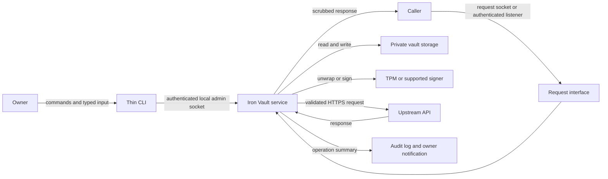
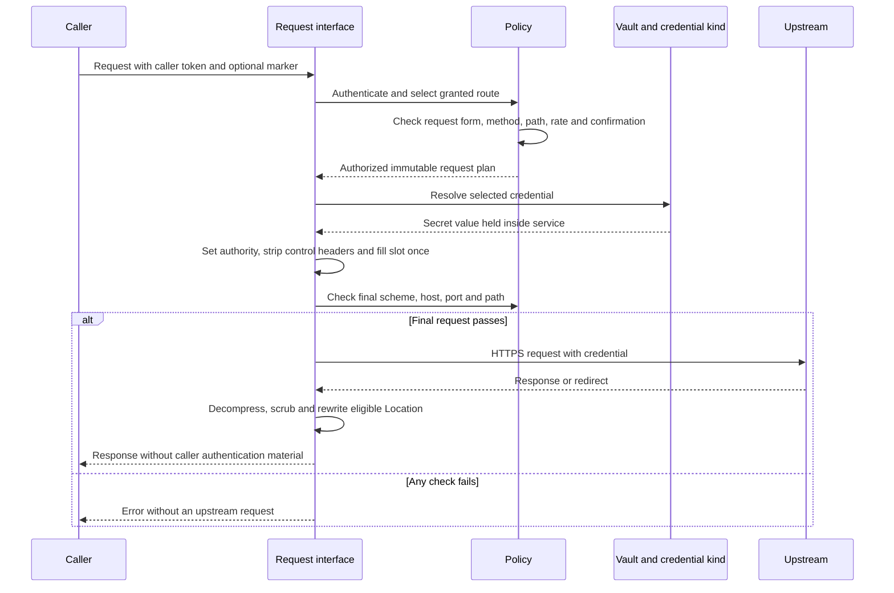
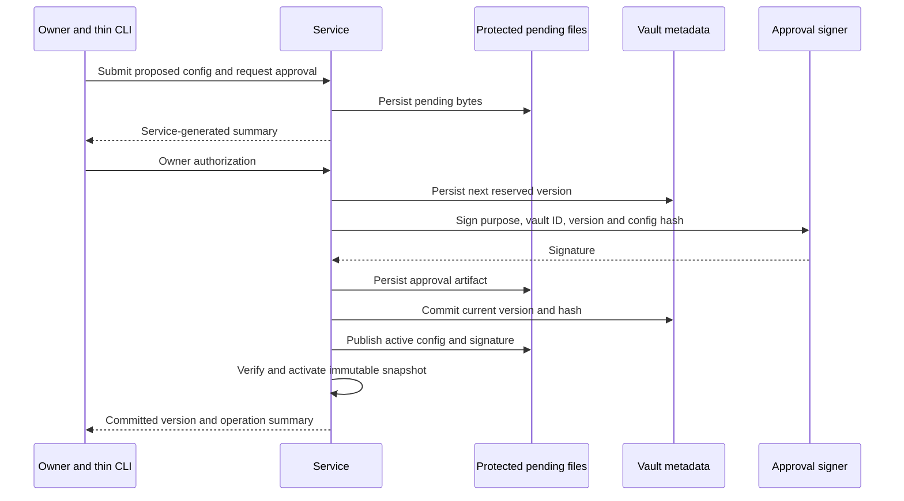
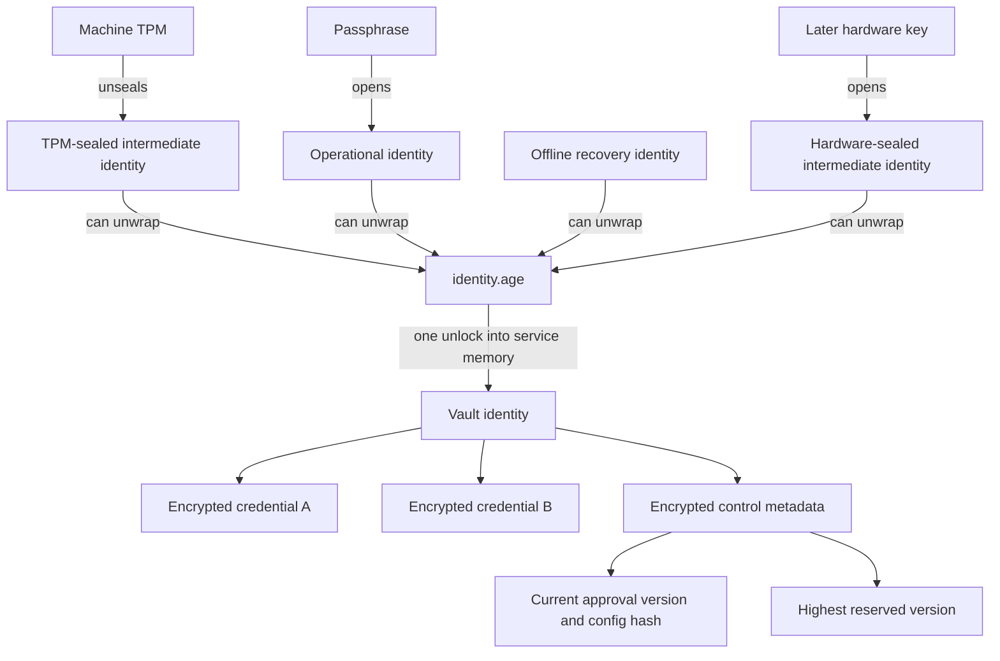
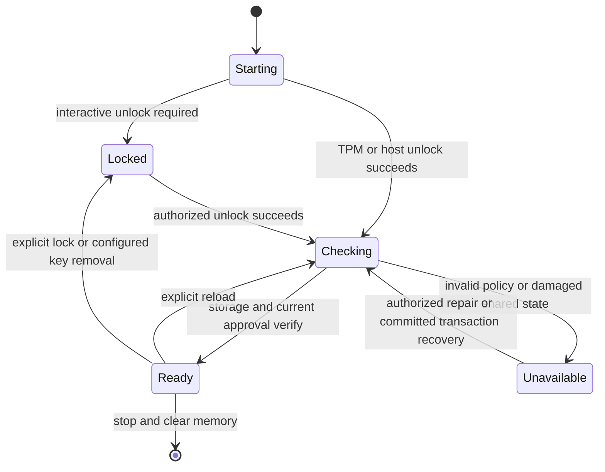
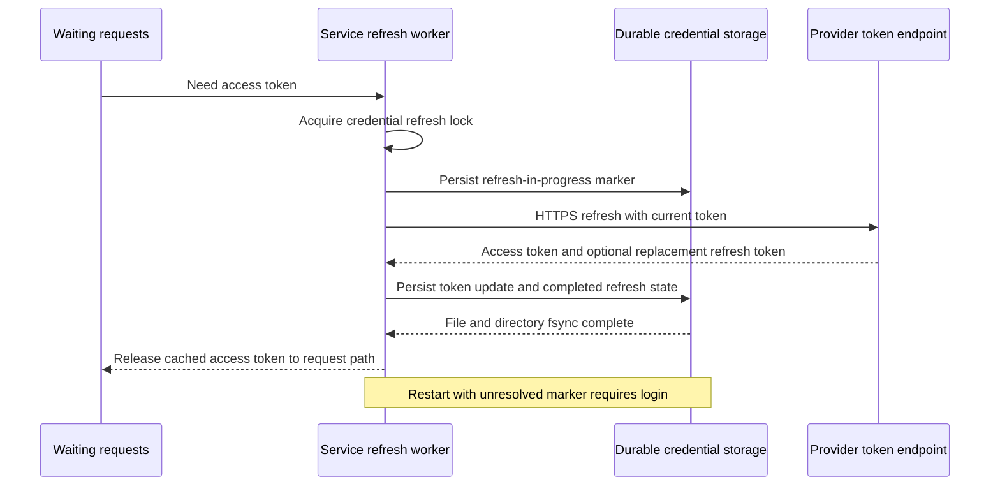
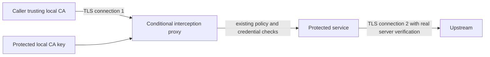

# Iron Vault product specification

Status: product specification, 2026-10-27. Implementation has not started.

This document defines the product behavior, security requirements, deployment boundaries, roadmap, and release
checks. It is the authoritative specification. Notes beside the requirements explain the attacks and failures
they address. Section 8.1 tracks deferred security and compatibility work. “Must” marks a release requirement.
“Later” and “conditional” identify work that does not block v0 unless a deployment uses it.

Contents:

- [Product and scope](#1-product-and-scope)
- [Release plan](#2-release-plan)
- [v0: protected proxy](#3-v0-protected-proxy)
- [v1: OAuth login and refresh](#4-v1-oauth-login-and-refresh)
- [Later: hardware keys and integrations](#5-later-hardware-keys-and-integrations)
- [Conditional: forward proxy and CLI compatibility](#6-conditional-phase-forward-proxy-and-cli-compatibility)
- [Implementation structure](#7-implementation-structure)
- [Verification and deferred security work](#8-verification-and-deferred-security-work)
- [Implementation gates](#9-implementation-gates-and-unresolved-details)
- [License and references](#10-license-and-design-references)

## 1. Product and scope

Iron Vault runs a local HTTP proxy that holds upstream credentials and attaches them to authorized requests.
Callers send requests to Iron Vault with a placeholder and, where required, a local caller token. Iron Vault
authenticates the caller, checks its route, supplies the credential, forwards the request over TLS, and returns
the response. Callers never receive upstream credentials through a credential-read API.

The product removes real API keys, passwords, refresh tokens, and signing keys from caller environments,
configuration files, and routine logs. It also centralizes OAuth refresh and request signing. A caller token
only grants local proxy access; operators can revoke it without rotating the provider credential.

### 1.1 Intended users

| User                                              | Required outcome                                                                                   | First phase                         |
|---------------------------------------------------|----------------------------------------------------------------------------------------------------|-------------------------------------|
| Desktop MCP servers and agents                    | Use FX, Brave, and Venice through configurable base URLs without holding real API keys             | v0                                  |
| Naomi back-office applications                    | Share the installation's Venice key and access Brave through isolated caller routes                | v0                                  |
| Naomi's Google integration                        | Complete consent once, retain the refresh token in the service, and supply access tokens on demand | v1                                  |
| CLI applications such as `gh`, `npm`, and `cargo` | Use the proxy without keeping provider credentials in their own files or environments              | Conditional on compatibility checks |
| Server and appliance operators                    | Run an unattended service with isolated callers and recoverable encrypted storage                  | v0                                  |
| Desktop hardware-key users                        | Unlock the vault and approve changes with PIN and touch                                            | Later                               |

For Naomi, Iron Vault supplies the credential responsibilities of `naomi-broker`; it does not replace unrelated
broker functions. ZeroClaw's provider and the screeners use the proxy base URL and a placeholder for the
installation's Venice key. Google consent belongs to the installation's support workflow. Operators must verify
each application's actual base-URL behavior before claiming support.

### 1.2 Security promise and limits

Iron Vault must prevent an ordinary caller from reading stored provider credentials, attaching them to another
origin, or accessing routes that its authenticated identity does not grant. It must reject unapproved configuration
changes and reject a previous configuration paired with its previous approval artifact. Response scrubbing reduces
accidental disclosure when an upstream echoes a secret; it cannot guarantee removal of every transformed secret.

Malware running as the desktop user can read that user's caller tokens and use the same routes. It can also open
any request socket available to that user. Iron Vault limits where those requests go, records their use, and keeps
the provider credential inside the service. It does not promise to prevent authorized-route misuse, malicious
content in API requests, or exfiltration of data that an allowed API returns. Method and path restrictions, rate
limits, and optional owner confirmation reduce this exposure.

The threat model excludes host root, administrators with equivalent access, control of Iron Vault's runtime or
memory, and malicious upstream services. Docker-daemon administrators count as host administrators for rootful
Docker. Cloud providers control the host and virtual TPM and remain outside this boundary. Confidential VMs are
outside the planned releases.

**Trust boundary (R-29).** A provider-controlled virtual TPM cannot protect secrets from that provider. Keeping
the provider outside the threat model avoids promising a boundary that this deployment cannot enforce.

The desktop session can capture secrets that the owner types, replace a user-writable CLI, or falsify a displayed
approval diff. A device touch proves presence, not that the owner saw the intended operation. The service must
minimize what the CLI handles and report approvals itself; it cannot establish a trusted display on an already
compromised desktop.

### 1.3 Terms

| Term              | Meaning                                                                                                               |
|-------------------|-----------------------------------------------------------------------------------------------------------------------|
| Caller            | An authenticated program identity with grants to named routes                                                         |
| Credential        | A named provider secret and the rules that govern its use                                                             |
| Credential record | The encrypted record containing a credential's secret, kind, permitted origins, and provider settings                 |
| Kind              | The operation that turns a credential into request bytes, such as a static key, an OAuth access token, or a signature |
| Route             | A caller grant and upstream mapping that selects one credential, its slot, and usage restrictions                     |
| Slot              | The route's permitted credential location: a named header, a named query parameter, or Basic authorization            |
| Marker            | An inert SDK placeholder such as `{iv:fx_key}`; Iron Vault interprets it only in the selected slot                    |
| Upstream          | The HTTPS service to which Iron Vault forwards an authorized request                                                  |
| Vault             | The service-owned encrypted storage and protected metadata on disk                                                    |
| Vault identity    | The generated `age` X25519 private key that decrypts individual credential files                                      |
| Recipient         | A public key or hardware-backed mechanism that can unwrap the vault identity                                          |
| Recovery key      | A generated offline `age` X25519 identity that opens the vault identity independently of the primary recipient        |
| Config approval   | A service-generated signature binding a vault identifier, approval version, and exact configuration hash              |
| Approval version  | A per-vault unsigned 64-bit counter that strictly increases for every reserved signing attempt                        |
| Owner             | The person authorized to enroll credentials, approve policy, recover the vault, and authorize destructive changes     |
| Hardware key      | A removable device, initially a YubiKey, that protects keys and supports PIN and touch policies                       |
| Source            | The origin of a credential imported into the vault, initially direct entry and later password-manager sync            |

The service uses stable GUIDs for vault and credential identities. Names provide human-readable references; a name
does not authorize replacement of the record behind it.

## 2. Release plan

Each phase inherits the requirements of earlier phases. A feature must meet all relevant review fixes before the
release enables it. A missing optional backend must produce an explicit unsupported or locked state; the service
must never weaken policy to make a feature work.

| Phase                            | Deliverable                                                                                                                                                                                                       | Release boundary                                                                             |
|----------------------------------|-------------------------------------------------------------------------------------------------------------------------------------------------------------------------------------------------------------------|----------------------------------------------------------------------------------------------|
| v0: protected proxy              | Static and Basic credentials, base-URL routing, service installation, caller authentication, narrowing, rate limits, scrubbing, versioned approval, two-level vault, recovery, migration, and deployment controls | FX MCP, Brave, Venice, and Naomi's static-credential callers                                 |
| v1: OAuth                        | Service-owned login, refresh-token storage, access-token caching, safe refresh recovery, and account identity                                                                                                     | Naomi Google integration can replace its existing credential broker behavior                 |
| Later: hardware and integrations | YubiKey recipients and signers, touch confirmation, additional credential kinds, and password-manager sync                                                                                                        | Each backend ships only after its security and interoperability checks pass                  |
| Conditional: forward proxy       | HTTPS interception for callers that cannot override their base URL                                                                                                                                                | Requires a separate design and evidence that base-URL mode cannot serve the intended callers |

v0 must include method/path narrowing, per-route rate limits, service installation, and the final outgoing-request
check. Later integrations must not defer these controls.

v0 defines and enforces `confirm = "touch"`: it refuses to activate a route with that policy when no supported touch
provider exists. The later hardware-key phase supplies that provider. v0 must not claim working touch confirmation
before the provider ships. Operators must leave routes that require touch disabled until then.

The specification retains versioned configuration approval after moving destination restrictions into credential
records. Approval protects caller grants and route policy; the records independently restrict credential egress.

## 3. v0: protected proxy

### 3.1 Installation and ownership

The supported desktop installation runs Iron Vault as a system service under a dedicated account. Installation
requires administrator access once. An ordinary desktop user must not control the service's executable, startup
definition, trusted settings, vault, or runtime directory.

| Platform | Required service boundary                                                                                                                | Key integration                                                                                |
|----------|------------------------------------------------------------------------------------------------------------------------------------------|------------------------------------------------------------------------------------------------|
| Linux    | Root-owned package or binary; system service under `iron-vault`; private state at `/var/lib/iron-vault`; sockets under `/run/iron-vault` | TPM through a host adapter using `tss-esapi`/`tpm2-tss`, or a verified `systemd-creds` adapter |
| Windows  | Administrator-owned installation; service under a dedicated virtual account; equivalent restrictive ACLs                                 | TPM-backed operations through the Platform Crypto Provider                                     |
| macOS    | Administrator-owned installation; launchd daemon under a dedicated account; equivalent restrictive permissions                           | Secure Enclave adapter where validated; otherwise interactive passphrase unlock                |

The Linux state directory must have mode `0700`. The package must make the binary and service definition
root-owned and unwritable by desktop users. The service must check ownership, permissions, containing directories,
and unsafe symlinks before trusting its binary, config, state, or socket paths. It must refuse an unsafe installation
and explain which path failed. Equivalent ACL checks apply on Windows and macOS.

A user-level installation or user-controlled container may serve development, but it must explicitly report that
it provides no isolation from malware running as that user. It does not qualify as a supported protected deployment.

The service starts with a controlled environment, obtains only the filesystem and device access it needs, and
holds an exclusive lock on its state directory. A second writer must fail to start. The CLI never writes vault
files, calls TPM or hardware-key APIs, or edits active policy directly.

**Attack prevented (R-2).** Protected installation files and a separate service identity stop ordinary-user
malware from replacing the vault executable or reading decrypted credentials through that user's process access.
Host administrators remain outside this protection.

### 3.2 Service and CLI boundary

The service exposes separate request and administrative interfaces. Request authorization never grants access to
administrative operations. The local admin socket authenticates the connecting OS account from its peer credentials
and accepts only an admin principal: root or the service account in a protected installation, and the invoking user
in a development installation. The admin principals are fixed by the deployment profile, not configured. The admin
socket is owned by the service account with mode `0600`, in a directory other accounts cannot write, so other accounts
cannot connect to it; the peer-credential check refuses them even if those permissions are wrong. A connection
forwarded over SSH is judged by the account it arrives as on the service host. Destructive and policy-changing
operations also require owner approval. Source ports, executable names, and caller-supplied identity headers do not
establish administrative identity.

The owner's login account is never an admin principal in a protected installation, so malware running as the owner
cannot reach the admin socket. The owner acts only by becoming a host administrator, for example through `sudo`, and
that step is only as strong as the host's privilege-escalation settings. Installation guidance must recommend
per-terminal credential caching or none, and a second factor such as a hardware key where the platform supports it.
Owner approval remains a separate barrier: a borrowed administrator session alone cannot approve a configuration.

The CLI sends commands to the service. The service reads staged configuration bytes, computes hashes, reserves
versions, signs approvals, updates state, and later owns OAuth login and refresh. The CLI may hold values that the
owner enters, but it must not receive stored provider secrets, private signing keys, refresh tokens, or PKCE verifiers.
Prompted values must not appear in arguments, shell history, command diagnostics, or normal logs.

The service accepts configuration approvals only from signing operations that it initiated for its own pending
transaction. It never offers an admin endpoint that accepts an arbitrary external signature as a new approval.
Normal loading may verify the artifact that the service previously committed. The committed version and hash
bind that artifact to the service's state.



The service must produce its own approval summary and notification, including changed callers, route grants,
destinations, restrictions, and the committed version. It must not treat the CLI's displayed summary as evidence
of what it signed. Device enrollment and access controls must prevent untrusted processes from using Iron Vault's
keys where the platform supports that restriction. They do not eliminate the compromised-display limit in §1.2.

**Attack mitigated (R-3).** Keeping private keys and stored secrets in the service removes them from a compromised
CLI's memory. Accepting only service-initiated approvals prevents an attacker from submitting a signature obtained
through an unrelated device operation. Neither control protects newly typed secrets or makes a fake CLI display trustworthy.

### 3.3 Credential records and configuration

The service encrypts and authenticates these fields together in each credential record:

- GUID, unique name, kind, and secret material.
- Exact permitted upstream hosts and permitted ports; HTTPS is mandatory.
- Provider settings, including token endpoint, OAuth scopes, client-credential reference, and account identity when applicable.
- Trusted source metadata and any future source-command definition.
- Operational state, such as a durable refresh-in-progress marker when v1 adds OAuth.

The service sets these fields during `add`, `login`, or an explicitly authorized replacement. Changing allowed
hosts, ports, token endpoint, scopes, or source execution settings requires re-entry of the credential or a new
login and owner authorization. A configuration edit cannot make an existing secret eligible for a new origin.
Automatic token rotation preserves these restrictions.

Configuration contains listeners, caller identities, grants, routes, slots, method/path restrictions, rate limits,
confirmation rules, and references to administrator-installed CA material. It contains no provider secrets or
credential-record definitions. Every upstream reference must match its record before activation and immediately
before sending a request. OAuth token requests later follow the same restriction.

`add` must reject an existing name. `replace`, `rm`, and login over an existing record require owner presence through
the approval mechanism. Removal must not let a caller silently rebind the old name to an attacker's account. The
service records replacement as a new authorized record identity and checks affected grants. Only the service may
plant or index encrypted record files: `age` encryption does not authenticate the sender of a newly created file.

**Attacks prevented (R-4, R-5).** Binding destinations to the encrypted record prevents a route edit from sending
an existing credential to an attacker's host or token endpoint. Explicit replacement authorization prevents
malware from silently replacing a user's account with the attacker's account under the same credential name.

The following TOML illustrates the product schema. The implementation must version and validate the schema before
release. Credential enrollment supplies allowed origins separately.

```toml
schema_version = 1

[listeners.local]
unix_socket = "/run/iron-vault/proxy.sock"

[callers.fx-mcp]
listener = "local"
auth = "peer"
user = "fx-mcp"
routes = ["fx"]

[listeners.loopback]
address = "127.0.0.1:7878"

[callers.brave-cli]
listener = "loopback"
token_hash = "blake2b:..."
routes = ["brave"]

[callers.naomi-backoffice]
listener = "naomi-backoffice"
auth = "isolated-network"
routes = ["venice", "brave"]

[listeners.naomi-backoffice]
address = "10.20.0.2:7878"
tls_certificate = "/etc/iron-vault/tls/server.crt"
tls_key = "/etc/iron-vault/tls/server.key"

[routes.fx]
prefix = "/fx"
upstream = "https://api.fx.example"
credential = "fx_key"
slot = { query = "access_key" }
methods = ["GET"]
paths = ["/latest", "/historical/**"]
rate_limit = { requests = 60, per_seconds = 60, burst = 10 }

[routes.venice]
prefix = "/venice"
upstream = "https://api.venice.ai/api/v1"
credential = "venice"
slot = { header = "Authorization", format = "Bearer {}" }
methods = ["POST"]
paths = ["/api/v1/chat/completions"]
rate_limit = { requests = 120, per_seconds = 60, burst = 20 }

[routes.brave]
prefix = "/brave"
upstream = "https://api.search.brave.com"
credential = "brave"
slot = { header = "X-Subscription-Token" }
methods = ["GET"]
paths = ["/res/v1/web/search"]
rate_limit = { requests = 60, per_seconds = 60, burst = 10 }
```

The non-local listener above requires TLS even on an internal Docker network. A local-only installation omits that
listener and its caller. Operators obtain caller tokens through the admin interface; no token in this example is
usable. The service stores a cryptographic hash of each generated high-entropy token, never its plaintext value.

Each route must declare a method allowlist, path restrictions, and a rate limit. Operators may explicitly choose
`paths = ["/**"]` when the application needs unrestricted paths. The service must not infer broader grants from
missing restrictions. It rejects unknown fields, unresolved references, duplicate names, ambiguous route matches,
invalid patterns, unsafe upstream URLs, and unavailable confirmation policies.

Path patterns match the final normalized upstream path, excluding its query. A literal segment matches itself;
`*` matches one segment and `**` matches zero or more complete segments. Matching covers the whole path. The service
must use the same path representation for authorization and forwarding.

### 3.4 Caller authentication and listeners

The service supports these caller identities:

| Mechanism               | Identity rule                                                                                        | Limits                                                                     |
|-------------------------|------------------------------------------------------------------------------------------------------|----------------------------------------------------------------------------|
| Unix peer account       | The OS account the kernel reports for the process connecting to a Unix socket is the caller's `user` | Every process running as that account can use its routes; Unix sockets only |
| Caller token            | A high-entropy token in `Proxy-Authorization` or a configured dedicated header matches a stored hash | Same-user malware can steal caller tokens; tokens never grant admin access |
| Isolated Docker network | A dedicated listener address identifies one caller network                                           | Requires one internal network per caller and no shared caller bridge       |

Loopback alone does not authenticate a caller: TCP reports no account, so a TCP caller presents a caller token or
arrives on its own isolated-network listener. On a Unix socket, callers that need different grants run as different
OS accounts (`auth = "peer"`) or present caller tokens. Peer callers share a socket only with other peer callers, one
caller per account; the service resolves each `user` to a uid when policy activates and refuses root and the service
account. Any local account may connect to a request socket; its peer account or token decides what it may use.
OS peer credentials can enforce account boundaries but must not prove trust in a named executable.
Inspecting `/proc/<pid>/exe` or launching the real application does not distinguish the owner from malware.
[`multiuser-linux.md`](multiuser-linux.md) walks through a workstation that separates work by OS account.

**Attack mitigated (R-1).** Peer-account identity bounds malware in one account to that account's granted routes,
without a token file for it to steal.

Token enrollment returns a fresh caller token once to the authorized owner. Revocation and rotation take effect
through an approved policy update; they never require a provider-credential rotation. The service compares token
hashes in constant time.

Default to a request socket under `/run/iron-vault`, plus a separate admin socket in that service-owned directory.
Other accounts may search that directory but never write to it, so they can reach a request socket but cannot
replace one.
For TCP on Linux, use systemd socket activation so the manager holds the port from boot and across restarts.
Supported TCP packages on other platforms must provide equivalent listener ownership or an authenticated transport
that prevents a replacement local process from impersonating Iron Vault. Privileged port numbers alone do not solve
port squatting.

**Attack prevented (R-6).** Protected socket paths and manager-owned TCP listeners stop another local process from
claiming Iron Vault's endpoint during downtime and collecting caller tokens or forging responses.

Reject non-loopback TCP listeners without TLS. Verify this rule at config load. WireGuard or Tailscale can protect
an additional network path, but their addresses do not bypass this listener rule. An SSH-forwarded Unix socket
preserves the local socket interface. Remote callers still authenticate, and operators may add source-address
allowlists as an additional restriction.

**Attack prevented (R-26).** Authenticated TLS prevents a network observer from reading caller tokens and request
bodies or modifying traffic to a non-local listener. Caller authentication still determines which routes it may use.

For Docker callers, bind a distinct listener to each isolated network, map identity from the local listen address,
and drop `NET_RAW` from caller containers. Do not establish identity from source IP on a shared bridge. Caller
containers must not receive Docker's management socket or access to Iron Vault's private files.

**Attack mitigated (R-27).** Isolated caller networks, listener-based identity, and removal of `NET_RAW` prevent
ordinary sibling-container address spoofing from becoming another caller's identity. Source IP on a shared bridge
does not provide that protection.

### 3.5 Request flow

Iron Vault must forward authorized requests itself. It must not redirect the caller to the upstream to obtain a
credentialed response. It does not follow upstream redirects with credentials attached.

For example, the caller sends `GET /fx/latest?base=USD` to the local request socket or the optional authenticated
loopback listener at `127.0.0.1:7878`. Iron Vault sends
`GET https://api.fx.example/latest?base=USD&access_key=<stored-key>` over TLS. The placeholder above describes the
upstream request; the service never returns that secret-bearing URL to the caller or writes it to a log.



The service executes these steps in order:

1. Enforce request size, header size, connection, and timeout limits.
2. Accept origin-form request targets only; reject `CONNECT`, absolute-form, authority-form, and unsupported upgrades.
3. Authenticate the caller and select a route that the caller may use.
4. Normalize and validate the path, select the method, and apply the route's restrictions.
5. Charge the route's rate limit and any stricter caller limit, then obtain required owner confirmation before credential resolution or
   sending.
6. Resolve the credential selected by the route; never select one from a caller-supplied marker.
7. Construct the URL structurally, remove control headers and caller auth, and fill the slot exactly once.
8. Apply the final outgoing-request check to the actual request about to leave the service.
9. Send over authenticated TLS with automatic redirects and ambient proxies disabled.
10. Process the response, return it to the caller, and write a redacted request event.

Rate limits apply to each route in aggregate across its callers; an operator may also set stricter limits for a
caller/route pair. The service uses token buckets with the configured refill rate and burst capacity, checks them
before upstream work, and returns `429` when either limit is exhausted. Concurrent requests cannot exceed a bucket
through races. v0 starts buckets empty and refills them normally, so repeated restarts cannot replenish an allowance
instantly.

**Attack mitigated (R-1).** Method and path restrictions limit the operations available to malware with a stolen
caller token. Rate limits mitigate application-level denial of service, request flooding, and provider-quota
exhaustion through those routes. They do not prevent all authorized misuse or volumetric network attacks;
connection, size, and timeout limits separately bound work before authorization.

### 3.6 URL, header, and slot rules

The policy must match route prefixes on complete segments. `/fx` matches `/fx` and `/fx/...`; it must not match
`/fx.evil.example` or `/fx@evil.example`. The service parses the configured upstream once and appends validated
remaining path segments through a URL API. It never concatenates untrusted text into a URL string or joins a
caller-supplied absolute URL.

Reject traversal and ambiguous paths before URL normalization can erase the evidence. This includes dot segments,
percent-encoded dots, slashes or backslashes, literal backslashes, NUL, malformed escapes, repeated interior empty
segments, and encodings that another decoding pass could reinterpret as these characters. A root path and one
trailing slash remain valid. The service must not let a request escape the upstream's configured base path.
Property tests must cover raw, mixed-case encoded, and double-encoded hostile paths.

Immediately before sending, `iron-vault-policy` must check the actual request for all of the following:

- Scheme equals `https`; no user-info component or caller-controlled authority exists.
- Host exactly matches a permitted host in the credential record after one canonical host conversion; suffix matching never grants access.
- Port matches both the configured upstream and the credential's allowed port; omitted HTTPS ports mean 443.
- Path stays inside the upstream base path and matches the authorized method/path decision.
- `Host` or HTTP/2 `:authority` and TLS server-name verification refer to the selected upstream.

A final-check failure indicates a policy or construction defect. The service must refuse the request, emit a
redacted high-severity event, and send no credentials. Every later credential kind and token-endpoint request must
use this boundary too.

The service must remove caller authentication before forwarding. It controls `Host`/`:authority`; it never copies
the caller's value. It removes hop-by-hop headers, headers named by `Connection`, forwarding headers such as
`Forwarded` and `X-Forwarded-*`, method-override headers, and URL-rewrite headers. The implementation maintains an
explicit, tested denylist, including `X-HTTP-Method-Override`, `X-Method-Override`, `X-HTTP-Method`, `X-Original-URL`,
and `X-Rewrite-URL`. It rejects ambiguous framing rather than interpreting conflicting lengths differently from
the HTTP stack.

The configured slot is the only injection location:

- Header slot: remove every occurrence of that header, regardless of case, then write one generated value.
- Query slot: parse query parameters structurally, remove every occurrence of the selected parameter, then insert one encoded value.
- Basic slot: remove caller `Authorization` headers and write one `Basic` value derived from the stored username and password.

For caller-forwarded requests, the service never inserts credentials into a body, URL path, unrelated header, or
unrelated parameter. Service-owned OAuth exchanges may send credentials in a provider-defined body, but only to
the separately enrolled token endpoint (§4.1). Header formats must have one substitution point and must not permit
CR or LF injection. Slot names must not collide with caller-authentication headers or transport-control headers.
A marker that names another credential in the selected slot causes rejection. A missing or ordinary SDK
placeholder may be replaced by the
route's selected credential. Markers outside that slot remain inert text, including markers in issue titles,
Gmail drafts, or arbitrary JSON bodies.

**Attacks prevented (R-7, R-9, R-11).** Structural URL construction and the final HTTPS origin check stop hostile
paths, alternate request targets, and cleartext upstream settings from diverting a credential. Service-controlled
authority and stripped override headers prevent domain fronting and method-override bypasses of route policy.

**Attack prevented (R-10).** Slot-only injection prevents an attacker from placing a marker in an issue title,
email body, or other published content and causing the upstream to store the real credential there.

### 3.7 Outbound TLS and environment

The outbound client must disable environment proxy discovery, including `HTTPS_PROXY` and `ALL_PROXY`; the Rust
adapter must use `reqwest::ClientBuilder::no_proxy()`. The client must use built-in trusted roots such as
`webpki-roots`, or an explicitly configured administrator-owned CA file. It must not inherit trust roots from
`SSL_CERT_FILE`, `SSL_CERT_DIR`, or desktop-controlled stores.

The service must verify certificates and hostnames. It must provide no option that disables these checks. A route
may reference an administrator-installed pinned CA for a self-hosted upstream, without changing its permitted
origin. The package must disable raw connection logging and cap HTTP/TLS dependency log verbosity in code,
regardless of `RUST_LOG` or other ambient logging settings.

**Attack prevented (R-8).** Ignoring ambient proxies and trust roots stops a user-controlled environment from
redirecting requests through an attacker-trusted TLS interceptor. Hard log caps prevent a verbose setting from
turning secret-bearing HTTP traffic into readable logs.

### 3.8 Responses, redirects, and scrubbing

The service scrubs exact occurrences of each secret value it actually injected, including complete Basic values,
the underlying username/password combination where appropriate, URL-encoded forms, and base64 encodings. It must
cover response headers, bodies, streamed bodies, and server-sent events. It must account for representation-specific
canonical forms where meaningful, including hex case variants, without case-folding arbitrary case-sensitive keys.

For each match pattern of length `n`, the streaming scrubber retains up to `n - 1` bytes across chunk boundaries;
the implementation uses the longest active pattern to set its overlap. It must not emit a possible secret prefix
before deciding whether the next chunk completes a match. It releases the remaining safe bytes at end of stream.

The service decompresses supported compressed responses before scrubbing. It recompresses only when the caller's
accepted encoding or application compatibility requires it. It updates encoding, length, and integrity-related
headers to match the emitted body. It enforces decompressed-size and resource limits; it must not bypass scrubbing
by forwarding an unsupported content encoding opaquely. Removing `Accept-Encoding` alone does not meet the
decompression and scrubbing requirement.

Scrubbing must not claim complete protection against partial keys, arbitrary JSON Unicode escapes, application
transformations, or malicious upstreams. It is a backstop after destination control. A scrub event identifies the
route and credential, never the matched bytes. Tests must cover chunk boundaries, encodings, compression, and
unchanged traffic that contains no secret.

The client must never follow an upstream redirect automatically. Before returning `Location`, the service resolves
relative references against the actual upstream request URL. It rewrites a same-origin destination that stays
within the configured upstream base path back under that route's proxy prefix. A same-origin redirect outside
that base path must fail explicitly rather than accidentally enter another local route. A destination on another
origin remains directed to that origin, subject to response scrubbing. The redirect must not carry an injected
credential back to the caller. The service never invents a credential-bearing redirect to replace proxy forwarding.

**Leak reduced (R-12).** Scrubbing removes supported secret representations that an upstream echoes into a
response, including across stream chunks. It cannot reliably remove arbitrary transformations or partial keys.

**Failure prevented (R-13).** Rewriting eligible relative redirects keeps the caller on the intended proxy route.
Refusing automatic redirect following also prevents a redirect from carrying the injected credential to another origin.

### 3.9 Configuration approval and reload

The service keeps the active config, pending config, and signature artifacts in service-owned storage. The owner
submits proposed bytes through the admin interface; the service writes `config.toml.pending`, validates it, and
produces its own summary. A byte change, including whitespace or comments, requires a fresh approval.

The signed payload must encode these fields without ambiguity:

| Field            | Required value                                             |
|------------------|------------------------------------------------------------|
| Purpose          | `iron-vault-config-v1`                                     |
| Vault identifier | The stable GUID of this vault                              |
| Approval version | A positive unsigned 64-bit integer reserved by the service |
| Config digest    | Blake-2b of the exact pending bytes the service reviewed    |

The service chooses and documents one deterministic, versioned payload encoding. The signature envelope carries
that payload and the supported signature-algorithm identifier. The service pins the approver's public key and
algorithm inside protected vault metadata; it must not trust a key supplied in the config or signature file.
TPM, YubiKey, and software signers use the same envelope and verification rules.

The TPM approval key must remain separate from the vault-unwrapping key. Its PIN authorizes signing, while the
normal TPM vault-unwrapping profile may start unattended. The service must enable TPM dictionary-attack protection
for the approval key and use a protected authorization session. It must not persist or cache the typed approval
PIN. The device retains its authorization secret internally. A software signer must encrypt its private key under
a separate approval passphrase and decrypt it only inside the service for the approval operation.

The service keeps two distinct values in protected metadata: the highest reserved version and the current committed
approval `(version, hash)`. Initialize the highest reserved version to zero only when creating a new vault; reserve
version 1 for the first approval. Serialize all approvals and persist a reservation before signing. Failed attempts
consume their versions. Never reuse a version, reset it on restart or signing-key replacement, or wrap on overflow.
Counter exhaustion must fail without signing.

The approval transaction must follow this order:

1. Write and fsync the pending config and its directory. Validate it and retain the same immutable byte snapshot for review and signing.
2. Authenticate the owner, show the service-generated summary, and durably reserve a higher version.
3. Sign the pending hash and reserved version with the approved signer; require touch when the signer policy requires it.
4. Durably stage the signed artifact beside the pending config in protected storage.
5. Atomically commit the new current `(version, hash)` in vault metadata, using the durable write procedure in §3.10.
6. Publish the pending config and artifact as `config.toml` and `config.toml.sig`, fsync their directory, and activate the verified
   snapshot.

Pause new request admission before committing the new current approval, then switch to its verified immutable
policy snapshot before resuming. Never admit new requests under the previous policy after that commit. Operations
already sent upstream remain subject to the cancellation limits below.



Multiple file renames do not form a filesystem transaction. On restart, the service may finish publishing only
when the protected staged files match the current committed version and hash and their signature verifies.
If it cannot complete that committed transaction, it must remain unavailable. It must never promote a merely
signed but uncommitted future version or fall back to an older committed version. Uncommitted files may be discarded;
their reserved counters remain consumed. Audit events must distinguish a reserved version from a completed approval.

At startup and explicit signal-triggered reload, the service must verify the purpose, vault identifier, signature,
exact config hash, and equality with the current committed version and hash. It must also validate all credential
references and route restrictions. An unknown credential reference invalidates the proposed config. A known record
that is damaged or needs login makes its routes unavailable without disabling unrelated healthy routes. Missing
or corrupt shared metadata, an invalid signature, a previous version, or an
uncommitted higher version stops proxying with `503`. The service warns the owner and does not retain old route
policy after a failed reload. It must gate new requests immediately and cancel or stop outstanding work where the
transport permits; it cannot retract a request that already reached the upstream.

To restore earlier configuration contents intentionally, the owner approves them again at a new higher version.
Loading never advances the counter or repairs missing trusted state from a caller-supplied artifact. Signing-key
rotation requires administrator or existing-owner authorization, invalidates the previous active signature until
reapproval, and preserves the vault's counter history.

The counter protects against replacement of config and signature files while private service state remains intact.
An attacker who restores the entire vault or disk can also restore that counter. Protection against whole-storage
rollback requires independent trusted state, such as a TPM NV counter or an external authority, and remains outside
v0. The shared signature flow does not itself provide that stronger guarantee.

**Attack prevented.** Signing both the config hash and version prevents an attacker from substituting a different
config or editing an old approval's version. Matching the committed state rejects an old config/signature pair.

**Failure prevented (R-21).** Durable staging and recovery of only the committed transaction prevent a crash
between config and signature publication from activating an unsigned or uncommitted configuration. The service
can finish the exact committed update after restart; otherwise it stays unavailable.

### 3.10 Vault structure and durable writes

The service generates one `age` X25519 vault identity. It encrypts that identity into `identity.age` for every
enrolled recipient. Every recipient of `identity.age` is an X25519 recipient key. A hardware-backed recipient (TPM,
YubiKey, Secure Enclave) or a passphrase reaches the vault through an intermediate identity: a generated X25519
identity whose recipient key is enrolled in `identity.age` and whose private key is kept in a separate file that only
that device or passphrase can open. Adding or removing any recipient therefore needs only public keys, never the
hardware or a plugin program, and `identity.age` never carries a stanza type other than X25519. It encrypts each
credential record into a separate file for the vault identity's public key.
The vault also contains encrypted control metadata for approved signer keys, approval counters, committed policy,
record indexing, and transaction recovery. Corruption of one credential must not require replacing every other
credential. Corruption of shared identity or control metadata may require recovery; the service must say so.



The private vault identity remains inside service memory while unlocked. TPM or YubiKey startup requires one
hardware operation to open its intermediate identity and one identity unwrap, not one hardware operation per
credential. The service clears the intermediate identity as soon as the vault identity is unwrapped. Public-key encryption lets the service write a new
credential without a fresh unwrap. Rewrapping the vault identity changes recipients without re-encrypting every
credential, but it does not revoke access to previously copied ciphertext.

The service alone writes vault and control files and holds the state-directory lock throughout its lifetime. It
serializes conflicting management and refresh operations. For every durable replacement, it must write a private
temporary file in the destination filesystem, fsync that file, rename it into place, then fsync the containing
directory. Deletions and transaction-marker changes also require the appropriate directory fsync. Recovery must
never depend on a CLI process completing a write.

Use service-owned manifests and record identities to detect missing or substituted records. Authenticated encryption
protects file contents, but anyone who knows a public recipient can create new encrypted ciphertext; directory
ownership and the service's index authorize which records exist. The service must report a damaged credential and
refuse requests that need it without silently substituting another record.

**Failures prevented (R-16, R-17, R-18).** A single writer and exclusive lock prevent competing updates from
silently replacing each other. Separate record files contain the damage from one failed record write. File and
directory fsync preserve a completed replacement across power loss; an atomic rename alone does not ensure durability.

### 3.11 Recipients, startup, and memory

The primary Linux TPM recipient uses a non-exportable hardware key to open a TPM-sealed intermediate identity, which
in turn unwraps the vault identity (§3.10). The service stores credentials on disk, not in TPM NV space. `age-plugin-tpm` provides an implementation lead, not a verified dependency;
the host adapter must demonstrate interoperable wrapping, recovery, and restart behavior before release.

PCR 7 records Secure Boot policy; it does not uniquely identify the intended installed OS. It cannot by itself
protect a stolen laptop from another trusted boot image. The laptop profile must combine TPM use with full-disk
encryption requiring a pre-boot PIN, an interactive TPM-unlock PIN, or a hardware-key recipient when that phase ships.
An approval-signing PIN does not satisfy this vault-unlock requirement. The server/appliance profile may use
unattended TPM unlock with PCR 7 when the deployment accepts its physical-access assumptions. Avoid broad PCR 0–4
bindings that cause routine firmware updates to strand the vault. Evaluate signed PCR 11 policies later.

The TPM does not authenticate an application by executable name. Restrict access to its key blobs, device APIs,
service account, and unwrapped identity. On Linux, configure `/dev/tpmrm0` access explicitly; do not assume a common
device group isolates all applications. The package must document the hardware and firmware policy it provisions.

Every vault must have at least two independent recovery paths. In v0, enroll the primary TPM or interactive-unlock
recipient plus a generated offline recovery recipient. Without a TPM, offer a passphrase-encrypted local envelope
for a generated operational recipient and keep the offline recovery identity separate. A passphrase may be the
owner's preferred unlock method even when a TPM exists. The service must not combine an `age` scrypt passphrase
stanza with other recipient stanzas in the same file; protect the relevant private identity in a separate
passphrase-encrypted envelope instead.

Use a validated Secure Enclave adapter on supported macOS hardware when available. An OS keyring is an optional
future service-account adapter, not a fallback into the desktop user's keyring. Until the hardware integration
passes its release checks, use interactive passphrase unlock and state its startup requirement.

The service must hold secret values in types that suppress debugging and clear buffers on release, using
`secrecy`/`zeroize` or equivalent. It must minimize copies, clear cached values on lock or replacement, lock secret
pages with `mlock` or a platform equivalent, and report failure to obtain the required memory protection. Production
profiles must not silently claim swap protection when memory locking failed.

Disable core dumps and crash reporters that capture service memory. On Linux set `PR_SET_DUMPABLE` to zero and
`LimitCORE=0`. Memory locking does not prevent hibernation from capturing RAM; installation guidance must require
encrypted swap and hibernation storage, normally through full-disk encryption, whenever those facilities are enabled.

**Failure prevented (R-14).** Separate passphrase-encrypted identity envelopes avoid an unsupported mix of scrypt
and ordinary recipients. A generated recovery recipient keeps hardware failure from making the only copy unusable.

**Leak mitigated (R-20).** Disabling dumps, locking secret pages, and encrypting swap and hibernation storage reduce
the chance that OS memory capture leaves plaintext credentials on disk for later collection.

**Attack mitigated (R-30).** A pre-boot PIN or interactive vault-unlock factor prevents a thief from relying only
on a similarly trusted boot image to use a stolen laptop's TPM. PCR 7 alone does not distinguish that image from
the intended installed OS.

### 3.12 Service states and errors

The service must distinguish lock state, invalid policy, damaged storage, and individual credential failure.
The request interface may remain bound through safe startup failures so callers receive an explicit status.
The admin interface must remain available for authorized recovery where the service can safely operate.



| Condition                                                       | Behavior                                                                                                        |
|-----------------------------------------------------------------|-----------------------------------------------------------------------------------------------------------------|
| Missing or invalid caller authentication                        | Return `401`; disclose no credential information                                                                |
| Authenticated caller lacks route or violates route restrictions | Return `403`; send no upstream request                                                                          |
| Malformed request target, framing, or marker mismatch           | Return `400`                                                                                                    |
| No matching route                                               | Return `404` without disclosing another caller's grants                                                         |
| Rate limit exhausted                                            | Return `429` with a safe retry indication                                                                       |
| Vault locked or policy/approval invalid                         | Return `503` with a redacted reason                                                                             |
| Credential damaged or later OAuth record needs login            | Return `503` for affected routes; keep unrelated healthy routes available                                       |
| Upstream transport or TLS failure                               | Return `502`, or `504` for timeout, without raw secret-bearing client diagnostics                               |
| Supported size limit exceeded                                   | Return `413` for requests; fail oversized response processing without returning unscreened secret-bearing bytes |

A healthy TPM service restarts unattended using a policy such as `Restart=on-failure`. Passphrase-only and later
YubiKey-only profiles remain locked until the owner supplies the required input. The YubiKey profile reports
`locked: needs a touch` and notifies the owner. The implementation must verify how unclean power loss affects its
chosen TPM session and dictionary-attack state; it must not assume that repeated power loss cannot cause lockout.

**Failure prevented (R-22).** Explicit startup states keep a missing interactive unlock from becoming a silent
fallback to weaker storage or an unexplained service failure. Hardware-specific power-loss behavior remains a
release check in §9.

### 3.13 Administration, recovery, and migration

| Command                                          | Required behavior                                                                                                    | Phase                                     |
|--------------------------------------------------|----------------------------------------------------------------------------------------------------------------------|-------------------------------------------|
| `iron-vault init`                                | Create protected state, vault identity, primary recipient, offline recovery key, approver, and first approved config | v0                                        |
| `iron-vault add <name>`                          | Prompt or read stdin; create a new credential record with permitted origins; never overwrite                         | v0                                        |
| `iron-vault list`                                | Show names, kinds, hosts, status, and later verified OAuth account identity; never show stored secret values         | v0                                        |
| `iron-vault replace <name>`                      | Obtain owner presence, re-enter secret and destination policy, and update affected references explicitly             | v0                                        |
| `iron-vault rm <name>`                           | Require owner presence, remove the record, and disable affected routes                                               | v0                                        |
| `iron-vault config approve`                      | Run the service-owned pending-config and versioned-signature transaction                                             | v0                                        |
| `iron-vault lock` / `unlock`                     | Clear or recover the in-memory vault identity and cached secrets                                                     | v0                                        |
| `iron-vault status`                              | Report service, vault, approval version, and affected credential states without secrets                              | v0                                        |
| `iron-vault recovery check`                      | Prompt for the offline recovery identity and verify that it opens the current vault identity                         | v0                                        |
| `iron-vault recipient add` / `remove`            | Require fresh existing-owner authorization; rewrap the vault identity; preserve independent recovery paths           | v0; each device backend follows its phase |
| `iron-vault export <bundle>` / `import <bundle>` | Authorize migration with an existing source factor before export; require the bundle passphrase on import           | v0                                        |
| `iron-vault forget-machine`                      | Check recipient removal and guide administrator-led TPM clearing and decommissioning                                 | v0                                        |
| `iron-vault reset`                               | Require explicit owner or administrator action; discard the vault and rebuild from reissued credentials              | v0                                        |
| `iron-vault login <name>`                        | Run service-owned OAuth consent; require presence before replacing an existing account                               | v1                                        |
| `iron-vault sync`                                | Import approved records from a supported password manager without returning secrets to the CLI                       | Later                                     |

The service must never place secret input in process arguments. It must present the generated recovery identity
once at initialization as text and a QR code, through the owner-only enrollment session, and require the owner to
confirm that they saved it. Recommend an independent password manager or paper storage. The owner may protect the
recovery identity in its own passphrase-encrypted file. The service must not retain the offline recovery private
key as an automatically usable local recovery path.

Schedule recovery reminders every few months through redacted logs and desktop notifications when available.
`recovery check` must prove that the supplied key opens the current envelope, without changing recipients or
approval state. Keep a service-owned plaintext inventory of names, kinds, permitted hosts, and provider reissue
instructions; include no secrets. The inventory helps the owner rebuild after complete loss. Iron Vault is not
the system of record for irreplaceable secrets: providers must be able to reissue enrolled credentials.

**Loss mitigated (R-15).** Independent recipients, recovery checks, reminders, and a reissue inventory reduce
permanent lockout when a device fails or the owner loses an infrequently used recovery secret. They do not replace
the owner's responsibility to retain a working recovery path.

A forgotten approval PIN requires an administrator to provision a replacement signing key and approve again,
without resetting an existing vault's version counter. A later YubiKey PIN recovery uses its configured PUK;
resetting the PIV applet loses that recipient, so another recipient must recover the vault.

Before allowing migration, the service must require fresh authorization through an already enrolled source-vault
method. An unlocked vault, an authenticated admin connection, or a newly chosen export passphrase does not meet
this requirement.

| Existing source method | Required migration authorization |
|---|---|
| TPM | The owner types the existing TPM approval-key PIN; the service proves authorization through that key. Unattended vault unwrap does not authorize migration. |
| YubiKey | The owner supplies a fresh touch on the enrolled key for this migration, plus any PIN its policy requires. A previous unlock or unrelated touch does not count. |
| Passphrase | The owner re-enters the original source-vault passphrase; the service verifies it against the existing enrolled identity envelope. A new export passphrase does not count. |

The service binds the authorization to one pending migration using the source vault identifier, operation,
destination recipient when applicable, and a short-lived, single-use challenge. It initiates and verifies any
hardware proof itself. Failed, cancelled, expired, replayed, or unavailable authorization must deny migration
before creating or releasing a usable export bundle or rewrapping the identity for a destination. The service
must not reuse a cached PIN, prior touch, or previous migration authorization. Clear typed secrets after use and
apply the configured device lockout or passphrase-attempt limits.

Only after this source-owner check succeeds may the service accept a new passphrase to protect the transfer.
That export passphrase encrypts the bundle; it does not establish authority over the source vault. Import on the
destination requires the bundle passphrase, not access to the source machine's non-exportable TPM key.

Migration follows this passphrase-protected export/import workflow:

1. The owner runs `export`. The service first obtains fresh source-owner authorization as specified above, then prompts for a new export
   passphrase and takes a consistent snapshot under its write lock. If the authorization expires before export begins, repeat the check.
2. The service creates a versioned `.tar.gz` migration bundle whose secret-bearing contents are encrypted under that passphrase. It decrypts
   source records only in service memory; it writes no plaintext secrets to temporary files, archive entries, stdout, or the CLI. It may
   copy already encrypted record files and add a separately passphrase-wrapped vault identity.
3. The owner installs the protected service on the destination and transfers the encrypted bundle.
4. The destination service runs `import`, prompts for the passphrase, validates the bundle and safe archive paths, and wraps the recovered
   identity for the destination TPM, hardware key, or separate operational passphrase recipient.
5. The destination preserves record identities and version history, enrolls its approval signer, and requires a new approval with a higher
   version before routing. The import must not reduce counters or overwrite an initialized vault implicitly.
6. The owner verifies recovery and requests, retires the source installation, and removes obsolete recipients as appropriate.

The bundle must preserve the current committed version and highest reserved version. It must not pretend that
restoring an old backup supplies freshness against whole-storage rollback. The migration workflow treats the
destination as the active writer; simultaneous independent writers for one logical vault are outside scope.

Adding a destination recipient and copying ciphertext remains an optional migration path when both devices can
participate. It requires the same fresh source-owner authorization before adding the recipient; it must not bypass
the export authorization rule. Neither migration path moves a non-exportable TPM private key. The service rewraps
the vault identity.

**Attack prevented (R-23).** Fresh authorization with an enrolled source factor stops malware with only an admin
connection or an already unlocked vault from exporting credentials under an attacker-chosen passphrase. Applying
the same check to destination-recipient enrollment closes the alternate migration path.

Removing a recipient protects future envelopes, not old backups. At decommission, guide an administrator to clear
the retired TPM after checking the impact on other TPM users and verifying another recovery path. Do not silently
clear a shared TPM. Deleting a key blob alone does not invalidate copies in backups. If the machine was lost,
rotate provider credentials; local recipient removal cannot revoke ciphertext already held by an attacker.

**Historical access addressed (R-24).** Clearing a retired TPM prevents its old wrapping capability from opening
backups on that machine. Removing a recipient from the current envelope alone does not revoke old copies; provider
credential rotation addresses exposure after a machine is lost.

### 3.14 Docker, remote servers, and appliances

On desktops, run Iron Vault as the host system service described in §3.1. Development containers may use rootless
Docker or Podman under the desktop user. Do not place Iron Vault inside that user-controlled runtime. The desktop
user must not control the host's rootful Docker daemon, its socket, or unrestricted passwordless Docker administration;
that access defeats the host service-account boundary.

The rootless daemon's owner also controls its containers without joining the `docker` group. Never use that user's
rootless daemon to isolate Iron Vault from malware running as the same user. Evaluate effective runtime access,
including socket ACLs and administrative APIs, rather than group membership alone.

On servers and Naomi appliances, container deployment is supported when callers cannot control the daemon,
execute commands in Iron Vault's container, inspect its memory, mount its state, or run privileged containers.
The runtime administrator remains outside the threat model. Maintain distinct caller networks and TLS listeners
as specified in §3.4.

Protect Compose definitions, overrides, entrypoints, mounted application code, unlock files, and deployment helpers
from untrusted host users. Otherwise an attacker can change what a later administrator-controlled recreation runs,
even without immediate daemon access. Bind-mounted Compose secret files still depend on host permissions. Use a
dedicated host-mapped service identity and retain process-inspection and dump restrictions; a container boundary
does not replace those host controls. Application containers must receive no vault mounts, unlock material,
administrative socket, host PID namespace, privileged mode, or Docker management socket.

Malware confined to a properly isolated sibling container can use that caller's authorized routes but must not
extract provider credentials. An ordinary host account without runtime access must also remain outside private
storage and process memory. The owner's desktop session can still expose newly typed secrets or administrative
authorization; §1.2 states that input limitation. Runtime administrators can replace the service or capture its
unwrapped vault identity after unlock, even when the hardware wrapping key remains non-exportable.

Prefer a host unlock adapter that unseals the vault identity using `systemd-creds` and supplies it to the container
through a restricted runtime credential or tmpfs secret file. Keep that handoff outside caller mounts and never
place it in environment variables, image layers, or persistent plaintext files. Validate the adapter's wrapping
and recovery format against the vault model; do not assume `systemd-creds` implements an `age` recipient. This
profile keeps TPM code and device access outside the request container.

A direct `/dev/tpmrm0` passthrough profile may exist only after it validates its device permissions, key access,
and isolation. In the host-unlock profile, the host must also own approval signing or expose a narrowly scoped,
authenticated signing helper. The container may request only the service's validated approval transaction; the
host must not expose an arbitrary signing oracle. Ordinary callers receive neither interface.

Remote deployments require authenticated TLS on non-local listeners. Remote administration uses the existing
local admin socket through an authenticated channel such as SSH forwarding. The service never exposes its local
admin protocol as an unauthenticated network API.

**Attacks mitigated (R-25, R-28).** Separating runtime administration, private mounts, and unlock delivery from
callers prevents a compromised sibling container from simply entering Iron Vault or reading its vault identity.
Protected deployment inputs also prevent an ordinary host user from replacing it at the next managed recreation.
The host unlock adapter avoids granting caller containers TPM access; no container arrangement hides decrypted
credentials from the administrator who controls that runtime.

### 3.15 Logging and v0 acceptance

Write one structured event per completed or rejected request: time, caller, route, credential name, upstream host,
method, status, request and response sizes, duration, and whether scrubbing occurred. Record administrative changes,
approvals and versions, recovery checks, lock transitions, corruption, and policy failures as separate audit events.
Escape caller-controlled labels and reject control characters in configured names to prevent log injection.

Never log request or response bodies, header values, raw query strings, passwords, caller tokens, provider tokens,
private keys, signature PINs, or unfiltered library errors containing URLs. No trace setting may re-enable raw
HTTP/TLS traffic. Notifications contain the operation summary and remediation, not secrets.

v0 release checks must demonstrate all of the following:

- FX, Brave, and Venice requests carry the correct credential only to the enrolled origin and selected slot.
- Unauthenticated and ungranted requests, traversal, header overrides, wrong markers, and mismatched final URLs produce no credentialed
  egress.
- The package rejects user-writable trusted paths; the desktop user cannot read service memory or vault records through ordinary account
  permissions.
- Rate limits and path/method restrictions apply under concurrency; unavailable touch requirements never degrade to unconfirmed access.
- Scrubbing handles supported representations, compression, and arbitrary stream chunk boundaries while preserving ordinary streaming
  responses.
- Old config/signature pairs fail after a newer approval; counters survive restart, failed signing, and key replacement without reuse.
- Power failure before the approval commit retains the previous committed policy; power failure after the commit completes that exact
  transaction or keeps the service unavailable. Recovery never activates an uncommitted version.
- Recovery opens the vault through an independent recipient; passphrase envelopes never create an invalid mixed-recipient `age` file.
- A second writer fails; a damaged credential does not overwrite healthy records; every durable rename includes its directory fsync.
- Export/import preserves records, counters, recovery access, and the service boundary without writing plaintext secret artifacts.
- Export and destination-recipient enrollment reject missing, incorrect, expired, replayed, or cancelled source-owner authorization,
  including when the vault is already unlocked. Each supported TPM PIN, YubiKey touch, or original-passphrase method must authorize only
  its pending migration. A new export passphrase or an earlier unlock must never authorize export on its own.
- Locked startup, invalid policy, TLS failures, unsafe listener configurations, and ownership failures produce explicit safe states.

## 4. v1: OAuth login and refresh

v1 adds `oauth_refresh` and targets Naomi's Google integration. It inherits every v0 destination, ownership,
approval, response, and logging rule. Neither the caller nor the CLI receives a refresh token or access token.
The route still supplies a placeholder; the service resolves a fresh access token into its slot.

### 4.1 Service-owned consent

`iron-vault login <name>` asks the service to start an authorization-code flow with PKCE and a loopback redirect,
or a device-code flow on a headless machine. The service generates and retains the verifier, authorization state,
and pending login identity. It owns the redirect listener, validates the returned state and transaction, and redeems
the code at the credential record's authorized token endpoint. The browser performs consent; the CLI only displays
the service-provided authorization URL or device instructions and login status.

For a remote service, prefer device-code login or explicitly forward the service's loopback callback through SSH.
Do not move the verifier or code redemption into the remote CLI. Use a short-lived, transaction-specific callback
listener and reject callbacks for completed, expired, or unrelated login transactions. A redirect listener does
not become a general request proxy or admin listener.

The owner supplies or approves the token endpoint, scopes, permitted resource origins, and OAuth-client reference
when enrolling the record. Store a confidential client's ID and secret in their own credential record; never place
the client secret in ordinary config. An OAuth record may reference that record but cannot redirect its secret to
another token endpoint. All token requests use the same controlled HTTPS client and final destination check.

`login` over an existing credential requires owner presence before replacement. Store a provider-verified account
identifier, such as issuer and `sub`, and a display email when the provider supplies them. Show the account in
`list` and in the service-generated replacement summary. Do not infer verified identity from an unvalidated JWT
payload or a caller-supplied email. Narrowed or changed scopes require explicit re-consent where the provider needs it.

### 4.2 Token cache and request retry

The service caches access tokens only inside protected service memory and renews them shortly before expiration.
It serializes refresh per credential; concurrent requests wait for one result instead of rotating the same refresh
token multiple times. A configurable expiry margin must account for clock and network uncertainty.

On an upstream `401`, the service may invalidate the cached access token, refresh once, and retry once only if it
can replay the original body and the operation's retry policy permits another attempt. It must not buffer arbitrary
streaming uploads solely to make them replayable without an explicit size limit. If it cannot replay safely, it
returns a clear error rather than sending a partial or changed body. It must not create an automatic retry loop
for an API operation that may already have caused a side effect.

### 4.3 Refresh-token rotation and crash recovery

The provider may invalidate the previous refresh token as soon as it issues a new one. No local transaction can
make that remote update atomic with a filesystem write. The service must narrow the failure window and treat an
uncertain outcome as a new-login requirement.



The service must execute this transaction:

1. Acquire the per-credential refresh lock and confirm that the record is usable.
2. Persist a refresh-in-progress marker before contacting the provider.
3. Send one refresh request to the authorized HTTPS endpoint. Do not automatically replay a possibly delivered refresh request.
4. Validate the response. Persist the replacement refresh token, or the retained token when no replacement exists, together with completion
   state. Use write, file fsync, rename, and directory fsync.
5. Only after durable completion, publish the new access token to waiting requests and release the lock.

If the process dies or the network outcome remains uncertain while the marker is unresolved, restart places that
credential in `needs login`. Never reuse the previous refresh token to see whether it still works. A successful
durable completion clears the uncertainty in the same record update; leftover temporary files must not erase a
valid completion or imply one that never committed.

`invalid_grant`, revoked consent, and an unrecoverable refresh outcome put the record in `needs login`. Notify the
owner and fail affected routes with `503`; keep unrelated credentials available. Retry only failures for which the
implementation can establish that replay does not reuse a potentially retired token. If it cannot establish that,
require a new login. A fresh, owner-authorized login replaces the failed token record and clears the marker.

### 4.4 v1 release checks

- Run authorization-code/PKCE and headless device-code login through the service, including a remote deployment.
- Prove that the CLI and callers never receive verifier, authorization code, refresh token, or minted access token through an admin
  response.
- Exercise account replacement, changed scopes, wrong-state callbacks, expired transactions, and token-endpoint substitution attempts.
- Exercise concurrent refresh, expiry-margin behavior, one permitted `401` retry, and a body that cannot be replayed.
- Cut power or inject failures before the refresh request, after the provider response, during record replacement, and after directory
  fsync. Recover to either a valid durable token or `needs login`, never an uncertain old-token retry.
- Validate the actual Google OAuth application status, consent setup, refresh-token lifetime, and requested scopes for Naomi before
  documenting unattended operation. Verify whether tokens for the selected Google OAuth “Testing” configuration expire after seven days;
  do not treat that lifetime as a universal guarantee.

The Gmail route below references a credential enrolled through this flow; its record owns the resource hosts,
token endpoint, scopes, client reference, and verified account.

```toml
[routes.gmail]
prefix = "/gmail"
upstream = "https://gmail.googleapis.com"
credential = "google_naomi"
slot = { header = "Authorization", format = "Bearer {}" }
methods = ["GET", "POST"]
paths = ["/gmail/v1/users/me/**"]
rate_limit = { requests = 120, per_seconds = 60, burst = 20 }
```

This route's broad path grant remains a conscious owner choice. It does not claim that every allowed Gmail call
is safe from misuse by a compromised caller.

## 5. Later: hardware keys and integrations

These features extend the protected service. Their absence must not weaken existing route, record, approval, or
recovery rules. Implement each provider only when a caller needs it and its release checks pass.

### 5.1 Hardware-key recipients, signers, and touch confirmation

The first removable-key backend targets a YubiKey PIV P-256 recipient through a validated
`age-plugin-yubikey` integration. The service owns PC/SC access and the key operations; Linux installations must
configure `pcscd` access deliberately. The package must verify device enrollment, PIN/touch policy, key-slot
separation, and interaction with other desktop smart-card applications. It must not assume that a common desktop
PC/SC policy limits a key to Iron Vault.

A hardware key may replace or accompany the TPM as a vault recipient, through its own hardware-sealed intermediate
identity (§3.10). Any enrolled recipient can unwrap the identity. A TPM-plus-YubiKey installation may still start through its TPM without a touch; adding a touch-enabled
recipient alone does not make touch mandatory. A YubiKey-only operational profile requires PIN and touch on
unlock and keeps the identity in service memory afterwards.

Aim for PIN `once` per service session and touch `always` for opening the hardware-sealed intermediate identity. Do not ship a
protected profile with both PIN and touch disabled. Separate approval signing from unattended vault use; use a
dedicated PIV signing key with the approved signing policy and the same versioned config envelope as the TPM.
The service must verify the policy it actually provisioned and tell the owner when a device cannot meet it.

Default behavior keeps an already unlocked vault open when the key is removed. An optional removal-lock policy
clears the vault identity, derived keys, and cached credential values, refuses requests, and waits for reinsertion
and touch. Losing a hardware key loses one recipient; another independent recipient must still recover the vault.
Use the configured PUK to recover a forgotten PIV PIN when possible. Resetting the applet invalidates its old keys.

Per-route `confirm = "touch"` requires a separate service-owned confirmation for each authorized operation. The
service must bind the pending confirmation to the caller, route, method, normalized destination and body digest
where a body exists, and give it a short expiry. It must not use a touch on an unrelated signing or unwrap request
as confirmation. Parallel requests must not share a confirmation or borrow a queued touch. Cancellation or device
absence must fail the request without sending it.

The service must show and log the operation summary itself, while retaining the compromised-display limitation.
For streaming uploads on confirmed routes, buffer within the configured limit before requesting a body-bound
confirmation, or refuse the route's unsupported streaming operation. Do not silently omit the body binding.

Operators must identify high-impact routes during enrollment and explicitly decide whether to require touch.
Until the product defines provider-specific defaults, it must not describe unconfirmed high-impact access as
protected from local misuse. A machine without a supported key must reject activation of a touch-required route;
it must not substitute a software prompt or approval PIN without an explicit new policy approval.

Evaluate FIDO2 `hmac-secret` for devices such as SoloKeys, Nitrokey, and YubiKey as a separate compatibility effort.
That feature may help derive an unwrap secret; it does not automatically implement an `age` recipient or PIV signing.
Prove wrapping, recovery, PIN/presence behavior, and service isolation before advertising another device family.

Hardware-key release checks must include one unwrap for many credential files, mandatory touch where configured,
service-owned signing, borrowed-touch attempts, concurrent confirmations, removal/reinsertion, wrong PIN and PUK
recovery, a lost device, and unattended startup through an alternate recipient when that profile permits it.

### 5.2 Credential kinds

Every kind accepts a credential record and an authorized request plan, then produces only the value or signed
request that the proxy needs. It must never expose a secret through the caller or management interfaces. The same
caller marker works regardless of whether the service uses a stored key, a minted token, or a computed signature.

| Kind                       | Record contains                                                                                       | Request behavior                                                                                | Phase |
|----------------------------|-------------------------------------------------------------------------------------------------------|-------------------------------------------------------------------------------------------------|-------|
| `static`                   | Provider key                                                                                          | Fill the selected header or query slot; apply an optional fixed format such as `Bearer {}`      | v0    |
| `basic`                    | Username and password                                                                                 | Write `Authorization: Basic base64(user:pass)`                                                  | v0    |
| `oauth_refresh`            | Refresh token, token endpoint, scopes, resource origins, account identity, and OAuth-client reference | Cache an access token and refresh through the service-owned transaction                         | v1    |
| `oauth_client_credentials` | Client ID, client secret, token endpoint, resource origins, and scopes                                | Obtain and cache an access token                                                                | Later |
| `jwt_bearer`               | Signing key, issuer/audience/claims policy, and permitted exchange endpoint                           | Sign an assertion and exchange it for an access token, for example for a Google service account | Later |
| `jwt_self_signed`          | Signing key and bounded claim policy                                                                  | Mint a short-lived JWT for direct upstream use, such as an Apple APNs token                     | Later |
| `github_app`               | App private key, installation ID, and permitted API endpoints                                         | Sign an app JWT, obtain an installation token, and cache it                                     | Later |
| `hmac`                     | Signing secret and a defined provider signing algorithm                                               | Sign the final method, destination, headers, timestamp, and body as required by the provider    | Later |
| `aws_sigv4`                | AWS access-key material, region/service restrictions, and optional session token                      | Sign the final request with AWS Signature Version 4                                             | Later |

Store provider claims, audiences, exchange endpoints, and signing algorithms in the credential record where they
can affect secret use. Restrict token and installation-token endpoints independently of resource hosts. A route
cannot override these values or use its signing key as an arbitrary signing oracle.

`hmac` and `aws_sigv4` require the complete final body. Buffer it within a configured size limit, apply URL/header
and slot transformations, then sign; run the final egress check before sending. Do not allow a later mutation to
change signed bytes. These routes do not support streaming uploads in the planned implementation. Other providers
must specify replayability, token expiry, cache invalidation, retry behavior, and redaction patterns before release.

### 5.3 Password-manager sync and command adapters

Provide explicit sync/import from LastPass, 1Password, and Bitwarden as supported connectors become available.
The service imports secrets into ordinary encrypted credential records. Requests use those local records; they
do not fetch a password-manager secret on every proxy call. Explicit sync keeps connector outages outside the
normal request path.

The owner configures each source through an authorized service operation. Source metadata lives with the credential
record and remains outside ordinary route config. The connector runs within the service boundary or a restricted
service-owned helper and returns imported secrets only to the service. A user-controlled CLI must not become the
repository for cached source credentials or imported provider tokens.

Sync must show a proposed inventory of additions and changes, preserve destination restrictions, reject silent
name collisions, and require owner presence before replacing or removing a record. A connector must not change
allowed hosts, token endpoints, scopes, or account identity merely because the remote field changed. Such a change
uses the explicit replacement or login flow. Imports must leave existing usable records intact on failure.

The later `command` source remains a gated adapter, not permission to execute a command from TOML route
config. If implemented, store its definition in the protected record, require explicit owner authorization, use an
administrator-approved executable and fixed arguments without a shell, and control its environment, timeouts,
output size, and logs. Command stdout carrying a secret goes only to the service. Execute it as an isolated helper
where possible, rather than granting arbitrary code the vault service's full memory and filesystem access.

Live request-time sources and their cache durations need a separate design before activation. The planned phase
ships explicit sync; it must not quietly replace that model with user-supplied code running on every request.

### 5.4 Later platform work

Validate Secure Enclave support and any `age-plugin-se` integration on macOS before promising equivalent hardware
behavior. Keep the platform's dedicated service account and interactive passphrase option throughout this work.
Evaluate signed PCR 11 policies for measured boot without brittle firmware bindings. Any future keyring adapter
must remain under the service identity and state exactly which attacks it does and does not resist.

mTLS client certificates may follow as a route transport feature rather than an injection slot. They require
separate key-storage, server-identity, and certificate-lifecycle requirements before implementation.

## 6. Conditional phase: forward proxy and CLI compatibility

v0 and v1 implement base-URL mode. A plain `CONNECT` tunnel leaves HTTPS opaque, so it cannot attach credentials.
Forward-proxy mode would require Iron Vault to terminate caller TLS with a locally trusted CA and open a separate
TLS connection upstream. That CA could impersonate sites to the caller and creates a larger security boundary.

Before planning this phase, run end-to-end compatibility checks for Brave's MCP server, the accounting/FX MCP
server, `gh`, `npm`, and `cargo`. Verify overrides, authentication behavior, redirects, metadata-provided absolute
URLs, streaming, and downloads. Publish only tested application/configuration combinations. Investigate npm tarball
URLs and GitHub host selection rather than assuming their base-URL settings cover the complete workflow.

If a required caller has no sufficient base-URL override, choose explicitly between a caller patch and a separate
interception design. Move unsupported CLI examples to this conditional phase; do not claim that setting
`HTTPS_PROXY` alone enables credential injection.



The conditional design must specify CA enrollment/removal, private-key isolation, authority selection, caller
authentication, allowed destinations, all existing final checks, and recovery after certificate failures. Existing
base-URL listeners must continue rejecting `CONNECT` and absolute-form targets. Do not share a permissive parser
or interception policy with them accidentally.

Browser login sessions, cookie jars as credentials, TOTP generation, and non-HTTP protocols remain outside the
planned product. SMTP/IMAP with XOAUTH2, databases, and SSH would require their own protocol-aware proxies. The
`ssh-agent` pattern is a useful reference for holding a key and performing an operation without returning it; it
does not imply an SSH feature commitment.

## 7. Implementation structure

Build one Rust workspace using edition 2024 with a pinned toolchain and shared dependency versions. Keep policy
decisions pure and perform filesystem, HTTP, process, device, and notification I/O through adapters. Establish
bounded contexts before adding abstractions; crates must not reach into each other's private storage models.

| Crate               | Responsibility                                                                                                                         |
|---------------------|----------------------------------------------------------------------------------------------------------------------------------------|
| `iron-vault-policy` | Caller grants, routes, slots, markers, path/method rules, confirmation requirements, and the final outgoing-request decision; no I/O   |
| `iron-vault-kinds`  | Credential resolution, token lifecycle, provider signing rules, and constrained token-endpoint adapters                                |
| `iron-vault-store`  | Vault identity, recipient envelopes, record files, manifests, approval metadata, durable transactions, recovery, and connector storage |
| `iron-vault`        | Service binary, HTTP/admin interfaces, CLI client, config loading, deployment adapters, scrubbing, logging, and notifications          |

Use value objects that reject invalid hosts, ports, paths, names, versions, and slots on construction. Libraries
return typed errors with `thiserror`; the binary may use `anyhow` for context. Avoid `unwrap`, `expect`, and `panic!`
outside tests. A corrupt file or hostile request must produce an error, not a crash. Keep generated configuration,
payload encodings, manifests, and logs deterministic; never depend on hash-map iteration order for persisted data.

The initial dependency candidates remain `tokio`, `hyper` or `axum`, `reqwest` with `rustls`, `age`,
`secrecy`/`zeroize`, `tss-esapi`, and platform service APIs. OAuth later adds `oauth2`; JWT and AWS providers may add
`jsonwebtoken` and `aws-sigv4`. `keyring` remains optional and constrained by the service-account rule. Validate
plugins and host-helper formats before choosing them; candidate names do not establish interoperability.

The HTTP adapter must make unsafe behavior difficult to enable: one controlled outbound-client constructor,
automatic redirects disabled, no ambient proxy/trust settings, and a final policy decision immediately before
transport. Provider adapters must not create their own unrestricted clients or log raw requests.

## 8. Verification and deferred security work

Use focused acceptance tests at the boundaries that can expose credentials or corrupt durable state. Property-test
URL construction and the final destination invariant with hostile path and header inputs. Use deterministic fault
injection at file write, fsync, rename, signing, and token-response boundaries. Use a mock upstream to observe
exactly which requests and credentials left the service; checking only the constructed URL is insufficient.

Release checks must also inspect actual process permissions, socket ownership, environment handling, memory-dump
settings, recovery behavior, and hardware/session behavior on each supported deployment. Do not claim platform or
hardware support solely from a plugin README. Keep performance checks representative of streamed LLM responses,
compressed API results, concurrent refresh, and signing-body limits; define supported limits before packaging.

### 8.1 Deferred security and compatibility work

The v0 design addresses the earlier findings through the requirements and threat notes in §1–3. Those controls
remain mandatory; removing duplicate findings does not claim that an implementation has passed verification.
Hardware and platform validation remains subject to §9. Later features inherit the same controls and must pass
their own release checks before activation.

Only the following follow-up work remains in this section:

| Follow-up | Remaining work | Release gate |
|---|---|---|
| R-19: OAuth refresh-token rotation | Implement and fault-test the durable refresh transaction and `needs login` recovery in §4.3–4.4. A provider can rotate a token before the service persists its replacement; an unresolved operation must never retry the old token. | v1 |
| R-31: CLI and MCP compatibility | Verify complete base-URL workflows for each advertised client (§6). If a required workflow cannot use those overrides, decide between a client patch and the conditional interception phase before claiming support. | Each integration claim |

### 8.2 Product decisions and resulting behavior

| Decision                                 | Specification result                                                                                                            |
|------------------------------------------|---------------------------------------------------------------------------------------------------------------------------------|
| Q-1: marker syntax                       | Use `{iv:name}` only as a slot placeholder; never expand it through arbitrary request text (§3.6)                               |
| Q-3: forward-proxy need                  | Keep base-URL mode; test actual callers and require a separate interception design (§6)                                         |
| Q-4: no TPM                              | Offer service-owned interactive passphrase unlock; validate Secure Enclave where available; retain independent recovery (§3.11) |
| Q-5: reload                              | Restart or explicit signal; verify signature, counter, record restrictions, and config; stop proxying on failure (§3.9)         |
| Q-6: compressed responses                | Decompress, scrub, and recompress when required; do not depend on stripping Accept-Encoding alone (§3.8)                        |
| Q-7: license                             | Release Iron Vault under Apache-2.0 (§10)                                                                                       |
| Q-9: one approval flow                   | Use one versioned signature envelope for TPM, YubiKey, and software signers; keep the version in protected state (§3.9)         |
| Config approval retained                 | Retain it for grants and route policy while credential records independently restrict destinations (§2, §3.3, §3.9)             |
| Touch policy without a device            | Refuse to activate a touch-required route; never silently downgrade (§2, §5.1)                                                  |

## 9. Implementation gates and unresolved details

The following items require engineering evidence or a published default before the relevant release. They do not
weaken the security requirements above.

| Gate                                    | Evidence required                                                                                                                                              | Blocks                           |
|-----------------------------------------|----------------------------------------------------------------------------------------------------------------------------------------------------------------|----------------------------------|
| Schema and operational limits           | Versioned TOML/envelope formats; explicit request, header, body-buffer, decompression, queue, connection, confirmation, and timeout limits                     | v0                               |
| Initial hardware and OS support matrix  | TPM wrap/unwrap, service account, recovery, signer provisioning, and permission checks on each advertised platform; explicit fallback for unsupported hardware | Each platform package            |
| Windows TPM approval provisioning       | Demonstrate signing-key provisioning through the platform provider without assuming access to owner authorization or an NV index                               | Windows package                  |
| TPM authorization and power failure     | Demonstrate protected authorization sessions, dictionary-attack settings, restart behavior, and recovery after unclean power loss                              | TPM profile                      |
| Host unlock handoff                     | Prove `systemd-creds` or equivalent can supply the same recoverable vault identity without persistent plaintext or exposing a signing oracle                   | Host-unlock container profile    |
| Streamed response compatibility         | Measure overlap buffering, decompression limits, SSE latency, rewritten headers, and supported encodings with target APIs                                      | v0                               |
| Caller compatibility                    | End-to-end results for target MCP servers and each advertised CLI integration                                                                                  | Each integration claim           |
| Google operational setup                | Confirm application publishing state, consent, scopes, renewal behavior, and account verification for Naomi                                                    | v1 Google integration            |
| Touch policy defaults                   | Publish route/provider guidance, confirmation expiry, cancellation behavior, and supported hardware policy                                                     | Working touch feature            |
| Password-manager connector trust        | Demonstrate service-owned secret transfer, authentication storage, replacement authorization, and failure isolation                                            | Each sync connector              |
| Optional whole-storage rollback defense | Select an independent monotonic state authority and design provisioning, migration, backup, and crash recovery                                                 | Any stronger anti-rollback claim |

The project must not advertise complete support where an adapter still relies only on an untested plugin README.
The product may release a narrower validated platform matrix and mark the remaining adapters as planned.

## 10. License and design references

Release Iron Vault under Apache-2.0. Check the licenses of chosen dependencies, adapters, and bundled helpers before
distribution. The comparison below records design references; it does not establish current feature parity,
audited security, or verified interoperability with those projects.

| Reference                                                                                                                                                                                         | Design question it informs                                                                                                            |
|---------------------------------------------------------------------------------------------------------------------------------------------------------------------------------------------------|---------------------------------------------------------------------------------------------------------------------------------------|
| [Fly.io tokenizer](https://github.com/superfly/tokenizer), [tokenized tokens](https://fly.io/blog/tokenized-tokens/), and [SSOkenizer](https://github.com/superfly/ssokenizer)                    | Bind allowed destinations to the secret; separate credential transformation from caller-held material and consent                     |

This specification supplies the complete release requirements, security boundaries, mitigation notes, and
product decisions. Section 8 tracks deferred follow-up work; the requirements explain the controls themselves.

