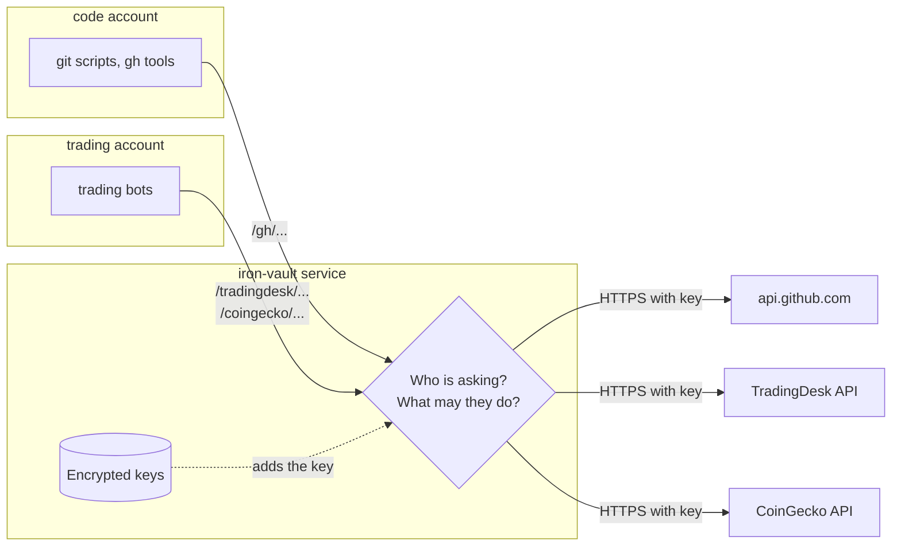

# Iron Vault on a shared Linux workstation: a beginner's guide

This guide explains one setup from start to finish: a single Linux machine where different kinds of work run under
different user accounts, and Iron Vault hands each account only the API access it needs. It assumes no knowledge of
cryptography, systemd or Linux permissions beyond "each user has their own files".

> **Status:** Iron Vault is still being built. This guide describes the planned behaviour in the
> [specification](iron-vault-specification.md) (§3.4 for how callers are recognised). Command names and config
> fields may still change.

## The situation

You have one Linux box and you have split your work across three accounts, so that malware in one account can't
reach everything:

| Account   | What it does                                       | API credentials it needs        |
|-----------|----------------------------------------------------|---------------------------------|
| `alice`   | Your main account: email, documents, the desktop  | AI services, Adobe, CRM         |
| `trading` | Crypto wallets and brokerage accounts             | TradingDesk, CoinGecko          |
| `code`    | Software development                              | GitHub                          |

You develop outside Docker because you need ordinary desktop (X) applications, so you rely on Linux user accounts
to keep things apart. That works well for files: `code` can't read `trading`'s wallet files.

## The problem

API keys have to live somewhere. Today they all live in `alice`'s home directory, in config files and environment
variables. That causes two problems:

1. **`alice` holds everything.** Malware that gets into `alice`'s account can copy every key at once: the AI
   services, Adobe, the CRM and the trading platforms.
2. **The other accounts need keys too.** To give `code` a GitHub token, you copy it into `code`'s home directory.
   Now malware in `code` can copy the token and use it from anywhere, for as long as it stays valid. You may never
   notice.

A copied key is the worst outcome: it works from the attacker's machine, it bypasses every limit you set, and the
only fix is to revoke it at the provider.

## What Iron Vault changes

Iron Vault is a small service that runs in the background under its own account, `iron-vault`. It holds the real
keys, encrypted, in a directory no ordinary account can read.

Think of it as a **front desk**. Your programs no longer carry keys. Instead they walk up to the front desk and
say "please send this request to GitHub for me". The desk checks who is asking and whether they're allowed to make
that request. If so, it adds the key, sends the request, and passes back the answer. The key never leaves the desk.



After the change:

- `code` can use GitHub through Iron Vault, but it can't read the GitHub token, and it can't reach the trading APIs.
- `trading` can use TradingDesk and CoinGecko, but not GitHub, and it can't read those keys either.
- `alice` no longer has the keys lying around in files. She manages them through Iron Vault's admin commands.

## How Iron Vault knows who is asking

When a program connects to Iron Vault's **Unix socket** (a special file programs use to talk to each other on the
same machine), the Linux kernel tells Iron Vault which user account the program runs as. A program can't lie about
this; only root could fake it.

So the rule is simple: **a request that arrives from the `code` account is the `code` caller**. You don't need
passwords, tokens or groups. You write in the config which account may use which routes, and the kernel's answer
does the rest.

The spec calls this **peer-account** identity, written `auth = "peer"` in the config.

### What about `http://localhost`?

Many tools only accept a web address such as `http://localhost:7878/gh`, not a socket file. Over a network
connection, even a local one, the kernel does *not* tell Iron Vault which account is connecting. For those tools,
Iron Vault gives the account a **caller token**: a long random password that the tool sends with each request.
Keep it in a file only that account can read.

| Connection                          | How Iron Vault recognises the account | What the account keeps         |
|-------------------------------------|---------------------------------------|--------------------------------|
| Unix socket `/run/iron-vault/proxy.sock` | The kernel reports the account   | Nothing                        |
| `http://127.0.0.1:7878`             | A caller token sent with each request | One caller token, not the API key |

A stolen caller token is much less dangerous than a stolen API key. It only works from this machine, only for that
account's routes, and only within that account's limits. You can replace it without touching the provider.

## Setting it up

The steps below are the planned flow. Run the `sudo` commands from `alice`'s terminal.

### 1. Install the package

The package creates the `iron-vault` account and its private directories, and installs Iron Vault as a system
service that starts at boot:

| Path                         | Owner        | Who else can get in                                |
|------------------------------|--------------|----------------------------------------------------|
| `/var/lib/iron-vault`        | `iron-vault` | Nobody. This holds the encrypted keys.             |
| `/etc/iron-vault/config.toml`| `iron-vault` | Nobody. This is the approved config.               |
| `/run/iron-vault`            | `iron-vault` | Other accounts can reach the sockets inside, but can't add, remove or replace files |

### 2. Create the vault

```sh
sudo iron-vault init
```

This creates the encryption keys, asks you to choose a passphrase, and shows you a **recovery key** once. Write the
recovery key down or store it in your password manager: it is how you get back in if you forget the passphrase.

> **Why `sudo`, and not just `alice`?** Admin commands only work for root or the `iron-vault` account. If plain
> `alice` could run them, malware in `alice`'s account could too. Going through `sudo` means typing your password
> each time. Approving a config change *also* needs your Iron Vault passphrase, so a hijacked `sudo` session alone
> isn't enough.

### 3. Add the credentials

```sh
sudo iron-vault add github
sudo iron-vault add tradingdesk
sudo iron-vault add coingecko
```

Iron Vault asks for each key at a prompt, not on the command line, so it never lands in your shell history. It also
asks which website the key may be sent to (for example `api.github.com`). That choice is locked in with the key: a
later config change can never send the GitHub token anywhere else.

Once a key is in, delete the old copies from config files and environment variables.

### 4. Write the config

The config says who may use what. Here is the whole thing for this machine:

```toml
schema_version = 1

# One socket for everyone. The connecting account decides what it may use.
[listeners.local]
unix_socket = "/run/iron-vault/proxy.sock"

# --- Who may use what ----------------------------------------------------

[callers.code]
listener = "local"
auth = "peer"
user = "code"
routes = ["gh"]

[callers.trading]
listener = "local"
auth = "peer"
user = "trading"
routes = ["tradingdesk", "coingecko"]

# --- Where each route goes -----------------------------------------------

[routes.gh]
prefix = "/gh"
upstream = "https://api.github.com"
credential = "github"
slot = { header = "Authorization", format = "Bearer {}" }
methods = ["GET", "POST", "PATCH"]
paths = ["/**"]
rate_limit = { requests = 300, per_seconds = 60, burst = 30 }

[routes.tradingdesk]
prefix = "/tradingdesk"
upstream = "https://api.tradingdesk.example"
credential = "tradingdesk"
slot = { header = "Authorization", format = "Bearer {}" }
methods = ["GET", "POST"]
paths = ["/v1/orders/**", "/v1/positions/**"]
rate_limit = { requests = 60, per_seconds = 60, burst = 10 }

[routes.coingecko]
prefix = "/coingecko"
upstream = "https://api.coingecko.com"
credential = "coingecko"
slot = { header = "x-cg-demo-api-key" }
methods = ["GET"]
paths = ["/api/v3/**"]
rate_limit = { requests = 30, per_seconds = 60, burst = 5 }
```

Reading it in plain words:

- **Listener:** where programs knock. Here it's one socket file.
- **Caller:** who is knocking. `code` is whatever runs as the `code` account.
- **Route:** a door to one API. It names the website, which key to use, and where in the request the key goes
  (the **slot**).
- **`methods` and `paths`:** which kinds of request the door allows. CoinGecko only allows reading (`GET`). Every
  route must list these; leaving them out never means "allow everything".
- **`rate_limit`:** how fast requests may come. If malware in `trading` starts hammering the API, it hits this limit.

You can make a door narrower for one account. To let `code` only *read* from GitHub, add a second route with the
same key and tighter rules, and grant `code` that one instead:

```toml
[routes.gh-read]
prefix = "/gh-read"
upstream = "https://api.github.com"
credential = "github"
slot = { header = "Authorization", format = "Bearer {}" }
methods = ["GET"]
paths = ["/repos/**", "/user"]
rate_limit = { requests = 300, per_seconds = 60, burst = 30 }
```

### 5. Approve the config

```sh
sudo iron-vault config approve
```

Iron Vault reads the new config, checks it, and shows you its own summary of what will change. If it looks right,
you approve it. Approving needs your Iron Vault passphrase.

Iron Vault only ever runs a config you approved. If someone edits the file behind your back, or puts back an older
one, Iron Vault refuses to use it.

### 6. Point the programs at Iron Vault

Programs in `code` and `trading` now send their API requests to Iron Vault instead of the provider, and leave the
key out:

```sh
# As the code account: list your GitHub repositories
curl --unix-socket /run/iron-vault/proxy.sock http://localhost/gh/user/repos

# As the trading account: get the Bitcoin price
curl --unix-socket /run/iron-vault/proxy.sock \
  "http://localhost/coingecko/api/v3/simple/price?ids=bitcoin&vs_currencies=usd"
```

The `http://localhost` part is only there because `curl` needs a web address; the request goes through the socket
file.

For a program that has a "base URL" setting, set it to the route. A Python script, for example, would use
`/gh` in place of `https://api.github.com`. Not every tool can talk to a socket file; for those, use the
`http://127.0.0.1` listener with a caller token, described above. Some command-line tools, such as `gh`, need more
than a base URL change and are not supported yet (specification §6).

## What each account can and can't do

| If malware gets into... | It can                                                         | It can't                                      |
|-------------------------|----------------------------------------------------------------|-----------------------------------------------|
| `code`                  | Make GitHub requests the `gh` route allows, at its rate limit  | Read the GitHub token; reach the trading APIs |
| `trading`               | Make TradingDesk and CoinGecko requests their routes allow     | Read those keys; reach GitHub                 |
| `alice`                 | Use any route granted to `alice`, if you grant her any         | Read any key; run admin commands without `sudo`; approve a config without your passphrase |

Iron Vault logs every request with the account, route and result, but never the key, so you can see afterwards what
was done in each account's name.

## What this doesn't protect against

- **Misuse through allowed routes.** Malware in `trading` can still place an order that the `tradingdesk` route
  allows. Keep routes as narrow as the work allows, and use the provider's own limits (such as trade size caps) as
  well.
- **Root.** Anyone who can become root, including through `sudo`, can read Iron Vault's memory once it's unlocked.
  Protect `alice`'s password and consider a hardware key for `sudo`.
- **Keys you type.** When you enter a key in step 3, it passes through `alice`'s terminal. Malware already running
  as `alice` at that moment could capture it.
- **Keys already copied.** Keys that sat in files before you moved them into Iron Vault may already have been
  copied. If in doubt, ask the provider for a new key and add that one instead.

## Words used in this guide

| Term          | Meaning                                                                                           |
|---------------|---------------------------------------------------------------------------------------------------|
| Caller        | A named program identity in the config; here, everything running as one account                    |
| Caller token  | A random password a caller sends when the connection doesn't reveal its account                    |
| Listener      | A socket file or network address where Iron Vault accepts requests                                 |
| Peer account  | The account the kernel reports for a program connecting to a socket file                           |
| Route         | A path prefix such as `/gh` that leads to one API, with one key and its limits                     |
| Slot          | The one place in a request where Iron Vault puts the key, such as the `Authorization` header       |
| Upstream      | The real API that Iron Vault forwards a request to                                                 |

The full definitions are in the [glossary](glossary.md).
