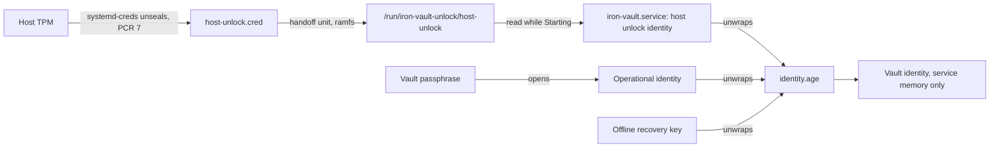

# TPM unlock

This document decides how a protected Linux installation unlocks its vault at startup with the machine's TPM, with no
owner present ([§14](iron-vault-specification.md#14-recipients-startup-and-memory)): which adapter seals and unseals,
which recipient role it enrols, how a portable machine gets its second secret, what a firmware or Secure Boot update
does, how power loss affects the TPM's dictionary-attack state, and what the release check must show. The passphrase
and the offline recovery key stay as they are: TPM unlock adds a way in, it replaces none.

The owner confirmed these decisions on 2026-11-11. The specification follows them: §4's Linux row and §14's TPM
unlock bullets and method table in [`iron-vault-specification.md`](iron-vault-specification.md), the "TPM unlock
binding" and "Host unlock handoff" gates in [`implementation-specification.md`](implementation-specification.md), and
the service unit in [linux-package.md](linux-package.md#service-unit).

This document introduces six terms, defined in the [glossary](glossary.md): *TPM unlock*, *Host unlock blob*,
*Handoff unit*, *Pre-boot secret*, *Owner-lock file* and *Unseal-failure file*.

## Scope

In scope: the [Linux package](linux-package.md), which runs the `Protected` deployment profile as `iron-vault.service`,
on a machine with a TPM 2.0 and systemd as init. **v0 supports TPM unlock on Ubuntu 24.04 LTS only** (systemd 255),
where the evidence below comes from ([Supported releases](#supported-releases)).

Out of scope:

- **The Compose profile.** It already unlocks this way ([docker-compose.md](docker-compose.md#host-unlock)), and this
  design reuses its mechanism. It shares the service's startup path, so the [owner-lock file](#lock-across-restarts)
  and the [`unseal_failed` outcome](#reporting-a-failed-unseal) reach it too.
- **The TPM approval signer** (EP-33). §14 keeps the approval key separate from the unlocking key; nothing here signs.
- **A TPM PIN.** The chosen adapter has none ([Portable machines](#portable-machines-and-the-second-secret)).
- **Windows and macOS**, whose platform providers are a later phase.
- **Signed PCR 11 policies and `systemd-pcrlock`**, which could survive Secure Boot updates
  ([Firmware and Secure Boot updates](#firmware-and-secure-boot-updates)); the implementation spec defers them.

## The adapter

§4 allowed two Linux adapters when this design began: "TPM through a host adapter using `tss-esapi`/`tpm2-tss`, or a
verified `systemd-creds` adapter". It now names the `systemd-creds` host unlock adapter for v0, and keeps an
in-service adapter with a TPM PIN for a later phase. The implementation spec names `age-plugin-tpm` as a lead. The
three candidates:

| | (a) `systemd-creds`, host unseals | (b) `tss-esapi` in the service | (c) `age-plugin-tpm` |
|---|---|---|---|
| Who opens the TPM | systemd, as root, once per boot | the service account, at each start | a plugin program the service runs |
| Service needs `/dev/tpmrm0` | no | yes | yes |
| New code in the credential-holding process | none | `tpm2-tss` (C) and OpenSSL, through FFI; `bindgen` and `pkg-config` at build | `age`'s plugin protocol and a child process |
| TPM PIN | no (`systemd-creds` has no PIN option) | possible | possible |
| Sealing policy maintained by | systemd | Iron Vault | the plugin's author |
| Verified here | the seal and unseal only, in the Compose profile's [release check](evidence/compose-unlock-check-2026-11-11.md) on an `swtpm` VM; the Protected setup is not yet (the service's mount namespace under `ProtectSystem=strict`, the `Wants=`/`After=` ordering, `RemainAfterExit=` across a service restart) | no | no |

**Decision: (a), `systemd-creds` through a separate handoff unit.** TPM unlock on Linux is the Compose profile's
[host unlock](docker-compose.md#host-unlock), installed by the package for `iron-vault.service` instead of for Docker.

Why:

- **The service never touches the TPM.** It keeps `PrivateDevices=yes` and gets no `DeviceAllow=`. A compromised
  service cannot unseal anything else sealed to this boot, and cannot exhaust the dictionary-attack counter that every
  PIN-protected TPM key on the host shares ([§17](iron-vault-specification.md#containerised-deployments) gives the same
  reason for containers). §14 now says the same: only root, through the host's init system, may read or unseal the
  service's TPM-sealed credential.
- **No TPM library runs in the process that holds provider credentials and answers callers.** (b) would put `tpm2-tss`
  and OpenSSL, through FFI, inside it. (c) would add a plugin protocol and a child process that the service must trust
  with the intermediate identity.
- **Most of it exists already.** The handoff, its trusted-path rule, its parser, the audit event,
  `init --host-unlock`, `recipient add --host-unlock` and the independence-rule handling are built for the Compose
  profile, whose seal and unseal passed their check. Extending them to `Protected` is a few lines; (b) or (c) would be
  a new subsystem.
- **Nothing outlives the boot.** The secret text is in the sealed blob on disk and, once unsealed, only in
  non-swappable memory: the unit's credentials directory and the handoff's ramfs.
- **No dependency changes.** (a) adds no crate. `Cargo.lock` already holds a second `rand` (0.8.8) and `rand_core`
  (0.6.4) beside the 0.10 line, and a second `getrandom` (0.2.17) beside 0.4.3, forced by `age` and `age-core`;
  `tss-esapi` 7.7 would add no third copy, but a C library and its build tooling. `age-plugin-tpm` is not a verified dependency.

What (a) costs:

- **No TPM PIN.** A portable machine gets its second secret from full-disk encryption instead
  ([below](#portable-machines-and-the-second-secret)).
- **One supported release in v0.** The [dictionary-attack analysis](#power-loss-and-dictionary-attack-state) reads
  systemd 255's source, and the evidence will come from Ubuntu 24.04 ([Supported releases](#supported-releases)).
- **A Secure Boot policy change ends unattended unlock** until the administrator provisions a new identity, as it does
  in the Compose profile ([below](#firmware-and-secure-boot-updates)).

### Why a handoff unit, and not `LoadCredentialEncrypted=` in the service unit

`iron-vault.service` could load the credential itself with `LoadCredentialEncrypted=`, and read it from
`$CREDENTIALS_DIRECTORY`. It does not, for two reasons found in systemd 255
([`exec-credential.c`](https://github.com/systemd/systemd/blob/v255/src/core/exec-credential.c)):

- **A failed decrypt fails the service's start.** systemd fails the unit when an absolute credential path cannot be
  decrypted, and does so before `ExecStart=`. After a PCR 7 change the service would never run: `Restart=on-failure`
  and `StartLimitIntervalSec=0` ([linux-package.md](linux-package.md#service-unit)) would retry once a second for ever,
  and the service would never reach Locked, so passphrase `unlock` would be impossible. The fallback §14 requires would
  be gone exactly when it is needed.
- **It widens the service's device policy.** With `PrivateDevices=yes`, `LoadCredentialEncrypted=` adds
  `/dev/tpmrm0 rw` to the unit's `DeviceAllow=`
  ([systemd.exec(5)](https://www.freedesktop.org/software/systemd/man/latest/systemd.exec.html#Credentials)). Whether
  the node then appears in the service's private `/dev` is not checked; the first reason decides on its own.

A separate oneshot unit fails on its own, and the service then starts without a handoff and waits Locked.

### Supported releases

*Decided (owner, 2026-11-11).* v0 supports TPM unlock on **Ubuntu 24.04 LTS** (systemd 255) only. Debian 12 ships
systemd 252, which handles the storage root key differently from 255, and has no evidence; it is added once a release
check run on it passes. The package itself still installs on both: only TPM unlock is limited. The provisioning
helper stops on any other release and names the supported one, so an unsupported machine waits Locked for passphrase
`unlock` as before.

## The recipient role

**Decision: TPM unlock on Linux is host unlock.** It enrols the host unlock identity with role
`host-unlock`, code 6, which the store already accepts, and reuses everything built for it:

- the [unlock handoff](docker-compose.md#format) `/run/iron-vault-unlock/host-unlock` and its format;
- the [host unlock blob](#provisioning) `/etc/iron-vault-host/host-unlock.cred`;
- `init --host-unlock` and `recipient add --host-unlock <age1…>`
  ([recipients.md](recipients.md#recipient-add---host-unlock-age1));
- the audit event `vault.host-unlock` and its refusals;
- part 1 of the [independence rule](recipients.md#independence-rule), where the host unlock adapter is configured for
  the `host-unlock` recipient whose key the handoff holds when the command runs.

The code change is the profile test. `tries_host_unlock` returns true for `Protected` as well as `Container`, so the
service tries the handoff at startup, `configured_host_unlock` reads it for `recipient remove`, and `init --host-unlock`
is accepted. The `--host-unlock` flag of `init` becomes visible in a default build as well as a container build.
`Development` stays excluded: it runs as the invoking user, with no root-owned handoff unit to trust.

Role code 4, `tpm`, stays reserved, still refused by the decoder. It is for a TPM the service opens itself: a later
in-service adapter with a TPM PIN, or the Windows platform provider. Such a role would be "configured" by something the
service can see, such as a sealed object in its state directory, which a host-held blob is not.

**Alternative: a separate `tpm` role.** Accept code 4 for the package and `host-unlock` for Compose, with
`init --tpm` and `recipient add --tpm`. The two would be the same key kind, sealed by the same tool and read from the
same handoff, differing only in name, so the rule "one name per concept" argues against it. It would also need a second
flag pair, a second "configured" rule and a second audit outcome for one mechanism. Its one advantage is that
`recipient list` would say `tpm` rather than `host-unlock` on a bare-metal server; the recipient's label can say that
instead.

## How it works



### Provisioning

The administrator provisions the **host unlock blob** once, as root, with the provisioning helper the package
ships. It is the Compose profile's [`provision-host-unlock.sh`](../packaging/compose/host/provision-host-unlock.sh),
with the same guarantees ([docker-compose.md](docker-compose.md#provisioning-on-the-host)): `age-keygen` generates the
identity, the secret text exists only in a pipe, `systemd-creds encrypt --with-key=tpm2 --tpm2-pcrs=7
--name=host-unlock` seals it to `/etc/iron-vault-host/host-unlock.cred` (root, `0600`, in a root `0700` directory), and
the recipient key `age1…` is printed for `init --host-unlock` or `recipient add --host-unlock`. `--tpm2-pcrs=7` is
always passed: systemd 255 binds PCR 7 by default, but current systemd binds none unless asked
([systemd-creds(1)](https://www.freedesktop.org/software/systemd/man/latest/systemd-creds.html)). "Credential" in
`systemd-creds` and `LoadCredentialEncrypted=` is systemd's word for any secret it hands a unit; it is never an Iron
Vault credential.

The package's helper adds what the Compose script lacks:

- a release check: it stops on anything but Ubuntu 24.04 ([Supported releases](#supported-releases));
- one argument, required and with no default: `--server` or `--portable`. It makes the administrator choose which
  §14 condition the machine meets ([Portable machines](#portable-machines-and-the-second-secret));
- a record of that choice ([The acceptance record](#the-acceptance-record)).

The helper is a root shell script, not the `iron-vault` CLI, so §4's "the CLI never … calls TPM" still holds. It never
clears the TPM, takes ownership, sets hierarchy authorization or changes dictionary-attack parameters.

### At boot

The package ships the **handoff unit**, `iron-vault-host-unlock.service`, which loads the host unlock blob and
installs the handoff before the service starts. It is the Compose unit with the service in place of Docker, the
[unseal-failure file](#reporting-a-failed-unseal) lines, and no `[Install]` section:

```ini
[Unit]
Description=Iron Vault host unlock handoff
Before=iron-vault.service
After=systemd-tmpfiles-setup.service
ConditionPathExists=/etc/iron-vault-host/host-unlock.cred

[Service]
Type=oneshot
RemainAfterExit=yes
LoadCredentialEncrypted=host-unlock:/etc/iron-vault-host/host-unlock.cred
ExecStart=/bin/rm -f /run/iron-vault-unlock/unseal-failed
ExecStart=/bin/mount -t ramfs -o mode=0711,nosuid,nodev,noexec ramfs /run/iron-vault-unlock
ExecStart=/usr/bin/install -o iron-vault -g iron-vault -m 0400 %d/host-unlock /run/iron-vault-unlock/host-unlock
ExecStopPost=-/bin/rm -f /run/iron-vault-unlock/host-unlock
ExecStopPost=-/bin/umount /run/iron-vault-unlock
ExecStopPost=-/bin/sh -c 'test "$SERVICE_RESULT" = success || : > /run/iron-vault-unlock/unseal-failed'
```

`iron-vault.service` gains two lines in `[Unit]`:

```ini
Wants=iron-vault-host-unlock.service
After=iron-vault-host-unlock.service
```

- **`Wants=`, not `Requires=`.** A failed handoff unit does not stop the service; it starts without a handoff, records
  `vault.host-unlock` `unseal_failed`, and waits Locked for passphrase `unlock`.
- **No enable step.** The service pulls the handoff unit in at every start. On a machine with no host unlock blob,
  `ConditionPathExists=` skips it, which is not a failure, so one unit file serves every install.
- **`RemainAfterExit=yes`.** A service restart, by `Restart=on-failure`, an upgrade or `systemctl restart`, finds the
  handoff unit active and does not unseal again. The TPM is used once per boot. After a failed unseal the next
  service start retries it, at most once a second under the restart loop; a PIN-less policy failure does not count
  toward dictionary-attack lockout ([below](#power-loss-and-dictionary-attack-state)).
- **The service's mount namespace.** `ProtectSystem=strict` and `PrivateDevices=yes` give the service its own mount
  namespace, created when it starts. `After=` puts the ramfs mount in place first, so the namespace holds it, read-only.
  A handoff unit started later, while the service runs (the [enrolment](#enrolment-and-retirement) steps), reaches the
  service through mount propagation: systemd makes a service's namespace a slave of the host's. The release check
  confirms both. The service needs no `ReadWritePaths=` entry for it.
- **`/run/iron-vault-unlock`** is the mount point, created by the package's `tmpfiles.d` as root `0711`. The ramfs
  mounted over it is root `0711` too, so the service account opens the one file it knows the name of and can list
  nothing. The modes match because every `systemd-tmpfiles --create` re-applies the mount point's mode through the
  mount, to the ramfs root.

The ramfs, the file's owner and mode and the `ExecStopPost=` clean-up have the reasons given for the Compose unit
([docker-compose.md](docker-compose.md#at-boot)).

### In the service

The service reads the handoff once, while Starting, exactly as a Container-profile service does
([docker-compose.md](docker-compose.md#in-the-container)), with one check before it: the
[owner-lock file](#lock-across-restarts). Then locked memory, the `UnlockHandoff` trusted-path rule, an Initialized
vault, the unwrap of `identity.age` and the manifest MAC, and then Checking
([§15](iron-vault-specification.md#15-service-states-and-errors)). Each attempt writes one `vault.host-unlock` record.
The intermediate identity is cleared once the vault identity is unwrapped.

`vault.host-unlock` gains two values of `host_unlock_outcome`, beside `unlocked`, `absent` and `refused`:

| Outcome | Level | When |
|---|---|---|
| `owner_locked` | INFO | The owner-lock file is present; the handoff was not opened |
| `unseal_failed` | WARN | No handoff, and the unseal-failure file is present |

`status` gains a field with the startup's `host_unlock_outcome`, so an administrator sees `unseal_failed` without
reading the audit log. This replaces the default of [docker-compose.md](docker-compose.md#open-questions)'s question 3
for both profiles.

### `lock` across restarts

*Decided (owner, 2026-11-11).* An explicit `lock` survives a crash, a restart and a reboot. Without this, a restart
would read the handoff again and undo it: `Restart=on-failure` restarts the service after any crash, and an ordinary
account can cause one, for example by filling `/var/log` so that an audit-log write fails and `serve` exits
([linux-package.md](linux-package.md#service-unit)).

The **owner-lock file** is the empty file `locked-by-owner` in the state directory (`/var/lib/iron-vault` in the
package):

- **`lock` writes it**, with `durable_replace`, under the service-wide lock and before it withdraws the serving
  snapshot, so a crash at any later point still leaves it. It does so in every profile, so the state directory's
  contents do not depend on the profile; only the profiles that try host unlock read it. If the write fails, `lock`
  still clears the vault, logs the failure at WARN, and its result says the lock will not survive a restart; the CLI
  prints that on stderr.
- **Startup reads it first.** If anything is at that name, whatever its type, the service skips host unlock, records
  `owner_locked` and stays Locked. A file it cannot inspect counts as present, so the check fails closed.
- **A passphrase `unlock` removes it**, with `durable_remove`, once the vault identity has unwrapped and before the
  answer. If the removal fails, the unlock still succeeds, the next start stays Locked, and the CLI says so.
- **A recovery key unlock would remove it too.** v0 has no command that opens the vault for serving with the recovery
  key; when one comes, it is owner-present and clears the file as passphrase `unlock` does. `recovery check` leaves the
  service's state alone and does not touch it. Host unlock never removes it.
- **It is store-owned.** The initialization state counts it as a known name, so an Initialized vault does not log it
  as a foreign file. It is not a vault file: like `recovery.toml`, a state directory holding only it is Uninitialized.
  `init` and `import` remove a stale one when they write a new vault; reset removes it with the other store-owned
  files ([Interactions](#interactions)); a migration bundle never carries it.

`lock` is still allowed only from Ready or Unavailable. A Locked service has nothing to clear, and it writes no file
([open question 4](#open-questions)).

The service account can delete the file. That gives a compromised service nothing: it can already read the handoff,
which stays on its ramfs for the whole boot.

### Reporting a failed unseal

*Decided (owner, 2026-11-11).* A failed unseal is reported as `unseal_failed`, apart from a machine never provisioned
(`absent`), because it is the routine case this design expects after a `dbx` or KEK update on an unattended server.

The handoff unit's last `ExecStopPost=` line writes the **unseal-failure file**, the empty root `0644` file
`/run/iron-vault-unlock/unseal-failed`, whenever `$SERVICE_RESULT` is not `success`. It runs after the ramfs is
unmounted, so it lands in the root `0711` directory beneath, which the service can open by name. A successful start
removes a stale one before mounting, and the ramfs hides the directory beneath anyway. `/run` goes at shutdown, so no
file outlives the boot.

**Why the line runs after a failed decrypt.** systemd sets up a unit's credentials, `LoadCredentialEncrypted=`
included, only for a command spawned with the `EXEC_WRITE_CREDENTIALS` flag
([`exec-invoke.c`](https://github.com/systemd/systemd/blob/v255/src/core/exec-invoke.c) lines 4454–4459, which call
`exec_setup_credentials` in [`exec-credential.c`](https://github.com/systemd/systemd/blob/v255/src/core/exec-credential.c)).
A failed decrypt there ends that command with `EXIT_CREDENTIALS`, before it executes. In systemd 255's
[`service.c`](https://github.com/systemd/systemd/blob/v255/src/core/service.c), every `ExecStart=` command of a oneshot
unit gets the flag (lines 2392 and 2693), and the first `ExecStopPost=` command does not (`service_enter_stop_post`,
lines 2066–2070). Each later control command gets it only while the unit is in a starting, running or reloading
state (`service_run_next_control`, line 2657), never in `stop-post`. So after a failed decrypt the first `ExecStart=`
exits with `EXIT_CREDENTIALS`, the unit's result becomes `exit-code` (`service_sigchld_event`, lines 3773–3774), the
oneshot goes through `stop-sigterm` to `stop-post` (lines 3812–3818 and 2145–2146), and the `ExecStopPost=` lines run
with no credential set-up, with `$SERVICE_RESULT` set to that result (lines 1734–1742). It also means the
`ExecStart=` line that removes a stale file never runs on that path; the `ExecStopPost=` line writes the file again.
[Release check](#release-checks) 9 confirms this on a real install.

When the handoff is missing, the service looks for the file: a regular file owned by root, not a symlink, means
`unseal_failed`; anything else means `absent`. It is a diagnostic only and never changes what the service does: both
outcomes leave it Locked for passphrase `unlock`. Any failure of the handoff unit writes it, not only a failed decrypt;
the unit's journal and `systemctl --failed` say which. A unit skipped by `ConditionPathExists=` never ran, so writes
nothing.

### Lifetime and failure

These follow the Compose profile ([lifetime](docker-compose.md#lifetime), [failure](docker-compose.md#failure)):

- The handoff stays on its ramfs until shutdown, so a crashed service restarts unattended, as §15 asks of a healthy
  TPM service, unless the owner locked it.
- After an explicit `lock` the service stays Locked until a passphrase `unlock`, across crashes, restarts and reboots
  ([`lock` across restarts](#lock-across-restarts)).
- A missing, unsafe or wrong handoff leaves the service Locked with passphrase `unlock` working, and is not counted
  toward the [passphrase attempt limit](migration-authorization.md#passphrase-attempt-limit).
- A failed unseal leaves no handoff and an unseal-failure file, so the service records `unseal_failed`
  ([Reporting a failed unseal](#reporting-a-failed-unseal)).

### Enrolment and retirement

The handoff unit runs before the service only at boot. On a running install it is started by hand, and the running
service sees its mount through propagation ([At boot](#at-boot)).

- **A new vault:** run the helper, `systemctl start iron-vault-host-unlock.service`, then
  `sudo iron-vault init --host-unlock`.
- **An existing vault:** run the helper, `systemctl start iron-vault-host-unlock.service`, then
  `sudo iron-vault recipient add --host-unlock <age1…> --label <text>`. A restart of the service then reaches Ready
  with no `unlock`.
- **On a new machine, from a migration bundle:** run the helper, start the handoff unit, then
  `sudo iron-vault import --host-unlock`. Import reads the handoff as `init --host-unlock` does and enrols this
  machine's `host-unlock` recipient while it writes the vault, as
  [§16](iron-vault-specification.md#16-administration-recovery-and-migration) step 4 asks. The bundle carries none of
  the source's recipients, so there is no old recipient to remove; the source machine's host unlock blob is
  useless off its TPM and goes with `forget-machine`.
- **Retiring TPM unlock:** stop the handoff unit, remove `host-unlock.cred`, then `recipient remove` the `host-unlock`
  recipient. Part 1 of the independence rule no longer keeps it.
- **Decommissioning the machine** is `forget-machine`'s job ([§16](iron-vault-specification.md#16-administration-recovery-and-migration); [forget-machine.md](forget-machine.md)).

## Portable machines and the second secret

§14: "On a portable device, TPM unlock should be combined with a second secret: a full-disk-encryption pre-boot PIN or a
TPM unlock PIN." `systemd-creds` has no PIN, so in v0 the second secret is the **pre-boot secret** of full-disk
encryption: a LUKS passphrase typed at boot, or a LUKS TPM key slot that needs a PIN
(`systemd-cryptenroll --tpm2-with-pin=yes`,
[systemd-cryptenroll(1)](https://www.freedesktop.org/software/systemd/man/latest/systemd-cryptenroll.html)).

Why it is enough: the host unlock blob lives on the encrypted root filesystem. A thief who boots the stolen
machine, even from a trusted image that reproduces PCR 7, cannot read the sealed blob without the pre-boot secret, so
cannot unseal it. A LUKS slot that the TPM opens with no PIN gives no second secret, and nor does the approval
passphrase (§14).

The service cannot see how the disk was opened, and the profile does not distinguish a laptop from a server. The
check is in the helper, and **it runs once, at provisioning**. A PIN-less slot enrolled later, for example with
`systemd-cryptenroll --tpm2-device=auto`, silently removes the second secret; the install guide says so, and says to
run the helper again after any change to the disk's key slots.

A TPM PIN for the vault itself needs an adapter that can ask for one, which (a) cannot; it is left for a later
in-service adapter with role `tpm`. The recipe [Unlock at boot with a TPM](../book/src/cookbook/tpm-unlock.md)
says plainly that v0 has no TPM PIN.

### `--portable`

The helper finds every LUKS device under `/etc/iron-vault-host` by walking the device-mapper stack down from the
filesystem's device (`/sys/class/block/*/slaves`, which lists partitions as well as the disks under `/sys/block`), so a
root on LVM-on-LUKS, or LUKS on LVM, resolves to its LUKS layer. A partition of an md or device-mapper device (`md0p1`)
is walked as its parent device, since a partition has no slaves of its own. `findmnt` names only one device, so when the
filesystem is `btrfs` or `bcachefs`, which can span several, the helper walks every member of the filesystem whose UUID
`findmnt` reports, each path judged on its own:

- btrfs: each entry of `/sys/fs/btrfs/UUID/devices/`, named for its block device;
- bcachefs: each `/sys/fs/bcachefs/UUID/dev-N/block` link, which the kernel's bcachefs sysfs makes to the member's block
  device. This layout is unverified on a real multi-device bcachefs, so the helper treats any member it cannot read as
  the whole list being unreadable.

However the stack is walked, the helper warns when any of these hold:

- some path in the stack reaches a disk with no `dm-crypt` layer above it: that part of the disk is unencrypted, as when
  an LV spans a LUKS PV and a plain one, or a btrfs filesystem a LUKS member and a plain one;
- a `systemd-tpm2` token in `cryptsetup luksDump` does not need a PIN (`tpm2-pin` false);
- a `clevis` token is present, TPM or Tang: neither asks for anything at boot. A LUKS1 header has no tokens, so there
  the helper runs `luksmeta show -d DEVICE` and warns on clevis's UUID, `cb6e8904-81ff-40da-a84a-07ab9ab5715e`. Real
  luksmeta prints a `SLOT active|inactive` line per key slot, so output without one is a check that could not run. A
  passphrase-only LUKS1 volume has no luksmeta area, so `luksmeta show` fails with "Device is not initialized": the warning
  stays, because the helper does not read luksmeta's stderr, and it says that this message means no clevis binding exists, so
  the administrator can accept it. It never suggests initializing luksmeta, which writes to the LUKS header;
- a LUKS2 token is of a type the helper does not recognise (`systemd-fido2` and `systemd-pkcs11` need a device the
  person holds, so they pass);
- `/etc/crypttab` names a key file for the device (a third field other than `none` or `-`), has `tpm2-device=` while
  some `systemd-tpm2` token needs no PIN, or has `keyscript=` with a script not known to ask a person. A keyscript such
  as `tpm2-initramfs-tool` opens the disk with no person present and leaves the third field `none`. With `keyscript=` the
  third field is the script's argument (`decrypt_keyctl`'s identifier, `askpass`'s prompt), so it is not checked as a key
  file. The helper cannot read a script, so only `decrypt_keyctl` (under `/lib/cryptsetup/scripts/`, where a bare name resolves) and
  `/lib/cryptsetup/askpass` pass, and any other script warns and is named;
- an initramfs holds a key file (`lsinitramfs` lists one under `cryptroot/keyfiles/`, where initramfs-tools puts
  them). Every `/boot/initrd.img-*` is checked, because a kernel update rebuilds them and any of them may boot.

A dm-crypt layer with no LUKS header (plain `cryptsetup`) warns that its key was not checked, and so does a LUKS layer
with no entry of its mapping name in `/etc/crypttab`. A `systemd-tpm2` token counts as needing a PIN only when
`luksDump` prints `tpm2-pin: true`; a token that prints no such line, as when cryptsetup lacks systemd's token plugin,
warns.

**A check that cannot run warns; it never passes.** A missing `cryptsetup`, `luksmeta` (on a LUKS1 volume) or
`lsinitramfs`, a device-mapper stack it cannot resolve, a btrfs or bcachefs member list that is missing, empty or
unreadable, a failed `luksDump` or `luksmeta`, a `luksmeta` listing with no key slot, an unreadable crypttab, or an initramfs
listing that is empty each give a
warning naming what could not be checked and how to fix that.

Each warning says that anyone who steals the machine can boot it and start the vault, and names the fix: encrypt the
disk, remove the key file, or re-enrol the slot it names with `systemd-cryptenroll --tpm2-with-pin=yes`, which
changes the key slot, not the data. The helper then seals nothing until the administrator accepts the risk:

- **On a terminal**, the administrator types `yes`; any other answer stops it.
- **When stdin is not a terminal**, the helper stops unless `--accept-no-second-secret` was given. It never reads an
  answer from a pipe, so `yes |` cannot accept for anyone. The flag is a usage error with `--server`, as
  `--accept-physical-access` is with `--portable`.

The check is best effort: it cannot see a passphrase written on the laptop. The choice is the owner's, as §14 allows,
so the helper warns rather than refuses.

### `--server`

`--server` prints §14's condition, that anyone with physical access and a trusted boot image can start the vault, and
asks the administrator to confirm it, under the same terminal rule: when stdin is not a terminal it stops unless
`--accept-physical-access` was given.

### The acceptance record

The service cannot see `/etc/iron-vault-host`, so its audit log cannot hold the choice. The helper records it twice,
before sealing:

- **in the journal**, through `logger -t iron-vault-host-unlock -p auth.notice`, or `auth.warning` when a warning was
  accepted: the mode, each warning, how it was accepted (terminal or flag) and `SUDO_USER`;
- **in `/etc/iron-vault-host/provisioning.txt`**, root `0600`, beside the blob: the same lines with the time,
  replaced whole at each provisioning (a temp file in the same directory, then a rename). The install guide and the
  release check read it.

A record that cannot be written stops the helper before it seals: the journal is written through `logger`, and a
failed `logger` or file write is an error, not a warning. `--server` has no warning to accept, so its journal lines are
`auth.notice`.

## Firmware and Secure Boot updates

§14: "A routine firmware update must not strand the vault." The seal is bound to PCR 7, which the implementation spec
chose because PCRs 0–4 change with firmware code.

What changes PCR 7 ([systemd-cryptenroll(1)](https://www.freedesktop.org/software/systemd/man/latest/systemd-cryptenroll.html),
[shim `README.tpm`](https://github.com/rhboot/shim/blob/main/README.tpm)):

- turning Secure Boot on or off;
- an update to the Secure Boot keys or databases: PK, KEK, `db`, `dbx`;
- a change in which certificate verifies the boot chain, such as a shim signed by a new CA;
- shim's `MokSBState` and SBAT level;
- an option ROM or UEFI driver verified by a different `db` entry: a new GPU or network card, or new firmware for one.

What usually does not: a firmware code update that leaves the Secure Boot variables alone, a new kernel or initrd
signed by the same key, and enrolling a MOK that verifies no boot-chain binary. Some vendors' firmware updates reset
the Secure Boot variables to factory defaults, which changes PCR 7 like a key update; treat a firmware update as one
unless the vendor says otherwise.

`dbx` updates are routine, delivered by `fwupd` and distribution updates, and Microsoft's 2011 UEFI CAs expired in June
2026, so the `KEK` and `db` updates that add the 2023 CAs are reaching machines now
([fwupd `uefi-db`](https://github.com/fwupd/fwupd/blob/main/docs/uefi-db.md)). Each changes PCR 7 at the next boot.
**Unattended unlock does not survive them.**

**The vault is not stranded.** After a PCR 7 change the handoff unit fails, the service waits Locked with
`unseal_failed`, and passphrase `unlock` and the recovery key work as before.

**Before a Secure Boot key or firmware update**, the owner:

1. runs `sudo iron-vault recovery check` with the offline recovery key, to prove a way in that does not need the TPM;
2. confirms that the vault passphrase holder can reach the machine after the reboot;
3. schedules the update in a window when callers can do without the vault until the passphrase is typed.

**Afterwards**, restoring unattended unlock:

1. `sudo iron-vault unlock` with the vault passphrase;
2. move the old blob aside and run the helper, which prints a new recipient key;
3. `systemctl restart iron-vault-host-unlock.service`;
4. `sudo iron-vault recipient add --host-unlock <new age1…>`;
5. restart the service and check it reaches Ready with no `unlock`;
6. `sudo iron-vault recipient remove <old age1…>`, and delete the old blob.

The package documents both lists, and that a server applying Secure Boot updates unattended needs someone to unlock
it afterwards. A server that cannot have that should hold Secure Boot updates for a maintenance window.

**Not offered: a bridge seal.** Before a planned update the helper could seal a second identity to no PCR, valid for
one boot, and re-seal to PCR 7 afterwards. While it exists, any OS booted on the machine can unseal it; on a server
without full-disk encryption that is anyone with physical access. That is worse than a Locked service, so the default
is not to offer it ([open question 1](#open-questions)).

**Later:** a signed PCR 11 policy (`--tpm2-public-key`) or `systemd-pcrlock`, which predicts PCR 7 after a `dbx`
update, could keep unattended unlock across updates. The implementation spec defers PCR 11; both wait for that work.

## Power loss and dictionary-attack state

§15: "The implementation must verify how unclean power loss affects its chosen TPM session and dictionary-attack state;
it must not assume that repeated power loss cannot cause lockout."

What the chosen adapter uses, from systemd 255's
[`tpm2-util.c`](https://github.com/systemd/systemd/blob/v255/src/shared/tpm2-util.c):

- The sealed object has no authorization value: it is unsealed through a policy session that checks PCR 7 alone.
- The storage root key `systemd-creds` seals under, persistent at `0x81000001`, is created with `noDA`.
- The parameter-encryption session is salted with that key.

What the TPM does with that, from the TPM 2.0 library specification (Part 1, dictionary-attack protection) and the
reference implementation ([libtpms `SessionProcess.c`](https://github.com/stefanberger/libtpms/blob/stable-0.10/src/tpm2/SessionProcess.c)):

- **Lockout does not block the unseal.** A policy session checks lockout only when the policy needs the object's
  authorization value or password, and this one needs neither.
- **The unseal does not arm the power-loss penalty.** After an unclean shutdown the TPM counts one failed try only if
  a dictionary-attack-protected authorization was used since the last orderly shutdown. A PIN-less policy session
  never marks it so.
- **A PCR mismatch is not a failed try.** It is a policy failure, which the dictionary-attack counter does not count.

So TPM unlock neither suffers lockout nor causes it. Other TPM users on the same machine, such as a LUKS slot with a
PIN, still can; that exposure is theirs and does not stop this unseal. This is the reference code's behaviour; firmware
TPMs implement it themselves, so the release check measures it on hardware.

## Threats

| Threat | Control | What remains |
|---|---|---|
| A compromised service unseals other secrets or exhausts the TPM's lockout counter | The service has no TPM device (`PrivateDevices=yes`, no `DeviceAllow=`); root unseals once per boot | None from the service |
| An ordinary account reads the intermediate identity | The handoff is the service account's `0400` in a root `0711` ramfs; the blob is root `0600` in a root `0700` directory | A member of the `tss` group can open `/dev/tpmrm0` (`tss:tss 0660` on Ubuntu) but cannot read the sealed blob |
| An account that can open the TPM denies unattended unlock | None: Linux leaves the owner and lockout authorizations empty, and the helper sets neither | A `tss` member can clear the TPM, or set an owner authorization so the storage root key cannot be made again. Either ends unattended unlock until re-provisioning; the vault waits Locked, not stranded |
| A crash or reboot undoes an explicit `lock` | The [owner-lock file](#lock-across-restarts) keeps host unlock off until a passphrase `unlock` | The service account or root can delete it; the service account can already read the handoff |
| A thief boots a stolen server from a trusted image | None: §14 accepts it for a server | The administrator declares `--server`, and the [acceptance record](#the-acceptance-record) says so |
| A thief boots a stolen laptop | The pre-boot secret protects the disk that holds the sealed blob | A laptop whose disk is unencrypted, or opened with no person present, after the administrator accepts `--portable`'s warning; a key slot added after provisioning, which the one-time check never sees |
| A Secure Boot update ends unattended unlock | Passphrase `unlock` and the recovery key; `unseal_failed` in `status`; documented re-provisioning | A server waits Locked until someone comes |
| The plaintext identity reaches disk | ramfs and the credentials directory, both unswappable; nothing in the environment or a persistent file | Hibernation writes the ramfs, like all RAM, into the hibernation image; §14 requires encrypted hibernation storage ([§14](iron-vault-specification.md#14-recipients-startup-and-memory), memory). This matters most on portable machines |
| A backup copies the sealed blob | It opens only on this TPM, at this PCR 7 | A backup with the blob and access to this machine at the same PCR 7 unseals it, as the machine itself does |

## Release checks

`scripts/release/tpm-unlock-check.sh` runs on a disposable machine with the package installed, behind the same
`--i-know-this-is-a-disposable-vm` opt-in as the Compose checks, in parts around reboots, printing one PASS, FAIL or
SKIP line per item. It is the evidence for the implementation spec's "TPM unlock binding" and "TPM authorization and
power failure" gates.

**OS matrix:** Ubuntu 24.04 LTS (systemd 255), the one supported release. A run on Debian 12 is what would add it.

1. `iron-vault.service` has `PrivateDevices=yes` and no TPM in `DeviceAllow=` (`systemctl show`), and its process's
   `/dev` has no `tpm*` node.
2. With the service already running, the helper, `systemctl start iron-vault-host-unlock.service` and
   `init --host-unlock` enrol the identity; a reboot then reaches Ready with no `unlock`, and `vault.host-unlock` says
   `unlocked`.
3. `kill -9` of the service, and reinstalling the same `.deb`, each reach Ready again with no `unlock`, and the handoff
   unit did not run again.
4. `recovery check` opens the same vault, and `identity.age` has three X25519 stanzas.
5. The handoff is on a ramfs (`findmnt`), the service account's `0400`, in a root `0711` mount; an ordinary account
   can read neither it nor the blob.
6. No `AGE-SECRET-KEY` appears in `/etc`, `/var`, the service's environment or swap.
7. **Handoff after the service.** On a vault with no `host-unlock` recipient and the service running, the helper, a
   start of the handoff unit and `recipient add --host-unlock`; the running service sees the handoff, so
   `recipient remove` of that recipient is refused.
8. **Owner lock.** From Ready, `lock` leaves `locked-by-owner` in the state directory. `kill -9` of the service
   restarts it Locked with `vault.host-unlock` `owner_locked`, and so does a reboot. A passphrase `unlock` reaches
   Ready and removes the file; a `kill -9` then reaches Ready with no `unlock`.
9. **Failed unseal.** With PCR 7 extended (`tpm2_pcrextend 7:sha256=…`), restarting both units leaves the service
   Locked with `vault.host-unlock` and `status` saying `unseal_failed`, a root-owned
   `/run/iron-vault-unlock/unseal-failed`, and passphrase `unlock` working; the
   [re-provisioning steps](#firmware-and-secure-boot-updates) then restore unattended unlock, the file is gone, and the
   old recipient is removed.
10. Retiring TPM unlock leaves the service starting Locked with `absent`, the handoff unit skipped and no
    unseal-failure file.
11. `tpm2_getcap properties-variable` reads `TPM2_PT_LOCKOUT_COUNTER` before and after item 9: unchanged by the PCR 7
    mismatch.
12. Nothing but the admin socket and the request listeners listens.
13. **`--portable`**, on a VM whose root can be rebuilt between cases. It warns, and seals only after `yes`, for: an
    unencrypted root; a LUKS root with a PIN-less `systemd-tpm2` token; a `clevis` token; a crypttab key file; a crypttab
    keyscript. It gives no warning for a LUKS root opened by passphrase only, or by a TPM+PIN slot, including on LVM-on-LUKS. With
    `cryptsetup` removed it warns that it could not check. Run as `yes | helper --portable`, it stops with nothing
    sealed. Each accepted warning appears in the journal and in `provisioning.txt`.
14. The helper stops on a release other than Ubuntu 24.04 (SKIP when none is at hand).

Two items need the hypervisor rather than the script, and are recorded with its output:

- **Power loss:** read `TPM2_PT_MAX_AUTH_FAIL` first, then more hard power-offs than that value, each after the boot's
  unseal. If each counted as a failed try the TPM would be in lockout by the end; the check passes when
  `TPM2_PT_LOCKOUT_COUNTER` is unchanged and the unseal still works at the next boot.
- **Lockout (emulated TPM only):** lockout induced with wrong authorizations on a throwaway dictionary-attack-protected
  key, then a reboot still reaches Ready with no `unlock`. This is never done on a real machine's TPM.

The gate is met by a run on Ubuntu 24.04 in a VM with `swtpm` and OVMF Secure Boot, and a run on Ubuntu 24.04 on a
machine with a firmware TPM for the non-destructive items and the power-loss item.

## Interactions

- **Reset** (K-315, `design/reset.md`). `locked-by-owner` joins reset's list of store-owned files and goes with the
  rest of the state directory, so a vault made after a reset host-unlocks again; it is not a vault file, so a
  directory holding only it is `nothing-to-reset`. This design keeps no TPM-sealed blob in the state directory and
  makes no persistent TPM handle or NV index of its own: the blob is in `/etc/iron-vault-host`, outside the
  directories reset touches, and the storage root key at `0x81000001` is systemd's, shared with every other
  `systemd-creds` and `systemd-cryptenroll` user, so neither reset nor `forget-machine` may remove it unasked. Host
  unlock at startup refuses Unfinished reset, as it refuses anything but Initialized.
- **Migration bundle** (K-307). `import --host-unlock` reads the handoff as `init --host-unlock` does and enrols the
  destination's `host-unlock` recipient during the import. The bundle never carries `locked-by-owner`.
- **Compose profile** ([docker-compose.md](docker-compose.md)). The startup path is shared, so the owner-lock file
  holds there too: [Lifetime](docker-compose.md#lifetime) no longer says `lock` lasts only until a restart. Its
  handoff unit has the same unseal-failure lines ([docker-compose.md](docker-compose.md#at-boot)).

## Work that follows

In order:

1. **The profile change:** `tries_host_unlock` accepts `Protected`, `init --host-unlock` in a default build, and the
   wording in [docker-compose.md](docker-compose.md), [recipients.md](recipients.md),
   [audit-logging.md](audit-logging.md) and the glossary entries *Host unlock*, *Host unlock identity* and
   *Unlock handoff* that now say "container profile". No store change. `import --host-unlock` (K-307's tickets) is
   accepted wherever `init --host-unlock` is, so it needs this first.
2. **The owner-lock file** (done in K-338): `lock` writes it and reports a failed write, passphrase `unlock` removes it,
   startup skips host unlock with `owner_locked`, and the initialization state's known names gain it. Docs:
   admin-protocol.md (the `lock` and `unlock` results), vault-initialization.md, audit-logging.md and
   docker-compose.md's lifetime. Reset's store-owned list gains it and reset writes it before its withdrawal.
3. **The unseal-failure report:** the service reads `unseal-failed` when the handoff is missing, `unseal_failed` in
   audit-logging.md, and the new `status` field in admin-protocol.md. The unit lines ship with item 4.
4. **Packaging** (done in K-323): the handoff unit with the unseal-failure lines, the
   helper with the release check and `--server`, the `Wants=` and `After=` lines, the `tmpfiles.d` line, and the
   [linux-package.md](linux-package.md) edits. The handoff unit is installed as a plain asset that `systemd-units`'
   `unit-name` leaves out, so the maintainer scripts never restart it on upgrade; `build-deb.sh` checks it is present
   and that the service unit still has no `DeviceAllow=`. It also says what [remove](linux-package.md#remove) and
   [purge](linux-package.md#purge) do. Default: `prerm remove` stops the handoff unit after the service, so its ramfs
   and handoff go, and dpkg removes the unit file; `/etc/iron-vault-host` stays on remove, and purge deletes it only
   when the vault question deletes the vault, since its identity opens only that vault and a kept vault needs it again.
5. **`--portable` and the acceptance record** (done in K-324): the checks, the terminal rule and its flags, and `provisioning.txt`.
6. **The release check and the manual** (done in K-325): `tpm-unlock-check.sh`, an installation guide section with the
   before-and-after update lists, a cookbook recipe replacing the roadmap one, and the one-time nature of the
   `--portable` check.
7. **The runs:** the release check on an Ubuntu 24.04 VM and on Ubuntu 24.04 hardware.

## Open questions

1. **A bridge seal for planned Secure Boot updates.** *Default:* not offered
   ([Firmware and Secure Boot updates](#firmware-and-secure-boot-updates)).
2. **systemd upgrades.** systemd changes how `systemd-creds` binds to the storage root key between releases. Not
   checked: whether a blob sealed under one distribution release still decrypts after an upgrade to the next.
   *Default:* the release check covers Ubuntu 24.04 only, and the install guide tells the administrator to have the
   vault passphrase at hand for a distribution upgrade; a failure there reads `unseal_failed`, as a Secure Boot change
   does.
3. **An owner hierarchy password.** `systemd-creds` creates its storage root key under the owner hierarchy, whose
   authorization is empty on Linux by default. A machine where another OS set it is not checked. *Default:* the helper
   fails with `systemd-creds`'s error, and the guide says so.
4. **`lock` in Locked.** A service Locked after a failed or absent host unlock may host-unlock at the next boot, and
   `lock` refuses it with `wrong-state`. *Default:* unchanged; the owner who wants it to stay Locked runs `unlock`, then
   `lock`.
5. **§15's "a healthy TPM service restarts unattended"** says nothing of an owner's `lock`. *Default:* a service its
   owner locked is not "healthy" in that sense, so the owner-lock file does not conflict; no spec edit.
6. **A check-only mode for `--portable`**, to catch a PIN-less slot added after provisioning. *Default:* not in v0;
   the guide says to run the helper again after any key-slot change, which re-provisions.
