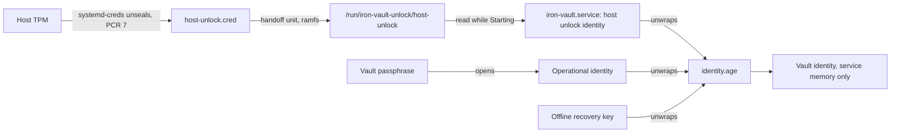

# TPM unlock

This document decides how a protected Linux installation unlocks its vault at startup with the machine's TPM, with no
owner present ([§14](iron-vault-specification.md#14-recipients-startup-and-memory)): which adapter seals and unseals,
which recipient role it enrols, how a portable machine gets its second secret, what a firmware or Secure Boot update
does, how power loss affects the TPM's dictionary-attack state, and what the release check must show. The passphrase
and the offline recovery key stay as they are: TPM unlock adds a way in, it replaces none.

The decisions marked **owner to confirm** change what the specification or another design says, and are listed word
for word under [Proposed specification changes](#proposed-specification-changes). Nothing in
[`iron-vault-specification.md`](iron-vault-specification.md), [`implementation-specification.md`](implementation-specification.md)
or the other designs is changed by this document.

This document introduces four terms, defined in the [glossary](glossary.md): *TPM unlock*, *Host unlock credential*,
*Handoff unit* and *Pre-boot secret*.

## Scope

In scope: the [Linux package](linux-package.md), which runs the `Protected` deployment profile as `iron-vault.service`,
on a machine with a TPM 2.0 and systemd as init.

Out of scope:

- **The Compose profile.** It already unlocks this way ([docker-compose.md](docker-compose.md#host-unlock)), and this
  design reuses its mechanism unchanged.
- **The TPM approval signer** (EP-33). §14 keeps the approval key separate from the unlocking key; nothing here signs.
- **A TPM PIN.** The chosen adapter has none ([Portable machines](#portable-machines-and-the-second-secret)).
- **Windows and macOS**, whose platform providers are a later phase.
- **Signed PCR 11 policies and `systemd-pcrlock`**, which could survive Secure Boot updates
  ([Firmware and Secure Boot updates](#firmware-and-secure-boot-updates)); the implementation spec defers them.

## The adapter

§4 allows two Linux adapters: "TPM through a host adapter using `tss-esapi`/`tpm2-tss`, or a verified `systemd-creds`
adapter". The implementation spec names `age-plugin-tpm` as a lead. The three candidates:

| | (a) `systemd-creds`, host unseals | (b) `tss-esapi` in the service | (c) `age-plugin-tpm` |
|---|---|---|---|
| Who opens the TPM | systemd, as root, once per boot | the service account, at each start | a plugin program the service runs |
| Service needs `/dev/tpmrm0` | no | yes | yes |
| New code in the credential-holding process | none | `tpm2-tss` (C) and OpenSSL, through FFI; `bindgen` and `pkg-config` at build | `age`'s plugin protocol and a child process |
| TPM PIN | no (`systemd-creds` has no PIN option) | possible | possible |
| Sealing policy maintained by | systemd | Iron Vault | the plugin's author |
| Verified here | yes: the Compose profile's [release check](evidence/compose-unlock-check-2026-11-11.md) | no | no |

**Decision: (a), `systemd-creds` through a separate handoff unit.** TPM unlock on Linux is the Compose profile's
[host unlock](docker-compose.md#host-unlock), installed by the package for `iron-vault.service` instead of for Docker.

Why:

- **The service never touches the TPM.** It keeps `PrivateDevices=yes` and gets no `DeviceAllow=`. A compromised
  service cannot unseal anything else sealed to this boot, and cannot exhaust the dictionary-attack counter that every
  PIN-protected TPM key on the host shares ([§17](iron-vault-specification.md#containerised-deployments) gives the same
  reason for containers). That is stricter than §14's "only the service account may reach the service's TPM objects":
  here not even the service account can.
- **No TPM library runs in the process that holds provider credentials and answers callers.** (b) would put `tpm2-tss`
  and OpenSSL, through FFI, inside it. (c) would add a plugin protocol and a child process that the service must trust
  with the intermediate identity.
- **It already exists and has passed its gate.** The handoff, its trusted-path rule, its parser, the audit event,
  `init --host-unlock`, `recipient add --host-unlock` and the independence-rule handling are built and checked in the
  Compose profile. Extending them to `Protected` is a few lines; (b) or (c) would be a new subsystem.
- **Nothing outlives the boot.** The secret text is in the credential's sealed blob on disk and, once unsealed, only in
  non-swappable memory: the unit's credentials directory and the handoff's ramfs.
- **No dependency changes.** (a) adds no crate. `tss-esapi` 7.7 would add no second `rand` but a C library and its
  build tooling; `age-plugin-tpm` is not a verified dependency.

What (a) costs:

- **No TPM PIN.** A portable machine gets its second secret from full-disk encryption instead
  ([below](#portable-machines-and-the-second-secret)).
- **systemd ≥ 250.** `systemd-creds` first shipped in 250; Debian 12 has 252 and Ubuntu 24.04 has 255, both above the
  package's floor.
- **A Secure Boot policy change ends unattended unlock** until the administrator provisions a new identity, as it does
  in the Compose profile ([below](#firmware-and-secure-boot-updates)).

### Why a handoff unit, and not `LoadCredentialEncrypted=` in the service unit

`iron-vault.service` could load the credential itself with `LoadCredentialEncrypted=`, and read it from
`$CREDENTIALS_DIRECTORY`. It does not, for two reasons found in systemd 255
([`exec-credential.c`](https://github.com/systemd/systemd/blob/v255/src/core/exec-credential.c)):

- **A failed decrypt fails the service's start.** systemd fails the unit when an absolute credential path cannot be
  decrypted, and does so before `ExecStart=`. After a PCR 7 change the service would never run: `Restart=on-failure`
  and `StartLimitIntervalSec=0` ([linux-package.md](linux-package.md#service-unit)) would retry once a second for ever,
  and the service would never reach Locked, so passphrase `unlock` would be impossible. The fallback §14 requires would
  be gone exactly when it is needed.
- **It grants the TPM to the service.** With `PrivateDevices=yes`, `LoadCredentialEncrypted=` adds `/dev/tpmrm0 rw` to
  the unit's `DeviceAllow=` ([systemd.exec(5)](https://www.freedesktop.org/software/systemd/man/latest/systemd.exec.html#Credentials)),
  so the service process could open the TPM for the rest of its life.

A separate oneshot unit fails on its own, and the service then starts without a handoff and waits Locked.

## The recipient role

**Decision (owner to confirm): TPM unlock on Linux is host unlock.** It enrols the host unlock identity with role
`host-unlock`, code 6, which the store already accepts, and reuses everything built for it:

- the [unlock handoff](docker-compose.md#format) `/run/iron-vault-unlock/host-unlock` and its format;
- the [host unlock credential](#provisioning) `/etc/iron-vault-host/host-unlock.cred`;
- `init --host-unlock` and `recipient add --host-unlock <age1…>`
  ([recipients.md](recipients.md#recipient-add---host-unlock-age1));
- the audit event `vault.host-unlock` and its refusals;
- part 1 of the [independence rule](recipients.md#independence-rule), where the host unlock adapter is configured for
  the `host-unlock` recipient whose key the handoff holds when the command runs.

The code change is the profile test. `tries_host_unlock` returns true for `Protected` as well as `Container`, so the
service tries the handoff at startup, `configured_host_unlock` reads it for `recipient remove`, and `init --host-unlock`
is accepted. The `--host-unlock` flag of `init` becomes visible in a default build as well as a container build.
`Development` stays excluded: it runs as the invoking user, with no root-owned handoff unit to trust.

Role code 4, `tpm`, stays reserved, still refused by the decoder. It is for a TPM the service opens itself: a later
in-service adapter with a TPM PIN, or the Windows platform provider. Such a role would be "configured" by something the
service can see, such as a sealed file in its state directory, which a host-held credential is not.

**Alternative: a separate `tpm` role.** Accept code 4 for the package and `host-unlock` for Compose, with
`init --tpm` and `recipient add --tpm`. The two would be the same key kind, sealed by the same tool and read from the
same handoff, differing only in name, so the rule "one name per concept" argues against it. It would also need a second
flag pair, a second "configured" rule and a second audit outcome for one mechanism. Its one advantage is that
`recipient list` would say `tpm` rather than `host-unlock` on a bare-metal server; the recipient's label can say that
instead.

## How it works



### Provisioning

The administrator provisions the **host unlock credential** once, as root, with the provisioning helper the package
ships. It is the Compose profile's [`provision-host-unlock.sh`](../packaging/compose/host/provision-host-unlock.sh),
with the same guarantees ([docker-compose.md](docker-compose.md#provisioning-on-the-host)): `age-keygen` generates the
identity, the secret text exists only in a pipe, `systemd-creds encrypt --with-key=tpm2 --tpm2-pcrs=7
--name=host-unlock` seals it to `/etc/iron-vault-host/host-unlock.cred` (root, `0600`, in a root `0700` directory), and
the recipient key `age1…` is printed for `init --host-unlock` or `recipient add --host-unlock`. `--tpm2-pcrs=7` is
always passed: systemd 255 binds PCR 7 by default, but current systemd binds none unless asked
([systemd-creds(1)](https://www.freedesktop.org/software/systemd/man/latest/systemd-creds.html)).

The package adds one argument the Compose script lacks, required and with no default: `--server` or `--portable`. It
makes the administrator choose which §14 condition the machine meets
([Portable machines](#portable-machines-and-the-second-secret)).

The helper is a root shell script, not the `iron-vault` CLI, so §4's "the CLI never … calls TPM" still holds. It never
clears the TPM, takes ownership, sets hierarchy authorization or changes dictionary-attack parameters.

### At boot

The package ships the **handoff unit**, `iron-vault-host-unlock.service`, which loads the credential and installs the
handoff before the service starts. It is the Compose unit with the service in place of Docker, and no `[Install]`
section:

```ini
[Unit]
Description=Iron Vault host unlock handoff
Before=iron-vault.service
After=systemd-tmpfiles-setup.service
ConditionPathExists=/etc/iron-vault-host/host-unlock.cred

[Service]
Type=oneshot
RemainAfterExit=yes
LoadCredentialEncrypted=host-unlock:/etc/iron-vault-host/host-unlock.cred
ExecStart=/bin/mount -t ramfs -o mode=0711,nosuid,nodev,noexec ramfs /run/iron-vault-unlock
ExecStart=/usr/bin/install -o iron-vault -g iron-vault -m 0400 %d/host-unlock /run/iron-vault-unlock/host-unlock
ExecStopPost=-/bin/rm -f /run/iron-vault-unlock/host-unlock
ExecStopPost=-/bin/umount /run/iron-vault-unlock
```

`iron-vault.service` gains two lines in `[Unit]`:

```ini
Wants=iron-vault-host-unlock.service
After=iron-vault-host-unlock.service
```

- **`Wants=`, not `Requires=`.** A failed handoff unit does not stop the service; it starts without a handoff, records
  `vault.host-unlock` `absent`, and waits Locked for passphrase `unlock`.
- **No enable step.** The service pulls the handoff unit in at every start. On a machine with no credential,
  `ConditionPathExists=` skips it, which is not a failure, so one unit file serves every install.
- **`RemainAfterExit=yes`.** A service restart, by `Restart=on-failure`, an upgrade or `systemctl restart`, finds the
  handoff unit active and does not unseal again. The TPM is used once per boot. After a failed unseal the next
  service start retries it, at most once a second under the restart loop; a PIN-less policy failure does not count
  toward dictionary-attack lockout ([below](#power-loss-and-dictionary-attack-state)).
- **The service's mount namespace.** `ProtectSystem=strict` and `PrivateDevices=yes` give the service its own mount
  namespace, created when it starts. `After=` puts the ramfs mount in place first, so the namespace holds it, read-only.
  The service needs no `ReadWritePaths=` entry for it.
- **`/run/iron-vault-unlock`** is the mount point, created by the package's `tmpfiles.d` as root `0755`. The ramfs
  mounted over it is root `0711`, so the service account opens the one file it knows the name of and can list nothing.

The ramfs, the file's owner and mode and the `ExecStopPost=` clean-up have the reasons given for the Compose unit
([docker-compose.md](docker-compose.md#at-boot)).

### In the service

The service reads the handoff once, while Starting, exactly as a Container-profile service does
([docker-compose.md](docker-compose.md#in-the-container)): locked memory first, then the `UnlockHandoff` trusted-path
rule, an Initialized vault, the unwrap of `identity.age` and the manifest MAC, and then Checking
([§15](iron-vault-specification.md#15-service-states-and-errors)). Each attempt writes one `vault.host-unlock` record.
The intermediate identity is cleared once the vault identity is unwrapped.

### Lifetime, `lock` and failure

These follow the Compose profile ([lifetime](docker-compose.md#lifetime), [failure](docker-compose.md#failure)):

- The handoff stays on its ramfs until shutdown, so a crashed service restarts unattended, as §15 asks of a healthy
  TPM service.
- After an explicit `lock` the service stays Locked until a passphrase `unlock` or a restart; a restart uses the handoff
  again. Only root can restart the service, and root is trusted (§2).
- A missing, unsafe or wrong handoff leaves the service Locked with passphrase `unlock` working, and is not counted
  toward the [passphrase attempt limit](migration-authorization.md#passphrase-attempt-limit).
- A failed unseal leaves no handoff, so the service records `absent`, the same as a machine never provisioned. The
  reason is in the handoff unit's journal and in `systemctl --failed`
  ([open question 2](#open-questions)).

### Enrolment and retirement

- **A new vault:** run the helper, then `sudo iron-vault init --host-unlock`.
- **An existing vault:** run the helper, `systemctl start iron-vault-host-unlock.service`, then
  `sudo iron-vault recipient add --host-unlock <age1…> --label <text>`. A restart of the service then reaches Ready
  with no `unlock`.
- **After `import` on a new machine:** a host unlock identity is bound to the TPM that sealed it, so none arrives with
  the vault. The owner provisions this machine's and enrols it with `recipient add --host-unlock`, then removes the old
  machine's `host-unlock` recipient ([§16](iron-vault-specification.md#16-administration-recovery-and-migration)).
- **Retiring TPM unlock:** stop the handoff unit, remove `host-unlock.cred`, then `recipient remove` the `host-unlock`
  recipient. Part 1 of the independence rule no longer keeps it.
- **Decommissioning the machine** is `forget-machine`'s job ([§16](iron-vault-specification.md#16-administration-recovery-and-migration)).

## Portable machines and the second secret

§14: "On a portable device, TPM unlock must be combined with a second secret: a full-disk-encryption pre-boot PIN or a
TPM unlock PIN." `systemd-creds` has no PIN, so in v0 the second secret is the **pre-boot secret** of full-disk
encryption: a LUKS passphrase typed at boot, or a LUKS TPM key slot that needs a PIN
(`systemd-cryptenroll --tpm2-with-pin=yes`,
[systemd-cryptenroll(1)](https://www.freedesktop.org/software/systemd/man/latest/systemd-cryptenroll.html)).

Why it is enough: the host unlock credential lives on the encrypted root filesystem. A thief who boots the stolen
machine, even from a trusted image that reproduces PCR 7, cannot read the sealed blob without the pre-boot secret, so
cannot unseal it. A LUKS slot that the TPM opens with no PIN gives no second secret, and nor does the approval
passphrase (§14).

The service cannot see how the disk was opened, and the profile does not distinguish a laptop from a server. The
check is in the helper:

- **`--portable`** refuses unless `/etc/iron-vault-host` is on a `dm-crypt` device, and every LUKS key slot of that
  device's TPM tokens (`cryptsetup luksDump`) requires a PIN. It is best effort: it cannot see a passphrase written on
  the laptop. The refusal names the slot to fix.
- **`--server`** prints, and asks the administrator to confirm, §14's condition: anyone with physical access and a
  trusted boot image can start the vault.

A TPM PIN for the vault itself needs an adapter that can ask for one, which (a) cannot; it is left for a later
in-service adapter with role `tpm`. The roadmap recipe [Unlock at boot with a TPM](../book/src/cookbook/roadmap/tpm-unlock.md)
promises "a laptop unlocks with a TPM PIN", which this design does not deliver in v0; the manual work rewrites it.

## Firmware and Secure Boot updates

§14: "A routine firmware update must not strand the vault." The seal is bound to PCR 7, which the implementation spec
chose because PCRs 0–4 change with firmware code.

What changes PCR 7 ([systemd-cryptenroll(1)](https://www.freedesktop.org/software/systemd/man/latest/systemd-cryptenroll.html),
[shim `README.tpm`](https://github.com/rhboot/shim/blob/main/README.tpm)):

- turning Secure Boot on or off;
- an update to the Secure Boot keys or databases: PK, KEK, `db`, `dbx`;
- a change in which certificate verifies the boot chain, such as a shim signed by a new CA;
- shim's `MokSBState` and SBAT level.

What does not: a firmware code update that leaves the Secure Boot variables alone, a new kernel or initrd signed by the
same key, and enrolling a MOK that verifies no boot-chain binary.

`dbx` updates are routine, delivered by `fwupd` and distribution updates, and Microsoft's 2011 UEFI CAs expired in June
2026, so the `KEK` and `db` updates that add the 2023 CAs are reaching machines now
([fwupd `uefi-db`](https://github.com/fwupd/fwupd/blob/main/docs/uefi-db.md)). Each changes PCR 7 at the next boot.
**Unattended unlock does not survive them.**

**The vault is not stranded.** After a PCR 7 change the handoff unit fails, the service waits Locked, and passphrase
`unlock` and the recovery key work as before. Restoring unattended unlock:

1. `sudo iron-vault unlock` with the vault passphrase;
2. move the old credential aside and run the helper, which prints a new recipient key;
3. `systemctl restart iron-vault-host-unlock.service`;
4. `sudo iron-vault recipient add --host-unlock <new age1…>`;
5. restart the service and check it reaches Ready with no `unlock`;
6. `sudo iron-vault recipient remove <old age1…>`, and delete the old credential.

The package documents this, and that a server applying Secure Boot updates unattended needs someone to unlock it
afterwards. A server that cannot have that should hold Secure Boot updates for a maintenance window.

**Not offered: a bridge seal.** Before a planned update the helper could seal a second credential to no PCR, valid for
one boot, and re-seal to PCR 7 afterwards. While it exists, any OS booted on the machine can unseal it; on a server
without full-disk encryption that is anyone with physical access. That is worse than a Locked service, so the default
is not to offer it ([open question 3](#open-questions)).

**Later:** a signed PCR 11 policy (`--tpm2-public-key`) or `systemd-pcrlock`, which predicts PCR 7 after a `dbx`
update, could keep unattended unlock across updates. The implementation spec defers PCR 11; both wait for that work.

## Power loss and dictionary-attack state

§15: "The implementation must verify how unclean power loss affects its chosen TPM session and dictionary-attack state;
it must not assume that repeated power loss cannot cause lockout."

What the chosen adapter uses, from systemd 255's
[`tpm2-util.c`](https://github.com/systemd/systemd/blob/v255/src/shared/tpm2-util.c):

- The sealed object has no authorization value: it is unsealed through a policy session that checks PCR 7 alone.
- The storage root key `systemd-creds` seals under, persistent at `0x81000001`, is created with `noDA`.
- The parameter-encryption session is salted with that key.

What the TPM does with that, from the TPM 2.0 library specification (Part 1, dictionary-attack protection) and the
reference implementation ([libtpms `SessionProcess.c`](https://github.com/stefanberger/libtpms/blob/stable-0.10/src/tpm2/SessionProcess.c)):

- **Lockout does not block the unseal.** A policy session checks lockout only when the policy needs the object's
  authorization value or password, and this one needs neither.
- **The unseal does not arm the power-loss penalty.** After an unclean shutdown the TPM counts one failed try only if
  a dictionary-attack-protected authorization was used since the last orderly shutdown. A PIN-less policy session
  never marks it so.
- **A PCR mismatch is not a failed try.** It is a policy failure, which the dictionary-attack counter does not count.

So TPM unlock neither suffers lockout nor causes it. Other TPM users on the same machine, such as a LUKS slot with a
PIN, still can; that exposure is theirs and does not stop this unseal. This is the reference code's behaviour; firmware
TPMs implement it themselves, so the release check measures it on hardware.

## Threats

| Threat | Control | What remains |
|---|---|---|
| A compromised service unseals other secrets or exhausts the TPM's lockout counter | The service has no TPM device (`PrivateDevices=yes`, no `DeviceAllow=`); root unseals once per boot | None from the service |
| An ordinary account reads the intermediate identity | The handoff is the service account's `0400` in a root `0711` ramfs; the credential is root `0600` in a root `0700` directory | A member of the `tss` group can open `/dev/tpmrm0` (`tss:tss 0660` on Ubuntu) but cannot read the sealed blob |
| A thief boots a stolen server from a trusted image | None: §14 accepts it for a server | The administrator declares `--server` |
| A thief boots a stolen laptop | The pre-boot secret protects the disk that holds the sealed blob | A laptop whose disk the TPM opens with no PIN is refused by `--portable`, best effort |
| A Secure Boot update ends unattended unlock | Passphrase `unlock` and the recovery key; documented re-provisioning | A server waits Locked until someone comes |
| The plaintext identity reaches disk | ramfs and the credentials directory, both unswappable; nothing in the environment or a persistent file | The same as the Compose profile |
| A backup copies the sealed blob | It opens only on this TPM, at this PCR 7 | A backup with the blob and access to this machine at the same PCR 7 unseals it, as the machine itself does |

## Release checks

`scripts/release/tpm-unlock-check.sh` runs on a disposable machine with the package installed, behind the same
`--i-know-this-is-a-disposable-vm` opt-in as the Compose checks, in parts around reboots, printing one PASS, FAIL or
SKIP line per item. It is the evidence for the implementation spec's "TPM unlock binding" and "TPM authorization and
power failure" gates.

1. `iron-vault.service` has `PrivateDevices=yes` and no TPM in `DeviceAllow=` (`systemctl show`), and its process's
   `/dev` has no `tpm*` node.
2. After the helper and `init --host-unlock`, a reboot reaches Ready with no `unlock`, and `vault.host-unlock` says
   `unlocked`.
3. `kill -9` of the service, and reinstalling the same `.deb`, each reach Ready again with no `unlock`, and the handoff
   unit did not run again.
4. `recovery check` opens the same vault, and `identity.age` has three X25519 stanzas.
5. The handoff is on a ramfs (`findmnt`), the service account's `0400`, in a root `0711` mount; an ordinary account
   can read neither it nor the credential.
6. No `AGE-SECRET-KEY` appears in `/etc`, `/var`, the service's environment or swap.
7. With PCR 7 extended (`tpm2_pcrextend 7:sha256=…`), restarting both units leaves the service Locked with
   `vault.host-unlock` `absent` and passphrase `unlock` working; the [re-provisioning steps](#firmware-and-secure-boot-updates)
   then restore unattended unlock, and the old recipient is removed.
8. Retiring TPM unlock leaves the service starting Locked with the handoff unit skipped.
9. `tpm2_getcap properties-variable` reads `TPM2_PT_LOCKOUT_COUNTER` before and after: unchanged by the PCR 7 mismatch.
10. Nothing but the admin socket and the request listeners listens.

Two items need the hypervisor rather than the script, and are recorded with its output:

- **Power loss:** 40 hard power-offs, each after the boot's unseal, then `TPM2_PT_LOCKOUT_COUNTER` and the unseal still
  working at the next boot.
- **Lockout (emulated TPM only):** lockout induced with wrong authorizations on a throwaway dictionary-attack-protected
  key, then a reboot still reaches Ready with no `unlock`. This is never done on a real machine's TPM.

The gate is met by a run on a VM with `swtpm` and OVMF Secure Boot, and a run on a machine with a firmware TPM for the
non-destructive items and the power-loss item.

## Work that follows

Once the owner confirms the role decision:

1. **The profile change:** `tries_host_unlock` accepts `Protected`, `init --host-unlock` in a default build, and the
   wording in [docker-compose.md](docker-compose.md), [recipients.md](recipients.md),
   [audit-logging.md](audit-logging.md) and the glossary entries *Host unlock*, *Host unlock identity* and
   *Unlock handoff* that now say "container profile". No store change.
2. **Packaging:** the handoff unit, the helper with `--server` and `--portable`, the `Wants=` and `After=` lines, the
   `tmpfiles.d` line, and the [linux-package.md](linux-package.md) edits. The handoff unit is installed as a plain file,
   not through `cargo-deb`'s `systemd-units`, so the maintainer scripts never restart it on upgrade; `build-deb.sh`
   checks it is present and that the service unit still has no `DeviceAllow=`.
3. **The release check and the manual:** `tpm-unlock-check.sh`, an installation guide section, a cookbook recipe
   replacing the roadmap one, and the re-provisioning procedure.
4. **The runs:** the release check on a VM and on hardware.

## Proposed specification changes

**All owner to confirm; none is applied.** Each gives the text to replace and its replacement.

### §14 TPM unlock, the last bullet

Replace:

> - The TPM does not know which program is asking. Only the service account may reach the service's TPM objects, and
>   the package must document the hardware and firmware policy it provisions.

with:

> - The TPM does not know which program is asking. Only root, through the host's init system, may reach the service's
>   TPM objects; the service account and ordinary accounts never open the TPM. On Linux the host unseals a host unlock
>   identity with `systemd-creds` and hands it to the service, as in [§17](iron-vault-specification.md#containerised-deployments). The package
>   must document the hardware and firmware policy it provisions.

### §14 unlock method table, the TPM row's Unlock cell

Replace `Unattended, or with a TPM PIN` with `Unattended; a TPM PIN in a later phase`.

### §4 platform table, the Linux row

Replace:

> TPM through a host adapter using `tss-esapi`/`tpm2-tss`, or a verified `systemd-creds` adapter

with:

> TPM through the verified `systemd-creds` host unlock adapter

### Implementation spec §3, the "TPM unlock binding" gate

Replace:

> Demonstrate interoperable wrap, recovery and restart through the chosen adapter (`age-plugin-tpm` is a lead, not a
> verified dependency). Bind to PCR 7, which records Secure Boot policy but does not identify the installed OS; avoid
> PCR 0–4, which routine firmware updates change; evaluate signed PCR 11 later. Grant `/dev/tpmrm0` to the service
> account explicitly, without relying on a shared device group

with:

> Demonstrate interoperable wrap, recovery and restart through the `systemd-creds` host unlock adapter
> ([tpm-unlock.md](tpm-unlock.md)). Bind to PCR 7, which records Secure Boot policy but does not identify the installed
> OS; avoid PCR 0–4, which routine firmware updates change; evaluate signed PCR 11 later. Give the service account no
> TPM device access: root's init system unseals and hands the intermediate identity over

### [linux-package.md](linux-package.md#service-unit)

Replace:

> The TPM epics will add `DeviceAllow=/dev/tpmrm0 rw`. With `PrivateDevices=yes`, they must check that the systemd
> versions the package supports make an allowed device node visible in the private `/dev`, or replace
> `PrivateDevices=yes` with `DevicePolicy=closed`.

with:

> TPM unlock adds no device: the handoff unit unseals as root and the service reads the result from
> `/run/iron-vault-unlock` ([tpm-unlock.md](tpm-unlock.md#at-boot)). `PrivateDevices=yes` stays.

## Open questions

1. **Role: `host-unlock` or `tpm`.** *Default:* `host-unlock` ([The recipient role](#the-recipient-role)). Owner to
   confirm.
2. **Whether the service can tell a failed unseal from no credential.** *Default:* no; both are `absent`, and the
   handoff unit's journal says which. The service cannot see `/etc/iron-vault-host`. A marker file the unit writes on
   failure would let `vault.host-unlock` say `unseal_failed`, at the cost of a second file in the handoff mount.
3. **A bridge seal for planned Secure Boot updates.** *Default:* not offered
   ([Firmware and Secure Boot updates](#firmware-and-secure-boot-updates)).
4. **systemd upgrades.** systemd changes how `systemd-creds` binds to the storage root key between releases. Not
   checked: whether a credential sealed under one distribution release still decrypts after an upgrade to the next.
   *Default:* the release check covers the installed release only, and the install guide tells the administrator to
   have the vault passphrase at hand for a distribution upgrade; a failure there is a Secure Boot change in effect.
5. **An owner hierarchy password.** `systemd-creds` creates its storage root key under the owner hierarchy, whose
   authorization is empty on Linux by default. A machine where another OS set it is not checked. *Default:* the helper
   fails with `systemd-creds`'s error, and the guide says so.
